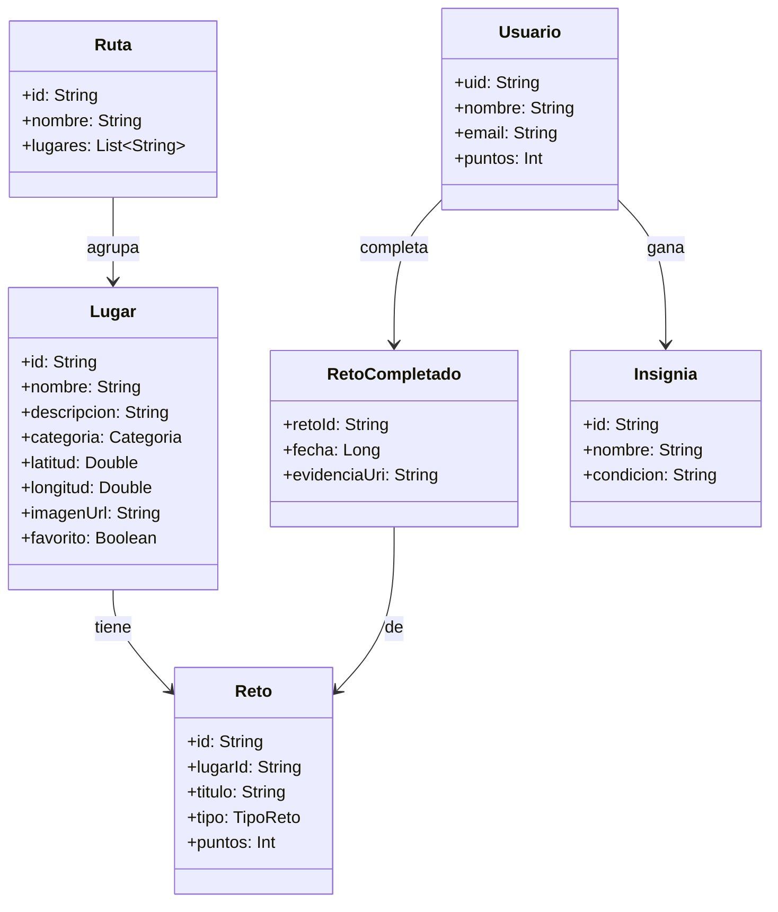
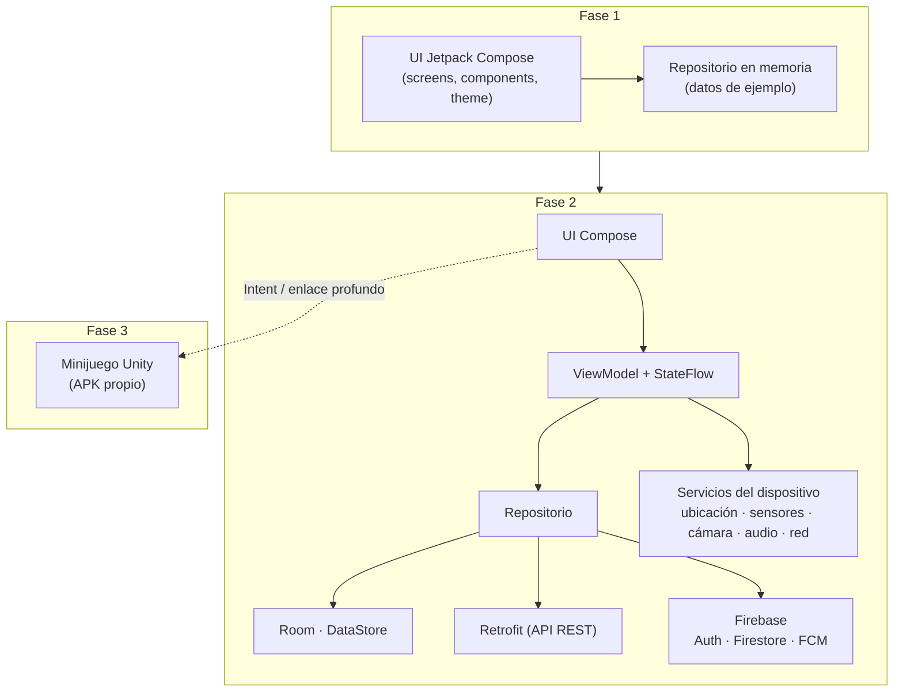

<ExportPDF />

# Descripción y requisitos generales

## Visión del producto

*Explora* es una aplicación para **descubrir lugares** de un entorno y completar **retos** en ellos. El usuario:

1. Consulta un **catálogo de lugares** y filtra por categoría, distancia o estado.
2. Abre el **detalle** de un lugar: descripción, fotos, horario, ubicación, tiempo actual y retos disponibles.
3. **Supera retos** en el sitio: estar físicamente allí (ubicación), hacer una foto, grabar un audio, contar pasos, responder una pregunta…
4. Gana **puntos e insignias** y consulta su **progreso** en su perfil.
5. Al completar una **ruta** (conjunto de lugares), desbloquea un **minijuego**.

## Modelo de datos

El modelo crece con las fases, pero conviene diseñarlo desde el principio:



| Enumeración | Valores de ejemplo |
|:---|:---|
| `Categoria` | Monumento, Naturaleza, Gastronomía, Cultura, Deporte… (según tu temática) |
| `TipoReto` | `UBICACION`, `FOTO`, `AUDIO`, `PASOS`, `PREGUNTA`, `JUEGO` |

## Pantallas

| Pantalla | Fase en que aparece | Contenido mínimo |
|:---|:---:|:---|
| Splash | 1 | Logo y nombre; decide si mostrar el onboarding. |
| Onboarding | 1 | 2-3 páginas de presentación y nombre de usuario (en la Fase 2, registro e inicio de sesión). |
| Catálogo | 1 | Lista o cuadrícula de lugares, búsqueda y filtros. |
| Detalle del lugar | 1 | Información, imagen, retos; en la Fase 2, mapa, distancia y tiempo. |
| Nuevo lugar / propuesta | 1 | Formulario validado para proponer un lugar. |
| Reto | 2 | Ejecución del reto según su tipo (ubicación, foto, audio, pasos…). |
| Mapa | 2 | Todos los lugares sobre un mapa y la posición del usuario. |
| Perfil y progreso | 1 | Datos del usuario, puntos, insignias y retos completados. |
| Ajustes | 1 | Tema claro/oscuro, idioma (Fase 2: notificaciones, cerrar sesión). |
| Juegos | 3 | Acceso al minijuego y récord. |
| Acerca de | 1 | Autoría, versión, créditos y licencias. |

## Arquitectura evolutiva



Organización de paquetes recomendada (se amplía en cada fase):

```
com.tunombre.explora
├── MainActivity.kt
├── data/            ← modelos, repositorios, Room, Retrofit, Firebase   (F2)
├── domain/          ← modelos de dominio y reglas (opcional)
├── device/          ← ubicación, sensores, conectividad, multimedia     (F2)
├── navigation/      ← Routes.kt, Navigation.kt                           (F1)
└── ui/
    ├── theme/       ← Color.kt, Type.kt, Shape.kt, Theme.kt              (F1)
    ├── components/  ← componentes reutilizables                          (F1)
    └── screens/     ← un paquete por pantalla + su ViewModel             (F1/F2)
```

## Requisitos transversales (todas las fases)

| Requisito | Detalle |
|:---|:---|
| **Repositorio Git** | Repositorio privado (GitHub, GitLab o el que indique el profesorado) compartido con el profesor. **Commits frecuentes y descriptivos**: el historial forma parte de la evaluación del proceso. Una **etiqueta** por entrega (`fase-1`, `fase-2`, `fase-3`). |
| **README.md** | Descripción, capturas, requisitos, cómo compilar, estructura del proyecto y créditos. |
| **Diario de desarrollo** | `docs/DIARIO.md`: una entrada por semana con lo realizado, problemas encontrados y cómo se resolvieron. |
| **Memoria técnica** | `docs/MEMORIA.md` (o PDF): decisiones de diseño y técnicas, con los apartados que pide cada fase. |
| **Recursos centralizados** | Textos en `strings.xml` (castellano, valenciano e inglés), dimensiones y colores en el tema. Nada *hardcoded*. |
| **Accesibilidad** | `contentDescription` en imágenes e iconos, tamaños en `dp`/`sp`, contraste suficiente, zonas táctiles de al menos 48 dp. |
| **Código** | Componentes y funciones pequeños, nombres semánticos, KDoc en las clases y funciones públicas. |
| **Licencias** | Imágenes, iconos, sonidos, librerías y APIs de terceros citados con su licencia en `docs/CREDITOS.md` y en la pantalla *Acerca de*. |
| **Privacidad** | No subir claves (`google-services.json`, claves de API, *keystore*) a repositorios públicos. Pedir solo los permisos necesarios. |
| **Identificación** | Paquete `com.tunombretuapellido.explora`. Tu nombre y foto en la pantalla *Acerca de*. |

## Defensa de cada fase

En cada entrega harás una **defensa de 10 minutos**:

1. **Demostración** (4 min) en emulador (Fase 1) o en móvil real (Fases 2 y 3).
2. **Recorrido técnico** (3 min) por la estructura del proyecto y una parte del código elegida por ti.
3. **Preguntas** (3 min) del profesorado sobre cualquier parte del código o de la memoria.

La defensa permite comprobar la **autoría** y es necesaria para que la fase se califique.
