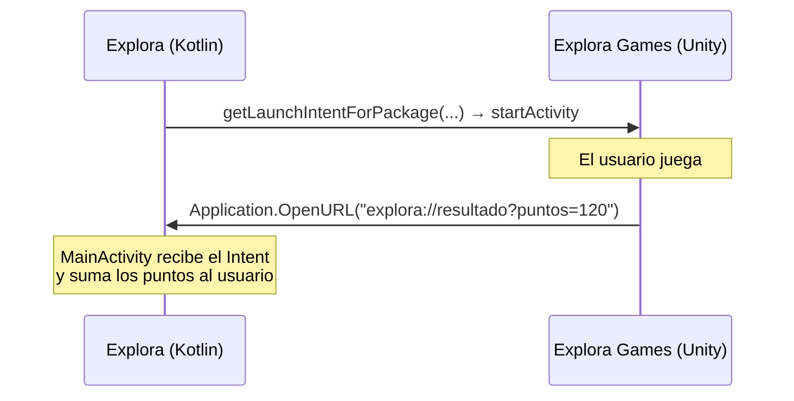

<ExportPDF />

# Guía técnica de apoyo

La Fase 2 incorpora funciones del dispositivo que no tienen una unidad propia: **conectividad e inalámbricos**, **sensores**, **ubicación y mapas**, **multimedia** y **tareas en segundo plano**. Esta guía resume lo imprescindible de cada una con ejemplos mínimos; amplía siempre en la documentación oficial enlazada. Al final se explica cómo **conectar la app con el minijuego** de la Fase 3.

::: info-box Patrón común: del callback al Flow
Muchas APIs del sistema avisan mediante *callbacks* (red, sensores, ubicación). Para usarlas con la arquitectura MVVM de la [UP06](../../up06/), conviértelas en un **`Flow`** con `callbackFlow`, recógelas en el **ViewModel** y exponlas en un `StateFlow`. Registra el *listener* al empezar a recoger y **libéralo en `awaitClose`**.
:::

## 1. Permisos en tiempo de ejecución

Los permisos **peligrosos** (ubicación, cámara, micrófono, actividad física, Bluetooth, notificaciones) se declaran en el manifiesto **y** se piden al usuario cuando se van a usar:

```kotlin
val launcher = rememberLauncherForActivityResult(
    ActivityResultContracts.RequestMultiplePermissions()
) { resultado ->
    val concedido = resultado.values.all { it }
    viewModel.onPermisosResultado(concedido)
}

Button(onClick = {
    launcher.launch(arrayOf(
        Manifest.permission.ACCESS_FINE_LOCATION,
        Manifest.permission.ACCESS_COARSE_LOCATION
    ))
}) { Text(stringResource(R.string.activar_ubicacion)) }
```

::: tip-box Buenas prácticas
- Pide el permiso **en el momento en que se necesita** y explica antes **para qué** (pantalla o diálogo propio).
- La app debe **seguir funcionando** si el usuario lo deniega (por ejemplo, sin la distancia a los lugares).
- Documentación: [Solicitar permisos en tiempo de ejecución](https://developer.android.com/training/permissions/requesting).
:::

## 2. Conectividad e inalámbricos (RA2.c)

### Estado de la red

```xml [AndroidManifest.xml]
<uses-permission android:name="android.permission.ACCESS_NETWORK_STATE" />
```

```kotlin [device/ConnectivityObserver.kt]
enum class TipoRed { NINGUNA, WIFI, DATOS, OTRA }

class ConnectivityObserver(context: Context) {
    private val cm = context.getSystemService(ConnectivityManager::class.java)

    val estado: Flow<TipoRed> = callbackFlow {
        val callback = object : ConnectivityManager.NetworkCallback() {
            override fun onCapabilitiesChanged(network: Network, caps: NetworkCapabilities) {
                trySend(
                    when {
                        caps.hasTransport(NetworkCapabilities.TRANSPORT_WIFI) -> TipoRed.WIFI
                        caps.hasTransport(NetworkCapabilities.TRANSPORT_CELLULAR) -> TipoRed.DATOS
                        else -> TipoRed.OTRA
                    }
                )
            }
            override fun onLost(network: Network) { trySend(TipoRed.NINGUNA) }
        }
        if (cm.activeNetwork == null) trySend(TipoRed.NINGUNA)
        cm.registerDefaultNetworkCallback(callback)
        awaitClose { cm.unregisterNetworkCallback(callback) }
    }.distinctUntilChanged()
}
```

Con este estado, *Explora* puede mostrar un **aviso sin conexión**, trabajar con los datos de Room y **sincronizar** cuando vuelva la red, o descargar imágenes solo con Wi-Fi si el usuario lo elige en Ajustes.

### Bluetooth Low Energy (BLE)

Permite detectar **balizas** (*beacons*) colocadas en los lugares para completar retos de proximidad.

```xml [AndroidManifest.xml]
<uses-permission android:name="android.permission.BLUETOOTH_SCAN"
    android:usesPermissionFlags="neverForLocation" />
<uses-permission android:name="android.permission.BLUETOOTH_CONNECT" />
<uses-feature android:name="android.hardware.bluetooth_le" android:required="false" />
```

```kotlin [device/BleScanner.kt]
class BleScanner(context: Context) {
    private val adapter = context.getSystemService(BluetoothManager::class.java)?.adapter

    @SuppressLint("MissingPermission")   // el permiso se comprueba antes de llamar
    fun dispositivos(): Flow<ScanResult> = callbackFlow {
        val scanner = adapter?.bluetoothLeScanner
            ?: run { close(IllegalStateException("Bluetooth no disponible")); return@callbackFlow }
        val callback = object : ScanCallback() {
            override fun onScanResult(callbackType: Int, result: ScanResult) { trySend(result) }
            override fun onScanFailed(errorCode: Int) { close(IllegalStateException("Error $errorCode")) }
        }
        scanner.startScan(callback)
        awaitClose { scanner.stopScan(callback) }
    }
}
```

Cada `ScanResult` incluye la dirección del dispositivo (`result.device.address`) y la intensidad de la señal (`result.rssi`), que da una idea de la cercanía. Documentación: [Bluetooth Low Energy](https://developer.android.com/develop/connectivity/bluetooth/ble/ble-overview).

### NFC (alternativa)

Leer una **etiqueta NFC** pegada en el lugar es otra forma de demostrar que se ha estado allí. Con `NfcAdapter.enableReaderMode` la `Activity` recibe la etiqueta (`Tag`) y su identificador. Documentación: [Conceptos básicos de NFC](https://developer.android.com/develop/connectivity/nfc/nfc).

::: warning-box Emulador
El emulador **no** simula Bluetooth ni NFC: estas funciones se prueban en un **móvil real**. El estado de la red sí se puede cambiar en el emulador (modo avión, Wi-Fi, datos).
:::

## 3. Sensores (RA2.d)

| Sensor | Uso en *Explora* |
|:---|:---|
| `TYPE_STEP_COUNTER` | Retos de tipo **pasos** («camina 500 pasos por la ruta»). Requiere el permiso `ACTIVITY_RECOGNITION`. |
| `TYPE_ACCELEROMETER` | **Agitar** el móvil para mostrar un lugar al azar. |
| `TYPE_ROTATION_VECTOR` / magnetómetro | **Brújula** que apunta hacia el lugar. |
| `TYPE_LIGHT` | Cambiar al tema oscuro con poca luz. |

```kotlin [device/SensorFlows.kt]
fun Context.sensorFlow(tipo: Int, retardo: Int = SensorManager.SENSOR_DELAY_NORMAL): Flow<FloatArray> =
    callbackFlow {
        val sm = getSystemService(SensorManager::class.java)
        val sensor = sm.getDefaultSensor(tipo)
            ?: run { close(IllegalStateException("Sensor no disponible")); return@callbackFlow }
        val listener = object : SensorEventListener {
            override fun onSensorChanged(event: SensorEvent) { trySend(event.values.clone()) }
            override fun onAccuracyChanged(sensor: Sensor?, accuracy: Int) = Unit
        }
        sm.registerListener(listener, sensor, retardo)
        awaitClose { sm.unregisterListener(listener) }
    }
```

Detección sencilla de una sacudida:

```kotlin
context.sensorFlow(Sensor.TYPE_ACCELEROMETER)
    .map { (x, y, z) -> sqrt(x * x + y * y + z * z) / SensorManager.GRAVITY_EARTH }
    .filter { fuerzaG -> fuerzaG > 2.5f }
    .collect { onAgitado() }
```

::: tip-box Pruébalo en el emulador
En el emulador, **Extended controls → Virtual sensors** permite mover el dispositivo y cambiar los valores de los sensores. Comprueba siempre con `getDefaultSensor` que el sensor existe y ofrece una alternativa si no.
:::

Documentación: [Descripción general de los sensores](https://developer.android.com/develop/sensors-and-location/sensors/sensors_overview).

## 4. Ubicación y mapas

### Ubicación actual

Dependencias: `com.google.android.gms:play-services-location` y `org.jetbrains.kotlinx:kotlinx-coroutines-play-services` (para usar `await()`).

```xml [AndroidManifest.xml]
<uses-permission android:name="android.permission.ACCESS_COARSE_LOCATION" />
<uses-permission android:name="android.permission.ACCESS_FINE_LOCATION" />
```

```kotlin [device/LocationRepository.kt]
class LocationRepository(context: Context) {
    private val client = LocationServices.getFusedLocationProviderClient(context)

    @SuppressLint("MissingPermission")
    suspend fun ubicacionActual(): Location? =
        client.getCurrentLocation(Priority.PRIORITY_HIGH_ACCURACY, null).await()

    fun distanciaMetros(desde: Location, lat: Double, lon: Double): Float {
        val resultado = FloatArray(1)
        Location.distanceBetween(desde.latitude, desde.longitude, lat, lon, resultado)
        return resultado[0]
    }
}
```

Un reto de tipo **ubicación** se completa cuando la distancia al lugar es menor que un umbral (por ejemplo, 50 m).

::: tip-box Ubicación en el emulador
En **Extended controls → Location** puedes fijar una posición o reproducir una ruta GPX para probar sin moverte.
:::

### Mapas

| Opción | Ventajas | Requisitos |
|:---|:---|:---|
| [**Maps Compose**](https://developers.google.com/maps/documentation/android-sdk/maps-compose) (Google Maps) | Componentes Compose nativos (`GoogleMap`, `Marker`). | **Clave de API** de Google Cloud (no la subas al repositorio: usa el *Secrets Gradle Plugin*). |
| [**osmdroid**](https://github.com/osmdroid/osmdroid) (OpenStreetMap) | Sin clave ni cuenta de facturación. | Se integra con `AndroidView`. Respeta la [política de uso de teselas de OSM](https://operations.osmfoundation.org/policies/tiles/). |

```kotlin
// Maps Compose: un marcador por lugar
GoogleMap(
    modifier = Modifier.fillMaxSize(),
    cameraPositionState = rememberCameraPositionState {
        position = CameraPosition.fromLatLngZoom(LatLng(39.47, -0.38), 13f)
    },
    properties = MapProperties(isMyLocationEnabled = permisoUbicacion)
) {
    lugares.forEach { lugar ->
        Marker(
            state = rememberMarkerState(position = LatLng(lugar.latitud, lugar.longitud)),
            title = lugar.nombre,
            onInfoWindowClick = { onLugarClick(lugar.id) }
        )
    }
}
```

## 5. Multimedia (RA3)

### Arquitectura multimedia de Android

| Necesidad | API recomendada | Alternativa |
|:---|:---|:---|
| Hacer una foto | Contrato `ActivityResultContracts.TakePicture` (abre la app de cámara) | **CameraX** (vista previa dentro de la app) |
| Elegir una imagen | `PickVisualMedia` (*Photo Picker*, sin permisos) | — |
| Grabar audio | `MediaRecorder` | `AudioRecord` (PCM sin procesar) |
| Reproducir audio y vídeo | **Media3 ExoPlayer** | `MediaPlayer` (más limitado) |
| Procesar y convertir imágenes | `Bitmap`, `BitmapFactory`, `ImageDecoder`, `ExifInterface` | Coil (transformaciones) |
| Guardar en la galería | `MediaStore` | Almacenamiento propio de la app ([UP07](../../up07/contenidos/04-sistema-archivos)) |

### Captura: foto como evidencia de un reto

```xml [AndroidManifest.xml — dentro de application]
<provider
    android:name="androidx.core.content.FileProvider"
    android:authorities="${applicationId}.fileprovider"
    android:exported="false"
    android:grantUriPermissions="true">
    <meta-data
        android:name="android.support.FILE_PROVIDER_PATHS"
        android:resource="@xml/file_paths" />
</provider>
```

```xml [res/xml/file_paths.xml]
<paths>
    <files-path name="evidencias" path="evidencias/" />
</paths>
```

```kotlin
val context = LocalContext.current
var uriFoto by remember { mutableStateOf<Uri?>(null) }
val hacerFoto = rememberLauncherForActivityResult(ActivityResultContracts.TakePicture()) { ok ->
    val uri = uriFoto
    if (ok && uri != null) viewModel.onFotoTomada(uri)
}

Button(onClick = {
    val carpeta = File(context.filesDir, "evidencias").apply { mkdirs() }
    val archivo = File(carpeta, "reto_${System.currentTimeMillis()}.jpg")
    val uri = FileProvider.getUriForFile(context, "${context.packageName}.fileprovider", archivo)
    uriFoto = uri
    hacerFoto.launch(uri)
}) { Text(stringResource(R.string.hacer_foto)) }
```

### Conversión y procesamiento de imágenes

La foto de la cámara puede ocupar varios megas. Antes de guardarla o subirla, **redúcela y conviértela a WebP**:

```kotlin [device/ImageProcessor.kt]
class ImageProcessor(private val context: Context) {

    /** Reduce la imagen a [maxLado] píxeles y la guarda como WebP. Devuelve el archivo creado. */
    suspend fun aWebp(origen: Uri, destino: File, maxLado: Int = 1280, calidad: Int = 80): File =
        withContext(Dispatchers.IO) {
            val original = context.contentResolver.openInputStream(origen)?.use(BitmapFactory::decodeStream)
                ?: throw IOException("No se ha podido leer la imagen")

            val escala = maxLado.toFloat() / maxOf(original.width, original.height)
            val reducida = if (escala < 1f)
                original.scale((original.width * escala).toInt(), (original.height * escala).toInt())
            else original

            val formato = if (Build.VERSION.SDK_INT >= Build.VERSION_CODES.R)
                Bitmap.CompressFormat.WEBP_LOSSY
            else @Suppress("DEPRECATION") Bitmap.CompressFormat.WEBP

            destino.outputStream().use { salida ->
                check(reducida.compress(formato, calidad, salida)) { "Error al comprimir" }
            }
            destino
        }
}
```

Otros procesamientos posibles: **miniaturas** para el listado, corregir la **orientación** leyendo la etiqueta EXIF con `ExifInterface`, aplicar un **filtro** (escala de grises con `ColorMatrix`) o añadir una **marca** con el nombre del lugar dibujando sobre un `Canvas`.

### Grabación de audio

```xml [AndroidManifest.xml]
<uses-permission android:name="android.permission.RECORD_AUDIO" />
```

```kotlin [device/AudioRecorder.kt]
class AudioRecorder(private val context: Context) {
    private var recorder: MediaRecorder? = null

    fun iniciar(salida: File) {
        recorder = (if (Build.VERSION.SDK_INT >= Build.VERSION_CODES.S) MediaRecorder(context)
                    else @Suppress("DEPRECATION") MediaRecorder()).apply {
            setAudioSource(MediaRecorder.AudioSource.MIC)
            setOutputFormat(MediaRecorder.OutputFormat.MPEG_4)
            setAudioEncoder(MediaRecorder.AudioEncoder.AAC)
            setOutputFile(salida.absolutePath)
            prepare()
            start()
        }
    }

    /** Devuelve false si la grabación ha fallado (por ejemplo, si ha durado demasiado poco). */
    fun detener(): Boolean = try {
        recorder?.stop()
        true
    } catch (e: RuntimeException) {
        false
    } finally {
        recorder?.release()
        recorder = null
    }
}
```

::: warning-box Eventos y excepciones (RA3.e)
Las APIs multimedia fallan con frecuencia: permiso denegado, archivo corrupto, formato no soportado, micrófono ocupado, grabación demasiado corta (`stop()` lanza `RuntimeException`). Captura cada caso, **informa al usuario** y libera siempre los recursos (`release()`).
:::

### Reproducción con Media3 ExoPlayer

Dependencias: `androidx.media3:media3-exoplayer` (y `media3-ui` para vídeo).

```kotlin [ui/components/ReproductorAudio.kt]
@Composable
fun ReproductorAudio(uri: Uri, modifier: Modifier = Modifier) {
    val context = LocalContext.current
    val player = remember { ExoPlayer.Builder(context).build() }
    var reproduciendo by remember { mutableStateOf(false) }
    var error by remember { mutableStateOf<String?>(null) }

    DisposableEffect(player) {
        val listener = object : Player.Listener {
            override fun onIsPlayingChanged(isPlaying: Boolean) { reproduciendo = isPlaying }
            override fun onPlayerError(e: PlaybackException) { error = e.errorCodeName }
        }
        player.addListener(listener)
        onDispose {
            player.removeListener(listener)
            player.release()
        }
    }

    LaunchedEffect(uri) {
        player.setMediaItem(MediaItem.fromUri(uri))
        player.prepare()
    }

    Row(modifier, verticalAlignment = Alignment.CenterVertically) {
        IconButton(onClick = { if (reproduciendo) player.pause() else player.play() }) {
            Icon(
                imageVector = if (reproduciendo) Icons.Default.Pause else Icons.Default.PlayArrow,
                contentDescription = stringResource(if (reproduciendo) R.string.pausar else R.string.reproducir)
            )
        }
        error?.let { Text(it, color = MaterialTheme.colorScheme.error) }
    }
}
```

Para **vídeo**, muestra un `PlayerView` de `media3-ui` dentro de un `AndroidView`. Documentación: [Media3 ExoPlayer](https://developer.android.com/media/media3/exoplayer).

## 6. Tareas en segundo plano

Para trabajos que deben ejecutarse aunque la app esté cerrada (sincronizar el progreso, recordatorios diarios) se usa **WorkManager**:

```kotlin [data/SyncWorker.kt]
class SyncWorker(ctx: Context, params: WorkerParameters) : CoroutineWorker(ctx, params) {
    override suspend fun doWork(): Result = try {
        // subir a Firestore los retos completados sin conexión
        Result.success()
    } catch (e: IOException) {
        Result.retry()
    }
}

val peticion = PeriodicWorkRequestBuilder<SyncWorker>(12, TimeUnit.HOURS)
    .setConstraints(Constraints.Builder().setRequiredNetworkType(NetworkType.CONNECTED).build())
    .build()
WorkManager.getInstance(context)
    .enqueueUniquePeriodicWork("sync", ExistingPeriodicWorkPolicy.KEEP, peticion)
```

Documentación: [WorkManager](https://developer.android.com/develop/background-work/background-tasks/persistent).

## 7. Conectar la app con el minijuego (Fase 3)

El minijuego es una **aplicación independiente** generada con Unity (paquete propio, por ejemplo `com.tunombre.exploragames`). La comunicación se hace con **intents** y **enlaces profundos**:



### De la app al juego

```xml [AndroidManifest.xml de Explora]
<!-- Android 11+: declarar qué paquetes se van a consultar -->
<queries>
    <package android:name="com.tunombre.exploragames" />
</queries>
```

```kotlin
fun abrirMinijuego(context: Context): Boolean {
    val intent = context.packageManager.getLaunchIntentForPackage("com.tunombre.exploragames")
        ?: return false   // no instalado: mostrar un aviso
    context.startActivity(intent)
    return true
}
```

### Del juego a la app

En Unity, al terminar la partida:

```csharp
Application.OpenURL($"explora://resultado?puntos={score}");
```

En *Explora*, la `MainActivity` declara el esquema y lee los parámetros:

```xml [AndroidManifest.xml de Explora — dentro de la activity principal]
<intent-filter>
    <action android:name="android.intent.action.VIEW" />
    <category android:name="android.intent.category.DEFAULT" />
    <category android:name="android.intent.category.BROWSABLE" />
    <data android:scheme="explora" android:host="resultado" />
</intent-filter>
```

```kotlin [MainActivity.kt]
override fun onNewIntent(intent: Intent) {
    super.onNewIntent(intent)
    procesarResultado(intent)
}

private fun procesarResultado(intent: Intent?) {
    val puntos = intent?.data?.getQueryParameter("puntos")?.toIntOrNull() ?: return
    viewModel.sumarPuntosJuego(puntos)
}
```

Llama también a `procesarResultado(intent)` en `onCreate` para el caso en que la app estuviera cerrada. Si la actividad usa `launchMode="singleTop"`, el resultado llega por `onNewIntent` sin crear una nueva instancia.

::: details Opción avanzada: Unity as a Library
Unity permite integrar el juego **dentro** de la app Android como un módulo ([Unity as a Library](https://docs.unity3d.com/Manual/UnityasaLibrary-Android.html)). Es más complejo de configurar y de mantener, por lo que es **opcional** y solo recomendable si ya dominas Gradle.
:::
