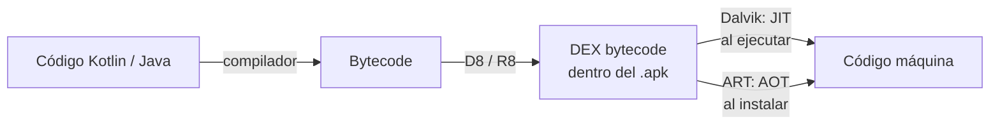

<ExportPDF />

# 3. Android

**Android** es un sistema operativo para dispositivos **móviles**. Su desarrollo lo inició la empresa Android Inc. en **2003** y **Google** la adquirió en 2005 por unos 50 millones de dólares.

## 3.1. Características de Android

- **Plataforma abierta.** Android es una plataforma libre, basada en Linux y de código abierto. Se puede utilizar, modificar y adaptar sin pagar derechos de autor (*royalties*).
- **Portabilidad garantizada.** Las aplicaciones se ejecutan sobre una máquina virtual (inspirada en la de Java), lo que ofrece un alto nivel de compatibilidad entre dispositivos actuales y futuros.
- **Arquitectura basada en componentes inspirados en Internet.** Por ejemplo, la interfaz de usuario permite reescalar la aplicación según el tamaño de la pantalla.
- **Filosofía de dispositivo siempre conectado a internet.**
- **Servicios integrados.** Localización GPS, bases de datos SQL, reconocimiento y síntesis de voz, navegador…
- **Nivel de seguridad aceptable.** Cada aplicación se ejecuta «dentro de una caja» (*sandbox*), aislada del resto de aplicaciones.
- **Optimizado para bajo consumo y poca memoria.** La máquina virtual está optimizada para dispositivos móviles.
- **Gráficos y sonido de alta calidad.** Gráficos vectoriales con suavizado (*anti-aliasing*), gráficos 3D basados en OpenGL ES y Vulkan, animaciones y códecs de vídeo y audio.

## 3.2. Arquitectura de Android

### De Dalvik a ART

En sus inicios Android usaba la máquina virtual **Dalvik** (DVM), muy similar a la máquina virtual de Java.

- Las aplicaciones Android se distribuyen en formato **`.apk`**, que contiene las clases compiladas en **DEX bytecode** (Java usa *Java bytecode*).
- Dalvik compilaba el DEX bytecode a código máquina **en tiempo de ejecución** (*just-in-time*, **JIT**).

A partir de **Android 4.4 KitKat** apareció **Android Runtime (ART)**, que sustituyó definitivamente a Dalvik en Android 5.0 Lollipop:

- ART utiliza la **compilación anticipada** (*ahead-of-time*, **AOT**): el DEX bytecode se compila **durante la instalación** de la aplicación.
- La instalación tarda más y consume más recursos, pero la **ejecución posterior es mucho más rápida**.
- ART también mejora el recolector de basura y las herramientas de desarrollo y depuración.

### Pila de software

La [documentación oficial](https://developer.android.com/guide/platform?hl=es-419) describe la plataforma como una pila de capas:

| Capa | Función |
|:---|:---|
| **System Apps** | Aplicaciones del sistema (teléfono, correo, calendario, cámara…). |
| **Java API Framework** | API con la que trabajamos los desarrolladores: sistema de vistas, proveedores de contenido y gestores (*Activity*, *Location*, *Notification*…). |
| **Native C/C++ Libraries** | Librerías nativas como WebKit, OpenGL ES o el *Media Framework*. |
| **Android Runtime** | ART y las librerías básicas (*core libraries*). |
| **Hardware Abstraction Layer (HAL)** | Interfaces estándar que exponen el hardware (audio, cámara, sensores…) al framework. |
| **Linux Kernel** | Controladores, gestión de memoria, energía y seguridad. |

### Android en todas partes

Gracias a la ejecución sobre máquina virtual es sencillo llevar Android a cualquier tipo de dispositivo: *smartphones*, tabletas, relojes, televisores, automóviles… e incluso PC, gracias al proyecto Android-x86.

Esto es también **uno de los principales problemas del desarrollador**, que se enfrenta a una enorme variedad de:

- Tamaños de pantalla.
- Densidades de píxeles.
- Relaciones de aspecto.
- Orientaciones de pantalla.
- Cantidad de memoria RAM.
- Cantidad de almacenamiento.
- Sensores disponibles.

::: tip-box Perfil de dispositivo
Antes de desarrollar una aplicación Android hay que decidir **en qué tipo de dispositivo** se va a ejecutar y **para cuántas pantallas** se va a diseñar. Esa decisión define el perfil que relaciona la aplicación con los dispositivos en los que funcionará.
:::

## 3.3. Fragmentación en Android

Cualquier sistema operativo evoluciona añadiendo mejoras en sucesivas versiones. Se llama **fragmentación** al hecho de que, en un momento dado, existan **diferentes versiones del sistema instaladas** en los dispositivos en uso.

En Android la fragmentación depende principalmente de dos factores:

- **La predisposición del fabricante** a actualizar sus dispositivos. ¿Obsolescencia programada?
- **El hardware del dispositivo**. ¿Obsolescencia programada?

Al desarrollar hay que tener en cuenta tanto la **versión** del sistema operativo como el **nivel de API**. Existen bibliotecas de compatibilidad (AndroidX) que permiten usar funcionalidades modernas en versiones antiguas.

### Versiones de Android

| | Versión | Número | Lanzamiento | Nivel de API | Estado |
|:---:|:---|:---:|:---|:---:|:---|
| A | Apple Pie | 1.0 | 23/09/2008 | 1 | Sin soporte |
| B | Banana Bread | 1.1 | 09/02/2009 | 2 | Sin soporte |
| C | Cupcake | 1.5 | 25/04/2009 | 3 | Sin soporte |
| D | Donut | 1.6 | 15/09/2009 | 4 | Sin soporte |
| E | Eclair | 2.0 – 2.1 | 26/10/2009 | 5 – 7 | Sin soporte |
| F | Froyo | 2.2 – 2.2.3 | 20/05/2010 | 8 | Sin soporte |
| G | Gingerbread | 2.3 – 2.3.7 | 06/12/2010 | 9 – 10 | Sin soporte |
| H | Honeycomb | 3.0 – 3.2.6 | 22/02/2011 | 11 – 13 | Sin soporte |
| I | Ice Cream Sandwich | 4.0 – 4.0.4 | 18/10/2011 | 14 – 15 | Sin soporte |
| J | Jelly Bean | 4.1 – 4.3.1 | 09/07/2012 | 16 – 18 | Sin soporte |
| K | KitKat | 4.4 – 4.4.4 | 31/10/2013 | 19 – 20 | Sin soporte |
| L | Lollipop | 5.0 – 5.1.1 | 12/11/2014 | 21 – 22 | Sin soporte |
| M | Marshmallow | 6.0 – 6.0.1 | 05/10/2015 | 23 | Sin soporte |
| N | Nougat | 7.0 – 7.1.2 | 15/06/2016 | 24 – 25 | Sin soporte |
| O | Oreo | 8.0 – 8.1 | 21/08/2017 | 26 – 27 | Sin soporte |
| P | Pie | 9.0 | 06/08/2018 | 28 | Sin soporte |
| Q | 10 (Quince Tart) | 10.0 | 03/09/2019 | 29 | Sin soporte |
| R | 11 (Red Velvet Cake) | 11.0 | 08/09/2020 | 30 | Sin soporte |
| S | 12 (Snow Cone) | 12.0 – 12L | 04/10/2021 | 31 – 32 | Antigua con soporte |
| T | 13 (Tiramisu) | 13.0 | 15/08/2022 | 33 | Antigua con soporte |
| U | 14 (Upside Down Cake) | 14.0 | 04/10/2023 | 34 | Antigua con soporte |
| V | 15 (Vanilla Ice Cream) | 15.0 | 14/10/2024 | 35 | Vigente |
| W | 16 (Baklava) | 16.0 | 10/06/2025 | 36 | Vigente |
| X | 17 (Cinnamon Bun) | 17.0 | 16/06/2026 | 37 | Vigente |

### Distribución acumulativa

Al crear un proyecto, Android Studio muestra la **distribución acumulativa** de versiones: la probabilidad de que un dispositivo tenga instalada **una versión igual o superior** a la indicada.

*Fuente: Android Studio*

::: accent-box teal 🎯 Elegir el SDK mínimo
Al elegir el nivel de API mínimo (*minSdk*) de una aplicación nos aseguramos de que funcionará en el porcentaje de dispositivos indicado por la distribución acumulativa. Cuanto más alto, más funcionalidades disponibles… y menos dispositivos compatibles.
:::
