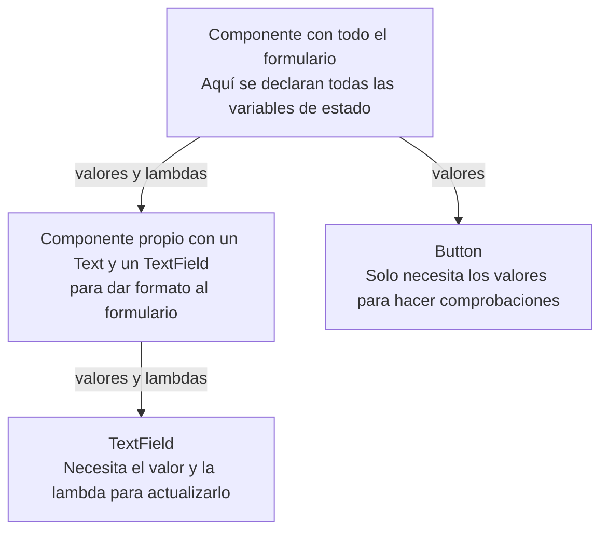

<ExportPDF />

# 2. Estados, State Hoisting y componentes de entrada de datos

## 2.1. Composición y recomposición

La **composición** y la **recomposición** son comportamientos habituales de las interfaces de usuario declarativas:

| Concepto | Qué es | Efecto |
|:---|:---|:---|
| **Composición** | Ejecución por **primera vez** de una función `@Composable`. | Pinta el componente en la interfaz. |
| **Recomposición** | Ejecución por **segunda vez o más** de una función `@Composable`. | Repinta la interfaz, pero **solo los componentes afectados**. |

Si en tiempo de ejecución se modifica un componente, ese componente **se recompone**. Así la interfaz siempre muestra su última versión.

## 2.2. Estados

En Jetpack Compose, un [estado](https://developer.android.com/develop/ui/compose/state) es una **variable conectada al estado de la aplicación**. Si un estado cambia su valor durante la ejecución, las partes de la interfaz que lo usan **se recomponen** (se vuelven a pintar).

Ya usaste un estado en el contador de clics de la UP03 para recomponer la interfaz al pulsar el botón:

```kotlin
@Composable
fun Content(modifier: Modifier = Modifier) {
    var times by rememberSaveable { mutableIntStateOf(0) }
    Column(
        modifier = Modifier.fillMaxSize().then(modifier),
        // …
```

- **`mutableStateOf`** (para `String`, `Boolean` u objetos) y **`mutableIntStateOf`** (o sus variantes `Long`, `Float` y `Double`) indican que la variable es un **estado**. Si cambia su valor, se recomponen las funciones `@Composable` que la usan.
- El problema es que, al volver a ejecutarse la función `@Composable`, el estado **volvería a su valor inicial**. Para evitarlo:

| Función | Qué recuerda |
|:---|:---|
| **`remember`** | El valor **durante la recomposición**. |
| **`rememberSaveable`** | Lo anterior y, además, el valor **al destruir y volver a crear la `Activity`** (girar el móvil, cambiar de tema…). |

### `=` frente a `by`

Los estados se pueden crear con `=`, pero entonces para acceder a su valor hay que usar **`.value`**. Para facilitar su uso existe el **delegado `by`**, que permite usar directamente el nombre de la variable:

::: tabs

== Con = (menos cómodo)

```kotlin
val quantity = rememberSaveable { mutableStateOf(0) }
quantity.value++
```

== Con by (recomendado)

```kotlin
var quantity by rememberSaveable { mutableStateOf(0) }
quantity++
```

:::

::: info-box rememberScrollState
Al estudiar `verticalScroll` y `horizontalScroll` usaste `rememberScrollState()`. Esta función crea un estado con `rememberSaveable`, por eso la posición del scroll se recuerda al cambiar la orientación o la configuración:

```kotlin
@Composable
fun rememberScrollState(initial: Int = 0): ScrollState {
    return rememberSaveable(saver = ScrollState.Saver) {
        ScrollState(initial = initial)
    }
}
```
:::

### Cambiar la interfaz con estados

Gracias a la recomposición es muy sencillo cambiar la apariencia de la interfaz. En este ejemplo el botón *Añadir* se desactiva al llegar a 5 productos y el botón de borrar solo aparece cuando hay alguno:

```kotlin
var quantity by rememberSaveable { mutableStateOf(0) }
var addButtonEnabled by rememberSaveable { mutableStateOf(true) }
var deleteButtonEnabled by rememberSaveable { mutableStateOf(false) }

Text("Añadidos: $quantity")
Row {
    Button(
        enabled = addButtonEnabled,
        onClick = {
            if (++quantity == 5) addButtonEnabled = false
            deleteButtonEnabled = true
        }
    ) {
        Text("Añadir")
    }
    Spacer(Modifier.width(8.dp))
    if (deleteButtonEnabled) {
        Button(
            enabled = deleteButtonEnabled,
            onClick = {
                quantity = 0
                addButtonEnabled = true
                deleteButtonEnabled = false
            }
        ) {
            Icon(
                imageVector = Icons.Default.DeleteOutline,
                contentDescription = "Borrar"
            )
        }
    }
}
Text("Máximo 5 productos")
```

Otro ejemplo: un botón que cambia de color aleatoriamente cada vez que se pulsa.

```kotlin
val colors = arrayListOf<Color>(Color.Red, Color.Green, Color.Blue, Color.DarkGray)
var buttonColor by rememberSaveable { mutableStateOf((0 until colors.size).random()) }

Button(
    onClick = {
        buttonColor = (0..2).random()
    },
    colors = ButtonDefaults.buttonColors(containerColor = colors[buttonColor])
) {
    Text("Cambia el color")
}
```

## 2.3. Componentes para introducir información

Los siguientes componentes permiten **recoger información del usuario**. Se usan en **formularios** y en **pantallas de ajustes**. Como cambian a medida que el usuario escribe o selecciona, **necesitan estados** para funcionar correctamente.

## 2.4. TextField

Los componentes `TextField` permiten al usuario **introducir datos con el teclado**. Hay tres:

| Componente | Descripción |
|:---|:---|
| `BasicTextField` | Campo de texto básico, sin estilo. |
| `TextField` | Aplica los principios de Material. |
| `OutlinedTextField` | Como `TextField`, pero con un borde predefinido en el parámetro `shape`. |

```kotlin
var textFieldValue by rememberSaveable { mutableStateOf("") }
TextField(
    value = textFieldValue,
    onValueChange = { textFieldValue = it }
)
```

Como con cualquier componente, conviene conocer sus parámetros:

```kotlin
fun TextField(
    value: String,
    onValueChange: (String) -> Unit,
    modifier: Modifier = Modifier,
    enabled: Boolean = true,
    readOnly: Boolean = false,
    textStyle: TextStyle = LocalTextStyle.current,
    label: @Composable (() -> Unit)? = null,
    placeholder: @Composable (() -> Unit)? = null,
    leadingIcon: @Composable (() -> Unit)? = null,
    trailingIcon: @Composable (() -> Unit)? = null,
    prefix: @Composable (() -> Unit)? = null,
    suffix: @Composable (() -> Unit)? = null,
    supportingText: @Composable (() -> Unit)? = null,
    isError: Boolean = false,
    visualTransformation: VisualTransformation = VisualTransformation.None,
    keyboardOptions: KeyboardOptions = KeyboardOptions.Default,
    keyboardActions: KeyboardActions = KeyboardActions.Default,
    singleLine: Boolean = false,
    maxLines: Int = if (singleLine) 1 else Int.MAX_VALUE,
    minLines: Int = 1,
    interactionSource: MutableInteractionSource = remember { MutableInteractionSource() },
    shape: Shape = TextFieldDefaults.shape,
    colors: TextFieldColors = TextFieldDefaults.colors()
)
```

- Los parámetros que aceptan una **lambda** (como `onValueChange`) permiten **realizar acciones**.
- Si además la lambda es **`@Composable`** (`label`, `placeholder`, `leadingIcon`, `trailingIcon`, `prefix`, `suffix`, `supportingText`), dentro puedes **incluir otros componentes**.

### Ejemplos

::: tabs

== Email y contraseña

```kotlin
var textFieldValue by rememberSaveable { mutableStateOf("") }
TextField(
    value = textFieldValue,
    onValueChange = { textFieldValue = it },
    label = { Text("Introduce tu email") },
    placeholder = { Text("tudireccion@server.com") },
    leadingIcon = { Icon(imageVector = Icons.Default.Mail, contentDescription = null) },
    trailingIcon = { Icon(imageVector = Icons.Default.PriorityHigh, contentDescription = null) },
)

Spacer(modifier = Modifier.size(8.dp))

var outlinedTextFieldValue by rememberSaveable { mutableStateOf("") }
OutlinedTextField(
    value = outlinedTextFieldValue,
    onValueChange = { outlinedTextFieldValue = it },
    label = { Text("Introduce tu contraseña") },
    visualTransformation = PasswordVisualTransformation()
)
```

== Ver la contraseña

```kotlin
var passFieldState by rememberSaveable { mutableStateOf("") }
var passVisibleState by rememberSaveable { mutableStateOf(false) }
OutlinedTextField(
    value = passFieldState,
    onValueChange = { passFieldState = it },
    trailingIcon = {
        val icon = if (passVisibleState) {
            Icons.Default.VisibilityOff
        } else {
            Icons.Default.Visibility
        }
        IconButton(onClick = { passVisibleState = !passVisibleState }) {
            Icon(
                imageVector = icon,
                contentDescription = "Ver contraseña"
            )
        }
    },
    visualTransformation = if (passVisibleState) {
        VisualTransformation.None
    } else {
        PasswordVisualTransformation()
    }
)
```

== Botón condicionado

Gracias a los estados y la recomposición **no hace falta un `if`** para activar el botón: basta con que `enabled` dependa de los campos.

```kotlin
var nameField by rememberSaveable { mutableStateOf("") }
var passwordField by rememberSaveable { mutableStateOf("") }
OutlinedTextField(
    value = nameField,
    onValueChange = { nameField = it },
    placeholder = { Text("Email") }
)
Spacer(Modifier.size(8.dp))
OutlinedTextField(
    value = passwordField,
    onValueChange = { passwordField = it },
    placeholder = { Text("Contraseña") }
)
Spacer(Modifier.size(8.dp))
Button(
    onClick = { /*TODO*/ },
    enabled = nameField.isNotEmpty() && passwordField.isNotEmpty()
) {
    Text("Entrar")
}
```

:::

### Teclado: keyboardOptions y keyboardActions

**`keyboardOptions`** indica **cómo será el teclado** que se muestra:

- `keyboardType`: tipo de teclado (`Text`, `Number`, `Phone`, `Email`, `Password`, `Decimal`, `Uri`, `NumberPassword`, `Ascii`).
- `imeAction`: botón de acción del teclado (`Next`, `Done`, `Go`, `Send`, `Search`, `Previous`, `None`, `Default`).

**`keyboardActions`** indica la **acción que se ejecuta al pulsar ese botón** (`onDone`, `onNext`, `onGo`, `onPrevious`, `onSearch`, `onSend`):

```kotlin
var textFieldValue by rememberSaveable { mutableStateOf("") }
TextField(
    value = textFieldValue,
    onValueChange = { textFieldValue = it },
    label = { Text("Introduce tu teléfono") },
    keyboardOptions = KeyboardOptions(
        keyboardType = KeyboardType.Phone,
        imeAction = ImeAction.Next
    ),
    keyboardActions = KeyboardActions(
        onNext = { /* TODO */ },
        onDone = { /* TODO */ },
    )
)
```

## 2.5. State Hoisting

Es muy habitual crear componentes propios que envuelven uno o más componentes de Jetpack Compose. Aquí hay dos opciones:

::: tabs

== Stateless

Componente propio en el que **no se declara un estado**:

```kotlin
@Composable
fun MyHeaderText(
    text: String,
    modifier: Modifier = Modifier
) {
    Text(
        text = text,
        fontSize = 30.sp,
        fontWeight = FontWeight.Bold,
        color = Color.White,
        modifier = modifier
            .background(Color.DarkGray)
            .padding(16.dp)
            .then(modifier)
    )
}
```

== Stateful

Componente propio en el que **se declara un estado**:

```kotlin
@Composable
fun MyTextField() {
    var textFieldState by rememberSaveable { mutableStateOf("") }
    TextField(
        value = textFieldState,
        onValueChange = { textFieldState = it }
    )
}
```

:::

### El problema

Desde fuera de un componente **stateful** no hay acceso a su estado. En el formulario de email y contraseña de antes, los campos y los estados estaban en el mismo sitio, así que no había problema. Pero si extraes cada campo a un componente propio stateful, como se recomienda…

```kotlin
NameTextField()
PasswordTextField()
Spacer(Modifier.size(8.dp))
AccessButton()
```

…¿cómo sabe `AccessButton` qué ha escrito el usuario en los otros dos?

### La solución

La solución es el [**State Hoisting**](https://developer.android.com/develop/ui/compose/state-hoisting) (elevación de estado): **el estado no se declara dentro del componente, sino en el componente más externo en el que se vaya a utilizar**. Al sacar el estado, el componente se convierte en **stateless**.

La técnica consiste en eliminar la declaración del estado y sustituirla por **uno o dos parámetros** que se le pasan al usarlo:

- Uno para **proporcionar el valor** al componente.
- Otro, una **lambda**, para **modificar ese valor**.

De hecho, ya lo has usado con `TextField`: recibe el valor en `value` y la lambda para cambiarlo en `onValueChange`.

::: info-box Recomendación
**Todos los componentes deberían ser stateless en la medida de lo posible.** Si un componente usa un estado que no se necesita fuera, puede ser stateful.
:::

Cada componente propio recibirá **el valor y la lambda**, o **solo uno** de ellos, según lo que necesite:



### Formulario con State Hoisting

::: tabs

== Componentes stateless

```kotlin
@Composable
fun NameTextField(value: String, onValueChange: (String) -> Unit) {
    TextField(
        value = value,
        onValueChange = { onValueChange(it) }
    )
}

@Composable
fun PasswordTextField(value: String, onValueChange: (String) -> Unit) {
    TextField(
        value = value,
        onValueChange = { onValueChange(it) },
        visualTransformation = PasswordVisualTransformation()
    )
}

@Composable
fun AccessButton(value: Boolean, onClick: () -> Unit) {
    Button(
        onClick = onClick,
        enabled = value
    ) {
        Text("Entrar")
    }
}
```

== Uso

```kotlin
var nameState by rememberSaveable { mutableStateOf("") }
var passState by rememberSaveable { mutableStateOf("") }

NameTextField(
    value = nameState,
    onValueChange = { nameState = it }
)
PasswordTextField(
    value = passState,
    onValueChange = { passState = it }
)
Spacer(Modifier.size(8.dp))
AccessButton(
    value = nameState.isNotEmpty() && passState.isNotEmpty(),
    onClick = { /* TODO */ }
)
```

:::

## 2.6. Switch

Los `Switch` son **interruptores** para activar y desactivar funciones. Son habituales en las preferencias:

```kotlin
var checked by rememberSaveable { mutableStateOf(false) }
Switch(
    checked = checked,
    onCheckedChange = {
        checked = it
    }
)
```

El parámetro **`thumbContent`** permite añadir un icono al interruptor, y con **`SwitchDefaults.colors`** puedes personalizar los colores de cada parte (`checkedThumbColor`, `checkedTrackColor`, `uncheckedBorderColor`, `disabledCheckedThumbColor`…):

::: tabs

== thumbContent

```kotlin
Switch(
    checked = checked,
    onCheckedChange = { checked = it },
    thumbContent = {
        Icon(
            imageVector = if (checked) Icons.Default.DarkMode else Icons.Default.LightMode,
            contentDescription = "Modo claro-oscuro"
        )
    }
)
```

== Colores

```kotlin
var switch by rememberSaveable { mutableStateOf(false) }
Switch(
    checked = switch,
    onCheckedChange = {
        switch = it
    },
    colors = SwitchDefaults.colors(
        uncheckedBorderColor = Color.Red,
        checkedBorderColor = Color.Blue
    )
)
```

:::

::: tip-box Practica
Ya puedes hacer la [Actividad 2 — Conversor](../ejercicios/#actividad-2).
:::

## 2.7. Checkbox

Los `Checkbox` permiten marcar **una o varias opciones**. Sus colores se personalizan de forma similar a los `Switch`:

```kotlin
var checked by rememberSaveable { mutableStateOf(false) }
Checkbox(
    checked = checked,
    onCheckedChange = {
        checked = it
    }
)
```

Como suelen ir acompañados de texto, conviene crear un **componente propio** que agrupe en una `Row` el `Checkbox` y un `Text`. Ejemplo con varios `Checkbox` y State Hoisting:

::: tabs

== Clase y componentes

```kotlin
// Data class para usar en los objetos CustomCheckbox
data class Check(
    val title: String,
    val selected: Boolean = false,
    val onCheckedChange: (Boolean) -> Unit
)

// Función que recibe un conjunto de títulos y los convierte en objetos Check
@Composable
fun getChecks(vararg titles: String): List<Check> {
    return titles.map {
        var state by rememberSaveable { mutableStateOf(false) }
        Check(
            title = it,
            selected = state,
            onCheckedChange = { state = it }
        )
    }
}

// Componente Checkbox stateless propio
@Composable
fun CustomCheckbox(check: Check) {
    Row(
        verticalAlignment = Alignment.CenterVertically
    ) {
        Checkbox(
            checked = check.selected,
            onCheckedChange = {
                check.onCheckedChange(it)
            }
        )
        Text(text = check.title)
    }
}
```

== Uso

```kotlin
val moviesCheckbox = getChecks("Matrix", "El señor de los anillos", "Vengadores: Endgame")
moviesCheckbox.forEach {
    CustomCheckbox(check = it)
}

Button(
    onClick = {
        // Se recorren los títulos y se consulta el dato almacenado en cada uno (true|false)
        moviesCheckbox.map { movie ->
            Log.i("--->", "${movie.title}: ${movie.selected}")
        }
    }
) {
    Text(text = "Guardar")
}
```

Al pulsar *Guardar*, en **Logcat** aparece cada película con `true` o `false`.

:::

## 2.8. TriStateCheckbox

`TriStateCheckbox` es como un `Checkbox`, pero con **tres posiciones**. Se usa junto a otros `Checkbox` y su icono cambia según cuántos estén marcados: **nada**, **algo** o **todo** seleccionado (`ToggleableState.Off`, `Indeterminate` y `On`).

```kotlin
// Estados para los check individuales
var essentialCookiesCheckBox by rememberSaveable { mutableStateOf(false) }
var thirdCookiesCheckBox by rememberSaveable { mutableStateOf(false) }
var otherCookiesCheckBox by rememberSaveable { mutableStateOf(false) }

// Estado para el TriStateCheckbox cuyo valor deriva de los otros estados
val allCookiesState by remember {
    derivedStateOf {
        when {
            essentialCookiesCheckBox && thirdCookiesCheckBox && otherCookiesCheckBox -> ToggleableState.On
            !essentialCookiesCheckBox && !thirdCookiesCheckBox && !otherCookiesCheckBox -> ToggleableState.Off
            else -> ToggleableState.Indeterminate
        }
    }
}

// Fila con el TriStateCheckbox como "padre" de todos
Row(verticalAlignment = Alignment.CenterVertically) {
    TriStateCheckbox(
        state = allCookiesState,
        onClick = {
            val finalState = allCookiesState != ToggleableState.On
            essentialCookiesCheckBox = finalState
            thirdCookiesCheckBox = finalState
            otherCookiesCheckBox = finalState
        }
    )
    Text(text = "Acepto todas las cookies")
}

// Columna con los Checkbox individuales "hijos"
Column(modifier = Modifier.padding(start = 16.dp)) {
    Row(verticalAlignment = Alignment.CenterVertically) {
        Checkbox(
            checked = essentialCookiesCheckBox,
            onCheckedChange = { essentialCookiesCheckBox = it }
        )
        Text(text = "Esenciales")
    }
    Row(verticalAlignment = Alignment.CenterVertically) {
        Checkbox(
            checked = thirdCookiesCheckBox,
            onCheckedChange = { thirdCookiesCheckBox = it }
        )
        Text(text = "De Terceros")
    }
    Row(verticalAlignment = Alignment.CenterVertically) {
        Checkbox(
            checked = otherCookiesCheckBox,
            onCheckedChange = { otherCookiesCheckBox = it }
        )
        Text(text = "Otras")
    }
}
```

::: info-box derivedStateOf
`derivedStateOf` crea un estado cuyo valor **se calcula a partir de otros estados**. Se recalcula automáticamente cuando cambia alguno de ellos.
:::

## 2.9. RadioButton

Los `RadioButton` permiten seleccionar **una única opción entre varias**. Los de un mismo conjunto **se deben agrupar** en un layout con **`Modifier.selectableGroup()`**:

```kotlin
var selected by rememberSaveable { mutableStateOf("") }
Column(modifier = Modifier.selectableGroup().fillMaxWidth()) {
    Row(verticalAlignment = Alignment.CenterVertically) {
        RadioButton(
            selected = selected == "DAM",
            onClick = {
                selected = "DAM"
            }
        )
        Text("DAM")
    }
    Row(verticalAlignment = Alignment.CenterVertically) {
        RadioButton(
            selected = selected == "DAW",
            onClick = {
                selected = "DAW"
            }
        )
        Text("DAW")
    }
}
```

Es interesante que se pueda pulsar **toda la fila** y no solo el círculo. Para ello, añade `Modifier.selectable` a la `Row`. Además, puedes generar las opciones a partir de una **lista**:

```kotlin
val fpOptions = listOf("DAM", "DAW", "ASIR", "SMR")
var selected by rememberSaveable { mutableStateOf("") }
Column(
    modifier = Modifier
        .selectableGroup()
        .fillMaxWidth()
) {
    fpOptions.forEach { option ->
        Row(
            verticalAlignment = Alignment.CenterVertically,
            modifier = Modifier.selectable(
                selected = selected == option,
                onClick = { selected = option }
            )
        ) {
            RadioButton(
                selected = selected == option,
                onClick = { selected = option }
            )
            Text(text = option)
        }
    }
}

Button(
    onClick = {
        selected = ""
    }
) {
    Text(text = "Borrar selección")
}
```

Con State Hoisting:

```kotlin
@Composable
fun MyRadioButton(vararg options: String, selected: String, onClick: (String) -> Unit) {
    options.forEach { option ->
        Row(verticalAlignment = Alignment.CenterVertically) {
            RadioButton(
                selected = selected == option,
                onClick = { onClick(option) }
            )
            Text(text = option)
        }
    }
}

var option by rememberSaveable { mutableStateOf("") }
MyRadioButton(
    "Opción 1", "Opción 2", "Opción 3",
    selected = option,
    onClick = { option = it }
)
```

## 2.10. Slider y RangeSlider

Los `Slider` son barras con un **indicador deslizable** para seleccionar un valor. Por defecto el valor va de `0.0` a `1.0`, pero se puede cambiar con `valueRange`; `steps` indica los saltos intermedios y `thumb` permite cambiar el indicador:

::: tabs

== Slider

```kotlin
var sliderValue by rememberSaveable { mutableFloatStateOf(0f) }
Row(verticalAlignment = Alignment.CenterVertically) {
    Text(sliderValue.toInt().toString())
    Spacer(modifier = Modifier.width(8.dp))
    Slider(
        value = sliderValue,
        onValueChange = {
            sliderValue = it
        },
        valueRange = 0f..10f,
        steps = 9
    )
}
```

== Indicador propio

```kotlin
Slider(
    value = sliderValue,
    onValueChange = { sliderValue = it },
    valueRange = 0f..10f,
    steps = 9,
    thumb = {
        Icon(
            imageVector = Icons.Default.Adb,
            contentDescription = null
        )
    }
)
```

== RangeSlider

`RangeSlider` permite seleccionar un **rango de valores**. Sus indicadores se modifican con `startThumb` y `endThumb`.

```kotlin
var rangeMinState by rememberSaveable { mutableFloatStateOf(0f) }
var rangeMaxState by rememberSaveable { mutableFloatStateOf(10f) }
Column(
    modifier = Modifier
        .fillMaxSize()
        .padding(20.dp)
) {
    Row(
        modifier = Modifier.fillMaxWidth(),
        horizontalArrangement = Arrangement.SpaceBetween
    ) {
        Text(text = "${rangeMinState.toInt()}")
        Text(text = "${rangeMaxState.toInt()}")
    }
    RangeSlider(
        value = rangeMinState..rangeMaxState,
        onValueChange = {
            rangeMinState = it.start
            rangeMaxState = it.endInclusive
        },
        valueRange = 0f..10f,
        steps = 9
    )
}
```

:::

## 2.11. ExposedDropdownMenu

`ExposedDropdownMenu` muestra un `TextField` con un **menú desplegable**. Según cómo se programe, puede ser:

- **No editable**: solo se puede seleccionar una opción.
- **Editable**: se puede elegir una opción o escribir.
- **Editable y autocompletable**: como el editable, pero además filtra los resultados.

Se compone de un `TextField` con el modificador **`menuAnchor()`** y de varios **`DropdownMenuItem`**, que son las opciones disponibles. Ejemplo no editable:

```kotlin
val classes = listOf("Bárbaro", "Bardo", "Brujo", "Clérigo", "Druida", "Explorador",
    "Guerrero", "Hechicero", "Mago", "Monje", "Paladín", "Pícaro")
var expanded by rememberSaveable { mutableStateOf(false) }
var selectedOptionText by rememberSaveable { mutableStateOf("Selecciona una clase") }

ExposedDropdownMenuBox(
    expanded = expanded,
    onExpandedChange = { expanded = !expanded }
) {
    OutlinedTextField(
        // Gracias al modificador menuAnchor, al hacer clic en el campo de texto
        // se expandirá o contraerá el ExposedDropdownMenu
        modifier = Modifier.menuAnchor(),
        readOnly = true,
        value = selectedOptionText,
        onValueChange = {},
        label = { Text(text = "Clase") },
        trailingIcon = { ExposedDropdownMenuDefaults.TrailingIcon(expanded = expanded) }
    )
    ExposedDropdownMenu(
        expanded = expanded,
        onDismissRequest = { expanded = false }
    ) {
        classes.forEach { option ->
            DropdownMenuItem(
                text = { Text(text = option) },
                onClick = {
                    selectedOptionText = option
                    expanded = false
                    Log.i("--->", "desde un DropdownMenuItem: $selectedOptionText")
                }
            )
        }
    }
}
```

::: info-box Componente experimental
`ExposedDropdownMenuBox` necesita `@OptIn(ExperimentalMaterial3Api::class)`. En versiones recientes de Material 3, `menuAnchor()` recibe el tipo de ancla, por ejemplo `Modifier.menuAnchor(MenuAnchorType.PrimaryNotEditable)`.
:::

## 2.12. DatePicker

`DatePicker` permite **seleccionar o introducir una fecha**. Se puede indicar la fecha seleccionada, cambiar la cabecera y el título, y mostrar el icono para cambiar el modo de introducción (calendario o teclado):

```kotlin
Column {
    val datePickerState = rememberDatePickerState(
        initialSelectedDateMillis = Calendar.getInstance().timeInMillis
    )
    DatePicker(
        state = datePickerState,
        modifier = Modifier.padding(16.dp)
    )
    Text(text = "Fecha seleccionada: ${
        datePickerState.selectedDateMillis?.let { millis ->
            val instant = Instant.ofEpochMilli(millis)
            val formatter = DateTimeFormatter.ofPattern("dd/MM/yyyy").withZone(ZoneId.systemDefault())
            formatter.format(instant)
        }
    }")
}
```

::: warning-box Importación
La clase `Instant` que debes importar es la de **Java** (`java.time.Instant`).
:::

También existen [`DatePickerDialog`](https://developer.android.com/develop/ui/compose/components/datepickers#modal) y [`DateRangePicker`](https://developer.android.com/develop/ui/compose/components/datepickers#range).

## 2.13. TimePicker y TimeInput

`TimePicker` (con **dial**) y `TimeInput` (con **teclado**) permiten seleccionar una **hora**:

::: tabs

== TimePicker

```kotlin
val timePickerState = rememberTimePickerState(
    initialHour = Calendar.getInstance().get(Calendar.HOUR_OF_DAY),
    initialMinute = Calendar.getInstance().get(Calendar.MINUTE)
)
TimePicker(
    state = timePickerState,
    layoutType = TimePickerLayoutType.Vertical
)
```

== TimeInput

```kotlin
val timePickerState = rememberTimePickerState(
    initialHour = Calendar.getInstance().get(Calendar.HOUR_OF_DAY),
    initialMinute = Calendar.getInstance().get(Calendar.MINUTE)
)
TimeInput(
    state = timePickerState
)
```

:::

## 2.14. Chips

Los **chips** son pequeños componentes con un texto que sirven para introducir información, iniciar acciones, filtrar contenido o hacer selecciones. Hay cuatro tipos:

| Tipo | Uso |
|:---|:---|
| **Assist** | Acciones predefinidas en la aplicación, por ejemplo *añadir al calendario* o *cómo llegar*. |
| **Filter** | Filtros que se aplican a los elementos de una colección. |
| **Input** | Pequeños fragmentos de información introducidos por el usuario, por ejemplo tras escribir un email. |
| **Suggestion** | Sugerencias generadas dinámicamente que guían las acciones del usuario. |

También existen las variantes `ElevatedAssistChip`, `ElevatedFilterChip` y `ElevatedSuggestionChip`.

::: info-box Cómo usar los chips
- **No son botones** y no se deben usar como acción final: para eso están los botones.
- Son **reactivos** a las acciones del usuario y **contextuales** al contenido.
- Deberían aparecer siempre **en grupo** y organizarse con **scroll horizontal**.
:::

Todas las variantes se basan en un componente privado `Chip`, así que son visualmente parecidas, pero cada una admite los parámetros propios de su función:

::: tabs

== Suggestion y Assist

```kotlin
SuggestionChip(
    onClick = { /* TODO */ },
    label = { Text("Suggestion Chip") }
)

AssistChip(
    onClick = { /* TODO */ },
    label = { Text("Assist Chip") },
    leadingIcon = {
        Icon(
            Icons.Filled.Settings,
            contentDescription = "Localized description",
            Modifier.size(AssistChipDefaults.IconSize)
        )
    }
)
```

== Filter e Input

```kotlin
var selectedFilterChip by rememberSaveable { mutableStateOf(false) }
FilterChip(
    selected = selectedFilterChip,
    onClick = { selectedFilterChip = !selectedFilterChip },
    label = { Text("Filter chip") },
    leadingIcon = {
        if (selectedFilterChip) {
            Icon(
                imageVector = Icons.Filled.Done,
                contentDescription = "Localized Description",
                modifier = Modifier.size(FilterChipDefaults.IconSize)
            )
        }
    }
)

var selectedInputChip by rememberSaveable { mutableStateOf(false) }
InputChip(
    selected = selectedInputChip,
    onClick = { selectedInputChip = !selectedInputChip },
    label = { Text("Input Chip") },
)
```

:::

## 2.15. IconButton

Los `IconButton` son **botones compactos**, habituales en las **barras de herramientas**. Hay varios tipos: `IconButton`, `IconToggleButton`, `FilledIconButton`, `FilledIconToggleButton`, `FilledTonalIconButton`, `FilledTonalIconToggleButton`, `OutlinedIconButton` y `OutlinedIconToggleButton`. Las variantes **Toggle** tienen dos estados: marcado o no.

```kotlin
FilledIconButton(onClick = { /*TODO*/ }) {
    Icon(
        imageVector = Icons.Default.Settings,
        contentDescription = "Configuración"
    )
}

var selected by rememberSaveable { mutableStateOf(false) }
FilledIconToggleButton(
    checked = selected,
    onCheckedChange = { selected = !selected }
) {
    Icon(
        imageVector = Icons.Default.Settings,
        contentDescription = "Configuración"
    )
}
```

## 2.16. Indicadores de progreso

`LinearProgressIndicator` y `CircularProgressIndicator` informan al usuario de que se está ejecutando una tarea. Pueden ser:

- **Indeterminados**: no tienen fin.
- **Determinados**: empiezan vacíos y se rellenan del todo. Para ello se usa el parámetro **`progress`**, con valores de `0.0f` a `1.0f`.

Sus parámetros principales son `progress`, `color` (color del progreso), `trackColor` (color del fondo), `strokeCap` (forma de la línea) y, solo en el circular, `strokeWidth` (grosor):

```kotlin
CircularProgressIndicator(
    strokeCap = StrokeCap.Round,
    trackColor = Color.LightGray,
    color = Color.Blue,
    strokeWidth = 8.dp
)

LinearProgressIndicator(
    progress = {
        .3f
    },
    strokeCap = StrokeCap.Butt,
    modifier = Modifier.height(16.dp)
)
```

## 2.17. SearchBar

Los componentes de barra de búsqueda permiten al usuario **buscar** y ver los resultados de forma dinámica:

- **`SearchBar`**: el cuerpo ocupa toda la pantalla.
- **`DockedSearchBar`**: el cuerpo ocupa una parte de la pantalla (configurable).

Tienen distintos parámetros, algunos dependientes de un estado. Desde la versión 1.3.0 de Material 3 se recomienda usar la sobrecarga con el parámetro **`inputField`**. Para mostrar los resultados puedes, por ejemplo, rellenar el cuerpo con todo y filtrarlo según lo escrito, dejarlo vacío y rellenarlo con los resultados, o crear un estado para el cuerpo.

```kotlin
val dragonBallCharacters = listOf("Son Goku", "Vegeta", "Piccolo", "Son Gohan", "Trunks",
    "Bulma", "Krillin", "Master Roshi", "Freezer", "Cell")

// En algunas ocasiones se necesita el contexto de ejecución (suele ser la Activity)
val myContext = LocalContext.current

var querySearchState by rememberSaveable { mutableStateOf("") }
var activeSearchState by rememberSaveable { mutableStateOf(false) }

DockedSearchBar(
    expanded = activeSearchState,
    onExpandedChange = { activeSearchState = it },
    inputField = {
        SearchBarDefaults.InputField(
            query = querySearchState,
            onQueryChange = { querySearchState = it },
            onSearch = { it: String ->
                // Este código se ejecutará al pulsar intro mientras se escribe
                if (it.isNotBlank()) {
                    // Para mostrar mensajes temporales en la parte inferior de la pantalla
                    Toast.makeText(myContext, "Se busca: $it", Toast.LENGTH_SHORT).show()
                }
            },
            expanded = activeSearchState,
            onExpandedChange = { activeSearchState = it },
            placeholder = { Text(text = "Introduce el personaje a buscar") },
            trailingIcon = {
                IconButton(
                    onClick = {
                        querySearchState = ""
                        activeSearchState = !activeSearchState
                    }
                ) {
                    Icon(
                        imageVector = if (activeSearchState) Icons.Default.Close else Icons.Default.Search,
                        contentDescription = null
                    )
                }
            }
        )
    }
) {
    // Variable para filtrar la lista de personajes y mostrar solo los que coinciden con la búsqueda
    val charactersToShow =
        if (querySearchState.isEmpty()) {
            dragonBallCharacters
        } else {
            dragonBallCharacters.filter {
                it.contains(querySearchState, ignoreCase = true)
            }
        }

    LazyColumn(
        verticalArrangement = Arrangement.spacedBy(12.dp),
        modifier = Modifier.heightIn(max = 300.dp)
    ) {
        items(charactersToShow) { characterName ->
            Text(
                text = characterName,
                modifier = Modifier
                    .padding(8.dp)
                    .clickable {
                        Toast.makeText(
                            myContext,
                            "Seleccionado: $characterName",
                            Toast.LENGTH_SHORT
                        ).show()
                        querySearchState = characterName
                        activeSearchState = false
                    }
            )
        }
    }
}
```

Al pulsar la barra se despliega la lista completa; al escribir se filtra, y al pulsar un personaje se muestra un `Toast` y se cierra el desplegable. `LazyColumn` lo estudiarás en el [apartado siguiente](./03-layouts-listas#_3-8-lazycolumn-y-lazyrow).

## 2.18. Diálogos: BasicAlertDialog

Estos componentes muestran un mensaje en una **ventana modal** (emergente):

- **`BasicAlertDialog`**: hay que configurar todas sus características, incluido el estilo. Sustituye a la antigua versión de `AlertDialog` con contenido libre, que está **obsoleta**.
- **`AlertDialog`** con `confirmButton`, `dismissButton`, `title` y `text`: sigue disponible y es la forma rápida de crear un diálogo con el estilo de Material.

```kotlin
if (dialogVisible) {
    AlertDialog(
        onDismissRequest = { dialogVisible = false },
        icon = { Icon(Icons.Default.Warning, contentDescription = "Alerta") },
        title = { Text("Atención") },
        text = { Text("Aquí se debe añadir el texto de la alerta") },
        confirmButton = {
            TextButton(onClick = { dialogVisible = false }) { Text("Confirmar") }
        },
        dismissButton = {
            TextButton(onClick = { dialogVisible = false }) { Text("Cancelar") }
        }
    )
}
```

Con `BasicAlertDialog` tú decides todo el contenido:

::: warning-box El diálogo lo controlas tú
Es labor de quien desarrolla la aplicación crear **todo el contenido del modal** y la **funcionalidad para mostrarlo y ocultarlo**, normalmente con un estado `Boolean`.
:::

```kotlin
var dialogVisible by rememberSaveable { mutableStateOf(false) }

if (dialogVisible) {
    BasicAlertDialog(
        onDismissRequest = { dialogVisible = false },
    ) {
        Surface(
            modifier = Modifier.wrapContentWidth().wrapContentHeight(),
            shape = MaterialTheme.shapes.large,
            tonalElevation = AlertDialogDefaults.TonalElevation,
        ) {
            Column(modifier = Modifier.padding(16.dp)) {
                Row(
                    modifier = Modifier.fillMaxWidth(),
                    horizontalArrangement = Arrangement.Center
                ) {
                    Icon(
                        imageVector = Icons.Default.Warning,
                        contentDescription = "Alerta",
                    )
                }
                MySpacer(height = 12)
                Text(text = "Aquí se debe añadir el texto de la alerta")
                MySpacer(height = 20)
                Row(
                    horizontalArrangement = Arrangement.End,
                    modifier = Modifier.fillMaxWidth()
                ) {
                    TextButton(onClick = { dialogVisible = false }) {
                        Text("Confirmar")
                    }
                    TextButton(onClick = { dialogVisible = false }) {
                        Text("Cancelar")
                    }
                }
            }
        }
    }
}

Button(
    onClick = { dialogVisible = true }
) {
    Text(text = "Mostrar AlertDialog")
}
```

::: tip-box Practica
Ya puedes hacer la [Actividad 3 — Registro](../ejercicios/#actividad-3).
:::
