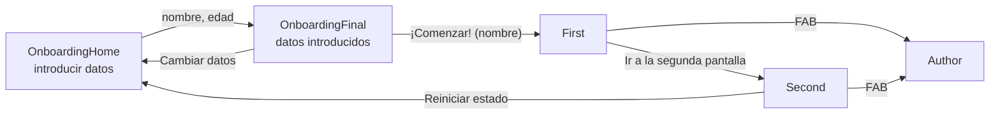

<ExportPDF />

# 1. Navegación con Navigation 3

## 1.1. De varias Activities a Single Activity

Con la programación tradicional de Android basada en *Views*, cada pantalla de la aplicación se implementaba en una **Activity** diferente. Esto obligaba a utilizar:

- Grafos de navegación.
- Instrucciones para iniciar Activities.
- Elementos específicos para mandar información a la ventana nueva y para recibir información cuando esa ventana se cierra.

Jetpack Compose simplifica toda la navegación porque la estructura que utiliza se basa en el patrón **Single Activity**.

::: accent-box primary 📖 Single Activity
Arquitectura en la que **una única Activity** gestiona todos los elementos de la interfaz. Esos elementos se dividen en diferentes componentes propios de Jetpack Compose (funciones `@Composable`), y es la propia aplicación la que decide qué componente-pantalla se muestra en cada momento.
:::

Actualmente la herramienta para gestionar la navegación es **Navigation 3**. Esta versión introduce cambios que permiten gestionar las pantallas de una forma más sencilla, incluso cuando hay que enviar datos de una pantalla a otra.

## 1.2. Organización del proyecto

A partir de ahora es muy importante tener **organizados en carpetas (paquetes)** todos los componentes de la aplicación. Una práctica habitual es crear un paquete llamado `screens` dentro de `ui`, donde se irán creando los componentes de cada una de las pantallas (botón derecho sobre `ui` → *New* → *Package*).

Dentro de `screens` se pueden ubicar directamente los archivos `.kt` de cada pantalla o, si una pantalla usa varios archivos `.kt`, crear un subpaquete para cada una.


## 1.3. La aplicación de ejemplo

El ejemplo que se estudia en esta unidad es una aplicación con cinco pantallas:

1. **Introducción de datos** (Onboarding): pide el nombre y la edad.
2. **Datos introducidos** (Onboarding): muestra los datos y permite cambiarlos o comenzar.
3. **Pantalla principal** (*First Screen*): muestra el nombre en la barra superior.
4. **Pantalla secundaria** (*Second Screen*): permite reiniciar el estado de la aplicación.
5. **Autor**: tarjeta con la información del autor.




Cada una de estas pantallas será un **componente `@Composable` propio**. Como se verá más adelante, toda la navegación de la aplicación se concentra en **un único lugar**; por eso se extraen de las pantallas las funcionalidades de navegación mediante **funciones lambda**: la pantalla no sabe *a dónde* se navega, solo avisa de *que* el usuario quiere navegar.

## 1.4. Las pantallas reciben lambdas de navegación

### Primera pantalla: introducción de datos

La primera pantalla solo tiene un elemento que permite navegar: el botón *"Navega a la siguiente ventana"*. Como en esta pantalla no se gestiona la navegación, se define para que reciba **una función lambda para esa acción**. Además, al navegar hay que enviar los datos introducidos, de modo que la lambda **recibe esos datos como parámetros** (`(String, Int) -> Unit`).

```kotlin
@Composable
fun OnboardingHomeScreen(
    navigateToDetail: (String, Int) -> Unit,
) {
    var showAgeError by rememberSaveable { mutableStateOf(false) }

    Column(
        horizontalAlignment = Alignment.CenterHorizontally,
        modifier = Modifier
            .fillMaxSize()
            .padding(top = 80.dp)
    ) {
        Text(text = "Introduce tus datos para continuar")

        Spacer(modifier = Modifier.height(20.dp))

        var nameState by rememberSaveable { mutableStateOf("") }
        TextField(
            value = nameState,
            onValueChange = { nameState = it },
            placeholder = { Text(text = "Escribe tu nombre") }
        )

        Spacer(modifier = Modifier.height(20.dp))

        var ageState by rememberSaveable { mutableStateOf("") }
        TextField(
            value = ageState.toString(),
            onValueChange = {
                ageState = it
                showAgeError = false    // Se oculta el mensaje de error
            },
            placeholder = { Text(text = "Escribe tu edad") },
            keyboardOptions = KeyboardOptions(keyboardType = KeyboardType.Number)
        )

        Spacer(modifier = Modifier.height(20.dp))

        Button(
            onClick = {
                // Si la edad es un número se navegará, en caso contrario se mostrará
                //  el mensaje de error
                try {
                    val age = ageState.trim().toInt()
                    navigateToDetail(nameState.trim(), age)
                } catch (e: NumberFormatException) {
                    showAgeError = true
                }
            },
            enabled = nameState.isNotBlank() && ageState.isNotBlank()
        ) {
            Text(text = "Navega a la siguiente ventana")
        }

        if (showAgeError) {
            Text(
                text = "La edad debe ser un número",
                color = Color.Red,
                fontWeight = FontWeight.Bold
            )
        }
    }
}
```

Observa que en el `onClick` del botón simplemente se **invoca la lambda** `navigateToDetail(nameState.trim(), age)`: la pantalla entrega los datos y es otro componente el que decide qué hacer con ellos.

### Segunda pantalla: datos introducidos

La segunda pantalla tiene **dos elementos que permiten navegar**: los botones *"Cambiar datos"* y *"¡Comenzar!"*. Por tanto recibe **una lambda por cada acción** y, además, **los dos datos** que debe mostrar. Al navegar a la ventana siguiente hay que enviar un dato (el nombre), así que esa lambda recibe un `String`.

```kotlin
@Composable
fun OnboardingFinalScreen(
    name: String,
    age: Int = 0,
    navigateToBack: () -> Unit,
    navigateToApp: (String) -> Unit,
) {
    Column(
        horizontalAlignment = Alignment.CenterHorizontally,
        modifier = Modifier
            .fillMaxSize()
            .padding(top = 80.dp)
    ) {
        Text(text = "Datos introducidos:")
        Text(text = "Nombre: $name")
        Text(text = "Edad: $age")

        Spacer(modifier = Modifier.height(20.dp))

        Row(
            horizontalArrangement = Arrangement.SpaceEvenly,
            modifier = Modifier.fillMaxWidth()
        ) {
            Button(onClick = {
                navigateToBack()
            }) {
                Text(text = "Cambiar datos")
            }

            Button(onClick = {
                navigateToApp(name)
            }) {
                Text(text = "¡Comenzar!")
            }
        }
    }
}
```

## 1.5. Un Scaffold propio para el resto de pantallas

El resto de pantallas de la aplicación se enmarcan en un **Scaffold** definido en un componente `@Composable` propio (`AppScaffold`). Este Scaffold tiene dos elementos que permiten navegar y que se mostrarán o no según la pantalla en la que se encuentre la aplicación:

- El **`navigationIcon`** de la `TopAppBar` (flecha para volver atrás).
- El **`FloatingActionButton`** (FAB), que lleva a la pantalla del autor.

Por eso el Scaffold propio recibe, **para cada elemento que permite navegar, una lambda y un booleano** que indica si se muestra o no:

```kotlin
@OptIn(ExperimentalMaterial3Api::class)
@Composable
fun AppScaffold(
    title: String,
    showNavigationToAuthor: Boolean = false,
    navigateToAuthor: () -> Unit = {},
    showNavigationToBack: Boolean = false,
    navigateToBack:  () -> Unit = {},
    content: @Composable () -> Unit
) {
    Scaffold(
        topBar = {
            TopAppBar(
                title = { Text(title) },
                navigationIcon = {
                    if(showNavigationToBack) {
                        IconButton(
                            onClick = navigateToBack
                        ) {
                            Icon(
                                imageVector = Icons.AutoMirrored.Filled.ArrowBack,
                                contentDescription = "Atrás"
                            )
                        }
                    }
                }
            )
        },
        floatingActionButton = {
            if(showNavigationToAuthor) {
                FloatingActionButton(
                    onClick = navigateToAuthor
                ) {
                    Icon(
                        imageVector = Icons.Outlined.PersonPin,
                        contentDescription = "Autor"
                    )
                }
            }
        },
        floatingActionButtonPosition = FabPosition.Start
    ) { paddingValues ->
        Box(
            modifier = Modifier
                .fillMaxSize()
                .padding(paddingValues)
        ) {
            content()
        }
    }
}
```

::: tip-box Valores por defecto
Las lambdas tienen como valor por defecto `{}` (no hacer nada) y los booleanos `false`. Así, cada pantalla solo tiene que indicar los elementos de navegación que realmente usa.
:::

### Pantalla principal

La pantalla principal, al enmarcarse en el Scaffold, recibe las lambdas para **navegar a la siguiente pantalla** y **navegar a la pantalla del autor**, además del **nombre**. No muestra la flecha de atrás, pero sí el FAB del autor.

```kotlin
@Composable
fun FirstScreen(
    name: String,
    navigateToSecond: (String) -> Unit,
    navigateToAuthor: () -> Unit,
) {
    AppScaffold(
        title = "First Screen - $name",
        showNavigationToAuthor = true,
        navigateToAuthor = navigateToAuthor,
        showNavigationToBack = false
    ) {
        Column(
            horizontalAlignment = Alignment.CenterHorizontally,
            modifier = Modifier.fillMaxSize().padding(top = 16.dp)
        ) {
            Text(text = "Página principal de la aplicación")

            Spacer(modifier = Modifier.height(20.dp))

            Button( onClick = { navigateToSecond(name) }) {
                Text(text = "Ir a la segunda pantalla")
            }
        }
    }
}
```

### Pantalla secundaria

Recibe las lambdas para **volver a la pantalla anterior**, **ir a la pantalla del autor** y **volver a la pantalla de introducción de datos**. Muestra tanto la flecha de atrás como el FAB.

```kotlin
@Composable
fun SecondScreen(
    navigateToBack: () -> Unit,
    navigateToAuthor: () -> Unit,
    navigateToOnboarding: () -> Unit,
) {
    AppScaffold(
        title = "Second Screen",
        showNavigationToAuthor = true,
        navigateToAuthor = navigateToAuthor,
        showNavigationToBack = true,
        navigateToBack = navigateToBack,
    ) {
        Column(
            horizontalAlignment = Alignment.CenterHorizontally,
            modifier = Modifier
                .fillMaxSize()
                .padding(top = 16.dp)
        ) {
            Text(text = "Segunda pantalla de la aplicación:")

            Spacer(modifier = Modifier.height(20.dp))

            Button( onClick = navigateToOnboarding ) {
                Text(text = "Reiniciar estado de la aplicación")
            }
        }
    }
}
```

### Pantalla de información del autor

Solo recibe la lambda para **volver a la pantalla anterior**. Muestra la flecha de atrás, pero no el FAB (ya estamos en la pantalla del autor).

```kotlin
@Composable
fun AuthorScreen(
    navigateBack: () -> Unit,
) {
    AppScaffold(
        title = "Autor",
        showNavigationToAuthor = false,
        showNavigationToBack = true,
        navigateToBack = navigateBack,
    ) {
        Column(
            verticalArrangement = Arrangement.Center,
            horizontalAlignment = Alignment.CenterHorizontally,
            modifier = Modifier
                .fillMaxWidth()
                .padding(vertical = 48.dp, horizontal = 30.dp)
                .border(color = Color.Black, width = 4.dp, shape = RoundedCornerShape(16.dp))
                .padding(vertical = 24.dp, horizontal = 24.dp)
        ) {
            Text(
                text = "Rick Sanchez",
                fontWeight = FontWeight.Bold,
                fontSize = 40.sp
            )

            Image(
                painterResource(R.drawable.rick),
                contentDescription = "Rick Sanchez",
                modifier = Modifier.size(300.dp)
            )

            Column(
                horizontalAlignment = Alignment.CenterHorizontally,
                modifier = Modifier
                    .fillMaxWidth()
                    .padding(vertical = 4.dp)
            ) {
                Button( onClick = navigateBack ) {
                    Text(text = "Volver")
                }
            }
        }
    }
}
```

## 1.6. Preparar el proyecto para navegar

### El componente Navigation

Una vez creadas todas las pantallas, se crea un paquete llamado **`navigation`** y, dentro, el archivo **`Navigation.kt`**, donde se definirá un componente `@Composable` propio llamado `Navigation`. En `MainActivity.kt` se indica que el contenido de la aplicación es ese componente:

::: tabs
== MainActivity.kt
```kotlin
class MainActivity : ComponentActivity() {
    override fun onCreate(savedInstanceState: Bundle?) {
        super.onCreate(savedInstanceState)
        enableEdgeToEdge()
        setContent {
            NavigationApuntesTheme {
                Navigation()
            }
        }
    }
}
```
== navigation/Navigation.kt
```kotlin
@Composable
fun Navigation() {

}
```
:::

### Dependencias

Para implementar la navegación con Navigation 3 hay que añadir las librerías de navegación y de **serialización** de Kotlin (las rutas se marcan como `@Serializable`).

En el archivo **`libs.versions.toml`**:

```toml [gradle/libs.versions.toml]
[versions]
# Navegación
navigation3Core = "1.0.0"
# Serialización
kotlinxSerializationCore = "1.10.0"
# Plugin Serialización
kotlinSerializationPlugin = "2.3.0"

[libraries]
# Navegación
androidx-navigation3-runtime = { group = "androidx.navigation3", name = "navigation3-runtime", version.ref = "navigation3Core" }
androidx-navigation3-ui = { group = "androidx.navigation3", name = "navigation3-ui", version.ref = "navigation3Core" }
# Serialización
kotlinx-serialization-core = {group = "org.jetbrains.kotlinx", name = "kotlinx-serialization-core", version.ref = "kotlinxSerializationCore" }

[plugins]
# Serialization
jetbrains-kotlin-serialization = { id = "org.jetbrains.kotlin.plugin.serialization", version.ref = "kotlinSerializationPlugin" }
```

::: info-box Añade solo las líneas nuevas
En tu `libs.versions.toml` ya existen las secciones `[versions]`, `[libraries]` y `[plugins]`: añade estas líneas dentro de cada una, no dupliques las cabeceras.
:::

En el archivo **`build.gradle.kts (Module: app)`**, dentro de `dependencies`:

```kotlin
// Navigation 3
implementation(libs.androidx.navigation3.runtime)
implementation(libs.androidx.navigation3.ui)
// Serialization
implementation(libs.kotlinx.serialization.core)
```

::: warning-box Aplica también el plugin de serialización
Declarar el plugin en `[plugins]` no basta: debe aplicarse en el bloque `plugins { }` del mismo `build.gradle.kts (Module: app)`, por ejemplo con `alias(libs.plugins.jetbrains.kotlin.serialization)`. Sin él, la anotación `@Serializable` no genera código. Recuerda pulsar **Sync Now** tras modificar los archivos de Gradle.
:::

### Las rutas: Routes.kt

Es recomendable crear, dentro del paquete `navigation`, un archivo **`Routes.kt`** con una **`sealed class`** en la que se definen las clases que sirven de **referencia a cada una de las pantallas** de la aplicación. Así las referencias quedan **centralizadas** y no habrá equivocaciones con los nombres al usarlas.

- Si la pantalla **no necesita** recibir valores, la ruta se define con un **`object`** (en el ejemplo, `data object`).
- Si la pantalla **necesita** recibir valores, la ruta se define con una **`data class`** cuyas propiedades son esos valores.
- Si hay **parámetros opcionales**, se indican dándoles un valor por defecto.

```kotlin
sealed class Routes : NavKey {
    // Onboarding: Pantalla inicial
    @Serializable
    data object OnboardingHome: Routes()

    // Onboarding: Pantalla que recibe parámetros
    @Serializable
    data class OnboardingFinal(val name: String, val  age: Int): Routes()

    // Pantalla principal de la aplicación
    @Serializable
    data class First(val name: String): Routes()

    // Segunda pantalla de la aplicación
    @Serializable
    data object Second: Routes()

    // Pantalla autor
    @Serializable
    data object Author: Routes()
}
```

## 1.7. BackStack y NavDisplay

La navegación en Jetpack Compose mediante Navigation 3 necesita dos elementos:

| Elemento | Qué es | Qué se define en él |
|---|---|---|
| **BackStack** | Variable de estado que mantiene la **pila** (*stack*) de pantallas. | La pantalla inicial (el primer elemento con el que se crea). |
| **NavDisplay** | Componente que se encarga de **mostrar** cada una de las pantallas a las que se navega. | Cada una de las pantallas a las que se puede navegar, el comportamiento de la flecha de atrás del sistema y las animaciones entre pantallas. |

Ambos elementos se añaden en el componente `Navigation`, que concentra toda la funcionalidad de navegación de la aplicación:

```kotlin
@Composable
fun Navigation() {
    // Aquí se indica la screen  inicial
    val backStack = rememberNavBackStack(Routes.OnboardingHome)

    NavDisplay(
        backStack = backStack,
        entryProvider = entryProvider {
            entry<Routes.OnboardingHome> {
                OnboardingHomeScreen(
                    navigateToDetail = { name, age ->
                        backStack.add(Routes.OnboardingFinal(name, age))
                    }
                )
            }

            entry<Routes.OnboardingFinal> { key ->
                OnboardingFinalScreen(
                    name = key.name,
                    age = key.age,
                    navigateToBack = {
                        backStack.removeLastOrNull()
                    },
                    navigateToApp = { name ->
                        // Usando la función de alcance: apply
                        backStack.apply {
                            clear()
                            add(Routes.First(name))
                        }
//                      backStack.clear()
//                      backStack.add(Routes.First(name))
                    }
                )
            }

            entry<Routes.First> { key ->
                FirstScreen(
                    name = key.name,
                    navigateToSecond = {
                        backStack.add(Routes.Second)
                    },
                    navigateToAuthor = {
                        backStack.add(Routes.Author)
                    }
                )
            }

            entry<Routes.Second> {
                SecondScreen(
                    navigateToBack = {
                        backStack.removeLastOrNull()
                    },
                    navigateToOnboarding = {
                        backStack.clear()
                        backStack.add(Routes.OnboardingHome)
                    },
                    navigateToAuthor = {
                        backStack.add(Routes.Author)
                    }
                )
            }

            entry<Routes.Author> {
                AuthorScreen(
                    navigateBack = {
                        backStack.removeLastOrNull()
                    }
                )
            }
        }
    )
}
```

En este componente se puede observar que:

- El **`backStack`** es una variable de estado que se inicializa (con `rememberNavBackStack`) con la **ruta de la pantalla que se quiere mostrar al inicio**.
- Al componente **`NavDisplay`** se le pasa el `backStack` y, en su parámetro **`entryProvider`**, se define **una entrada (`entry`) por cada pantalla** de la aplicación, indicando como tipo genérico la ruta de esa pantalla (por ejemplo, `entry<Routes.First>`).
- Dentro de cada entrada se crea el `@Composable` de la pantalla y se le pasan las **lambdas con las acciones de navegación**, tal como se definieron en las pantallas. Es aquí, y solo aquí, donde se decide qué ocurre al navegar.
- Mediante el parámetro **`key`** de la entrada se obtienen los **datos enviados a la ruta** (`key.name`, `key.age`).

::: tip-box La función de alcance apply
`backStack.apply { clear(); add(Routes.First(name)) }` es equivalente a las dos líneas comentadas: dentro del bloque `apply`, `this` es el propio `backStack`, por lo que no hace falta repetir su nombre.
:::

### Operaciones sobre la pila

El `backStack` se comporta como una lista mutable cuya **cima** (el último elemento) es la pantalla visible:

| Operación | Efecto |
|---|---|
| `backStack.clear()` | Elimina **todas** las pantallas de la pila. |
| `backStack.add(RUTA)` | Añade una pantalla en la **cima** de la pila; al quedar en la cima, es la que se visualiza. |
| `backStack.add(ÍNDICE, RUTA)` | Añade una pantalla en la posición concreta indicada de la pila. |
| `backStack.removeLastOrNull()` | Elimina la pantalla de la cima (la visible), con lo que se muestra la anterior. |

Combinando estas operaciones se controla el historial. Por ejemplo, al pulsar *"¡Comenzar!"* se vacía la pila antes de añadir `First`: de ese modo el Onboarding desaparece del historial y el usuario no puede volver a él con el botón atrás.

::: warning-box Pila vacía = salir de la aplicación
Cuando en la pila `backStack` no quedan más pantallas, el sistema **sale de la aplicación**. Si se quiere evitar este comportamiento al eliminar pantallas (ya sea con `clear` o con `removeLastOrNull`), se puede comprobar cuántas pantallas hay en la pila antes de eliminar:

```kotlin
if (backStack.size > 1) backStack.removeLastOrNull()
```
:::

## 1.8. BackHandler

Los dispositivos Android suelen tener un **botón para volver** a la pantalla anterior (en la barra de navegación del sistema o mediante un gesto) y, además, muchas aplicaciones colocan una **flecha** en la barra superior que hace lo mismo. Estos botones ejecutan la operación `backStack.removeLastOrNull()`: en la definición de `NavDisplay` se ve que su parámetro `onBack` lo hace por defecto.

```kotlin
@Composable
public fun <T : Any> NavDisplay(
    backStack: List<T>,
    modifier: Modifier = Modifier,
    contentAlignment: Alignment = Alignment.TopStart,
    onBack: () -> Unit = {
        if (backStack is MutableList<T>) {
            backStack.removeLastOrNull()
        }
    },
    // …
)
```

El botón atrás del sistema **siempre vuelve a la pantalla anterior, sea de la propia aplicación o de otra**. De hecho, si acabas de abrir la aplicación desde el escritorio del móvil, al pulsarlo vuelves al escritorio.

Este comportamiento se puede alterar con el componente **`BackHandler`**. Mientras `enabled` sea `true`, el botón atrás del sistema **no navega** y, en su lugar, se ejecutan las acciones del bloque:

```kotlin
BackHandler(enabled = true) {
    /* Realizar acciones */
}
```

::: warning-box No bloquees la salida
No es recomendable que `enabled` sea siempre `true`, porque **nunca se podría salir de la aplicación**. Úsalo con una condición, por ejemplo para pedir confirmación o ejecutar instrucciones antes de salir.
:::

::: tip-box Practica
Ya puedes hacer la [Actividad 1 — Estudio de la aplicación de navegación](../ejercicios/#actividad-1).
:::
