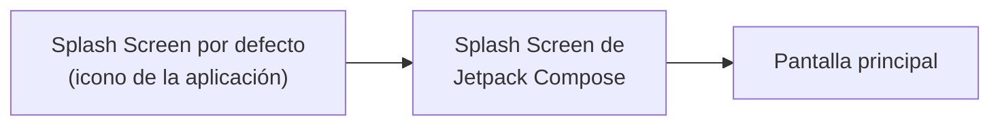

<ExportPDF />

# 2. Diseño adaptativo, Splash Screen y Onboarding

## 2.1. Diseños adaptativos

Los dispositivos móviles tienen **tamaños y resoluciones de pantalla muy distintos**. Si conoces el tamaño y la orientación de la pantalla, puedes decidir qué componentes mostrar en cada caso.

Un ejemplo clásico son las aplicaciones **maestro-detalle** (*master-detail*): en vertical, la pantalla muestra la lista (maestro) y, al pulsar un elemento, se navega a su detalle; en horizontal o en una tableta, la lista y el detalle se muestran **a la vez**, en dos columnas.

### Clases de tamaño de ventana

La documentación de Jetpack Compose define unas [clases de tamaño de ventana](https://developer.android.com/develop/ui/compose/layouts/adaptive/use-window-size-classes) e indica [cómo organizar los elementos](https://developer.android.com/develop/ui/compose/layouts/adaptive) en cada una:


| Clase de tamaño | Punto de interrupción | Dispositivos habituales |
|:---|:---|:---|
| Ancho compacto | Menos de 600 dp | Casi todos los teléfonos en vertical. |
| Ancho medio | 600 dp o más | Tabletas en vertical; pantallas grandes desplegadas en vertical. |
| Ancho expandido | 840 dp o más | Tabletas en horizontal; pantallas grandes desplegadas en horizontal. |
| Alto compacto | Menos de 480 dp | Casi todos los teléfonos en horizontal. |
| Alto medio | 480 dp o más | Tabletas en horizontal; teléfonos en vertical. |
| Alto expandido | 900 dp o más | Tabletas en vertical. |

Por ejemplo, un **Pixel 6a con API 35** obtiene:

| Orientación | Ancho | Alto |
|:---|:---|:---|
| Vertical | `COMPACT` | `EXPANDED` |
| Horizontal | `EXPANDED` | `COMPACT` |

### Dependencia

::: tabs

== libs.versions.toml

```toml [gradle/libs.versions.toml]
[versions]
# …
adaptiveAndroid = "1.0.0"

[libraries]
# …
androidx-adaptive-android = { group = "androidx.compose.material3.adaptive", name = "adaptive-android", version.ref = "adaptiveAndroid" }
```

== build.gradle.kts (Module: app)

```kotlin [app/build.gradle.kts]
dependencies {
    // …
    implementation(libs.androidx.adaptive.android)
}
```

:::

Recuerda pulsar **Sync Now** tras añadir la dependencia.

### Conocer la clase de tamaño

Con la dependencia añadida, estas instrucciones devuelven las clases de tamaño de la ventana:

```kotlin
val widthSizeClass = currentWindowAdaptiveInfo().windowSizeClass.windowWidthSizeClass
val heightSizeClass = currentWindowAdaptiveInfo().windowSizeClass.windowHeightSizeClass
```

| Ancho | Alto |
|:---|:---|
| `WindowWidthSizeClass.COMPACT` | `WindowHeightSizeClass.COMPACT` |
| `WindowWidthSizeClass.MEDIUM` | `WindowHeightSizeClass.MEDIUM` |
| `WindowWidthSizeClass.EXPANDED` | `WindowHeightSizeClass.EXPANDED` |

::: info-box Versiones más recientes
En las versiones más recientes de la librería adaptativa, `windowWidthSizeClass` y `windowHeightSizeClass` están marcadas como obsoletas en favor de `windowSizeClass.isWidthAtLeastBreakpoint(...)`. Siguen funcionando con la versión indicada.
:::

### Dimensiones y orientación con LocalConfiguration

La clase **`LocalConfiguration`** permite conocer las **dimensiones** de la pantalla en `dp` y su **orientación**:

```kotlin
val widthDp: Int = LocalConfiguration.current.screenWidthDp
val heigthDp: Int = LocalConfiguration.current.screenHeightDp
Log.i("Resolución en Dp ->", "${widthDp}x${heigthDp}")   // 411x840

if (LocalConfiguration.current.orientation == Configuration.ORIENTATION_PORTRAIT) {
    Log.i("Orientación ->", "Vertical")
} else {
    Log.i("Orientación ->", "horizontal")
}
```

### BoxWithConstraints

Otra opción es el layout **`BoxWithConstraints`**, que inyecta automáticamente las dimensiones disponibles:

```kotlin
BoxWithConstraints {
    Log.i("BoxWithConstraints ->", "$maxWidth x $maxHeight")   // 411.42856.dp x 914.2857.dp

    // Contenido del componente
}
```

::: warning-box Dentro o fuera del Scaffold
Si usas `BoxWithConstraints` fuera de un `Scaffold`, obtendrás valores mayores, porque incluye los márgenes y las barras de estado y de navegación.
:::

### Cargar unos componentes u otros

Una vez conoces el tamaño y la orientación, decides qué mostrar:

```kotlin
val orientation = LocalConfiguration.current.orientation
val widthSizeclass = currentWindowAdaptiveInfo().windowSizeClass.windowWidthSizeClass

if (widthSizeclass == WindowWidthSizeClass.EXPANDED || orientation == Configuration.ORIENTATION_LANDSCAPE) {
    // mostrar dos columnas
} else {
    // mostrar una columna
}
```

::: tip-box Practica
Ya puedes hacer la [Actividad 2 — Dragon Ball adaptativo](../ejercicios/#actividad-2).
:::

## 2.2. Splash Screen

Una **Splash Screen** (pantalla de presentación) es la ventana que aparece al lanzar una `Activity` de una aplicación o un juego **cuando su proceso no se está ejecutando**. Por defecto consiste en el **icono de la aplicación sobre un fondo blanco o negro** (según el modo activo).

Es un buen recurso para **evitar la pantalla en blanco** mientras se abre la aplicación y **se cargan los datos necesarios**. En una Splash Screen suelen aparecer:

- Imagen o logotipo.
- Nombre y versión de la aplicación.
- Nombre de quienes la desarrollan.
- Motor utilizado para el desarrollo.

Además, se suelen usar **animaciones**.

Android ofrece una librería para personalizar la Splash Screen por defecto, pero su configuración es bastante compleja y, si la aplicación debe cargar muchos datos, puede no durar lo suficiente. Gracias a Jetpack Compose y a la arquitectura *Single Activity*, se puede crear **una segunda Splash Screen** para cargar los datos. En esta unidad verás las dos técnicas:

- Modificar la Splash Screen **por defecto** (XML).
- Crear una Splash Screen con **Jetpack Compose**.

### Splash Screen por defecto (XML)

A partir de **Android 12**, la Splash Screen por defecto se compone de los siguientes elementos ([documentación](https://developer.android.com/develop/ui/views/launch/splash-screen?hl=es-419)):


1. El **icono de la app**: debe ser vectorial. Puede ser estático o animado; se recomienda que las animaciones no excedan los 1000 ms.
2. El **fondo del icono**: opcional, útil si necesitas más contraste entre el icono y el fondo.
3. Como en los iconos adaptables, **un tercio del primer plano queda enmascarado**.
4. El **fondo de la ventana**: un único color opaco.

El proceso de mostrar la Splash Screen sigue esta secuencia:


| Fase | Qué ocurre |
|:---|:---|
| **Animación de entrada** | Se muestra la Splash Screen. La controla Android y **no se puede personalizar**. |
| **Splash Screen** | Se muestra su contenido; la imagen se anima automáticamente si es un **vectorial animado** (XML) y la versión de Android es 12 o superior. |
| **Animación de salida** | La Splash Screen desaparece. Por defecto la controla el sistema, pero se puede personalizar animando la imagen o la propia pantalla; en ese caso **es obligatorio eliminar la Splash Screen manualmente** al terminar la animación. |

#### Pasos para personalizarla

1. **Sube la API mínima a 31** en `build.gradle.kts (Module: app)` y sincroniza:

   ```kotlin [app/build.gradle.kts]
   android {
       namespace = "com.alextorres.combosplashscreen"
       compileSdk = 35

       defaultConfig {
           applicationId = "com.alextorres.combosplashscreen"
           minSdk = 31
           targetSdk = 34
           versionCode = 1
           versionName = "1.0"
           // …
       }
   }
   ```

2. Si quieres usar una **imagen**, añádela a `res/drawable`. Es preferible un **vectorial**, aunque puedes usar un mapa de bits (PNG o JPG) convertido a WebP. Sus medidas deben ser:

   | Imagen | Tamaño | Zona visible |
   |:---|:---|:---|
   | Sin transparencia | 240 × 240 | Círculo de 160 de diámetro |
   | Con transparencia | 288 × 288 | Círculo de 192 de diámetro |

   Si es un vectorial, las medidas son en `dp`; si es un mapa de bits, en `px`.

3. **Crea el estilo** de la Splash Screen en un nuevo recurso `res/values/splash.xml` (clic derecho sobre `values` → **New → Values Resource File**). El `parent` es el **tema del proyecto**:

   ```xml [res/values/splash.xml]
   <?xml version="1.0" encoding="utf-8"?>
   <resources>
       <style name="Theme.MySplashScreen" parent="Theme.ComboSplashScreen">
           <!-- Color de fondo -->
           <item name="android:windowSplashScreenBackground">#81D4FA</item>
           <!-- Imagen -->
           <item name="android:windowSplashScreenAnimatedIcon">@mipmap/ic_launcher_foreground</item>
       </style>
   </resources>
   ```

4. En el **manifiesto**, indica que la `Activity` usa ese estilo:

   ```xml [AndroidManifest.xml]
   <activity
       android:name=".MainActivity"
       android:exported="true"
       android:label="@string/app_name"
       android:theme="@style/Theme.MySplashScreen">
       <intent-filter>
           <action android:name="android.intent.action.MAIN" />
           <category android:name="android.intent.category.LAUNCHER" />
       </intent-filter>
   </activity>
   ```

Con esto la Splash Screen funciona en todos los dispositivos. A partir de Android 12 (API 31) también puedes usar **imágenes animadas** (solo vectoriales XML), una **imagen secundaria** (*branding image*) en la parte inferior y una **animación de salida**. Tienes todos los detalles y ejemplos en la [documentación](https://developer.android.com/develop/ui/views/launch/splash-screen?hl=es-419).

### Splash Screen con Jetpack Compose

Con la navegación de Jetpack Compose es muy sencillo crear una Splash Screen:

1. Crea una **ruta** para la Splash Screen en `Routes.kt`.
2. Indica en el **`backStack`** (`Navigation.kt`) que la Splash Screen es la **primera pantalla**.
3. Añade un **`entry`** para la Splash Screen en el `NavDisplay`.
4. Crea un componente `@Composable` con el **contenido** de la Splash Screen.
5. En ese componente, indica que **al terminar de cargar se navegue** a la siguiente pantalla.

::: tabs

== Routes.kt

```kotlin
sealed class Routes : NavKey {
    // Splash Screen
    @Serializable
    data object SplashScreen : Routes()
    // …
}
```

== Navigation.kt

```kotlin
val backStack = rememberNavBackStack(Routes.SplashScreen)

NavDisplay(
    backStack = backStack,
    entryProvider = entryProvider {
        entry<Routes.SplashScreen> {
            SplashScreen(
                navigateToOnboarding = {
                    backStack.clear()
                    backStack.add(Routes.OnboardingHome)
                }
            )
        }
        // …
    }
)
```

== SplashScreen.kt

```kotlin
@Composable
fun SplashScreen(
    navigateToOnboarding: () -> Unit,
) {
    LaunchedEffect(key1 = true) {
        delay(timeMillis = 5000)
        navigateToOnboarding()
    }

    Column(
        modifier = Modifier.fillMaxSize(),
        verticalArrangement = Arrangement.Center,
        horizontalAlignment = Alignment.CenterHorizontally,
    ) {
        Image(
            painter = painterResource(id = R.drawable.logo),
            contentDescription = "Logo",
            modifier = Modifier
                .size(200.dp)
                .clip(CircleShape)
                .border(width = 8.dp, color = Color.Gray, shape = CircleShape)
        )
        Text(
            text = "Bienvenido",
            fontSize = 30.sp,
            fontWeight = FontWeight.Bold
        )
    }
}
```

:::

- **`LaunchedEffect`** (lo estudiarás en la UP06) ejecuta ese código en **segundo plano** (en una corrutina).
- En una aplicación real, en lugar de `delay(5000)` irían las instrucciones que **obtienen la información** que necesita la aplicación (de una base de datos o de una API).
- Fíjate en que, al navegar, se **vacía la pila**: así el usuario no puede volver a la Splash Screen con el botón atrás.

Con esta técnica el flujo de apertura queda así:



Así aprovechas la facilidad de diseño de Jetpack Compose. Además, puedes empezar la Splash Screen de Compose con el **icono de la aplicación en el centro** para dar continuidad entre las dos. Con las animaciones de la [página 4](./04-animaciones) puedes diseñar Splash Screens muy vistosas.

## 2.3. Animaciones entre pantallas

`NavDisplay` ofrece unos parámetros para indicar cómo se **animan las pantallas al navegar**:

| Parámetro | Cuándo se aplica |
|:---|:---|
| `transitionSpec` | Al navegar **hacia delante** (una pantalla entra en la cima de la pila). |
| `popTransitionSpec` | Al navegar **hacia atrás** (la pantalla de la cima sale de la pila). |
| `predictivePopTransitionSpec` | Como la anterior, pero al volver con el **gesto** de atrás. |

Al definirlos en el `NavDisplay`, las animaciones se aplican a **todas las pantallas**. En el ejemplo se extraen a funciones para no repetir código:

::: tabs

== NavDisplay

```kotlin
NavDisplay(
    backStack = backStack,
    entryProvider = entryProvider { /* … */ },
    transitionSpec = {
        enterTransitions()
    },
    popTransitionSpec = {
        exitTransitions()
    },
    predictivePopTransitionSpec = {
        exitTransitions()
    }
)
```

== Funciones de animación

```kotlin
fun enterTransitions() =
    slideInHorizontally(
        initialOffsetX = { it },
        animationSpec = tween(400)
    ) togetherWith slideOutHorizontally(
        targetOffsetX = { -it },
        animationSpec = tween(400)
    )

fun exitTransitions() =
    slideInHorizontally(
        initialOffsetX = { -it },
        animationSpec = tween(400)
    ) togetherWith slideOutHorizontally(
        targetOffsetX = { it },
        animationSpec = tween(400)
    )
```

:::

Para configurar la animación de **una pantalla concreta**, se añade en su `entry` mediante `metadata`:

```kotlin
entry<Routes.Author>(
    metadata =
        NavDisplay.transitionSpec {
            slideInVertically(
                initialOffsetY = { it },        // entra desde abajo
                animationSpec = tween(400)
            ) togetherWith ExitTransition.KeepUntilTransitionsFinished
        } +
        NavDisplay.popTransitionSpec {
            EnterTransition.None togetherWith slideOutVertically(
                targetOffsetY = { it },         // sale hacia abajo
                animationSpec = tween(400)
            )
        } +
        NavDisplay.predictivePopTransitionSpec {
            EnterTransition.None togetherWith slideOutVertically(
                targetOffsetY = { it },
                animationSpec = tween(400)
            )
        }
) {
    AuthorScreen(
        navigateBack = {
            backStack.removeLastOrNull()
        }
    )
}
```

En los ejemplos se usan `slideInHorizontally`, `slideOutHorizontally`, `slideInVertically` y `slideOutVertically`. En la [documentación](https://developer.android.com/develop/ui/compose/animation/composables-modifiers#enter-exit-transition) tienes todos los tipos; consúltala, porque cada animación puede tener sus propios parámetros.

::: tip-box Practica
Ya puedes hacer la [Actividad 3 — Estudio de la Splash Screen](../ejercicios/#actividad-3).
:::

## 2.4. Onboarding

Se conoce como **Onboarding** («subir a bordo») a la serie de pantallas que se muestran a modo de **presentación de la aplicación**:

- Explica al usuario, en pocos pasos, **cómo funciona** la aplicación.
- Permite que el usuario **introduzca datos**. Por ejemplo, Telegram o WhatsApp piden el número de teléfono, su confirmación y el nombre de usuario.

Hay muchas técnicas: en unas es obligatorio pasar por todos los pasos y en otras se permite **saltarlos** e ir directamente a la aplicación.

::: info-box ¿Cuándo se muestra?
- Solo la **primera vez** que se abre la aplicación tras instalarla.
- Si recoge datos necesarios, se seguirá mostrando **mientras no se hayan recogido**.
- En aplicaciones con cambio de usuario, se mostrará cada vez que el usuario **cierre sesión** (*logout*).
:::

En internet encontrarás muchas técnicas y buenas prácticas para diseñar un buen Onboarding: pantallas con ilustración, título y texto breve, indicador de página y botones *Saltar* / *Siguiente* / *Empezar*.

Con Jetpack Compose y la navegación puedes elegir entre:

- Crear **tantas pantallas** como pasos tenga el Onboarding y controlar la navegación entre ellas.
- Crear **una única pantalla** con un **`HorizontalPager`**. Si se recogen datos obligatorios, controla el paso entre páginas con botones.

Al acabar el Onboarding se navega a una pantalla que ya tenga funcionalidad de la aplicación (vaciando la pila).

El ejemplo de la unidad implementa un Onboarding con una pantalla donde se **introducen los datos** y otra donde se **muestran**. Para que solo aparezca la primera vez (o tras un *logout*), hay que **guardar esa información**; en la [UP07 — Persistencia](../../up07/) verás cómo guardar preferencias de la aplicación.

::: tip-box Practica
Ya puedes hacer la [Actividad 4 — Navegando](../ejercicios/#actividad-4).
:::
