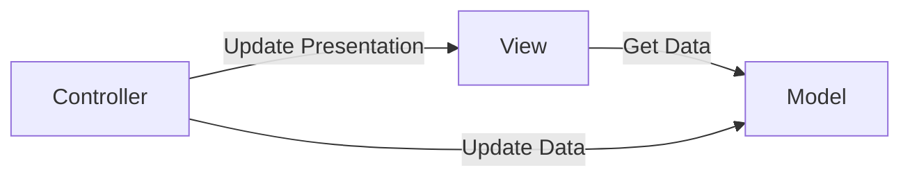
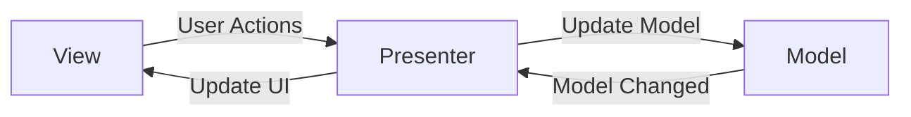
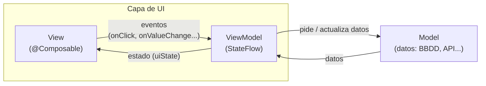
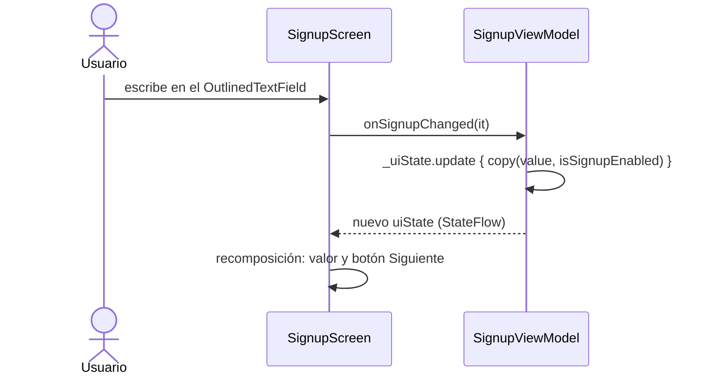

<ExportPDF />

# 2. Arquitecturas Android, MVVM y StateFlow

## 2.1. Arquitecturas Android

En el desarrollo de cualquier tipo de aplicación es muy importante elegir bien la **arquitectura**. Lo más habitual es usar una arquitectura que **separe la lógica de la aplicación (programación) de las vistas (interfaz gráfica)**:

- Las **vistas** se encargan únicamente de mostrar la interfaz (pintar).
- La **lógica** se separa en otros componentes, donde se programa el funcionamiento de la aplicación.

Con esta separación es mucho más fácil trabajar después con la lógica, hacer cambios, escribir tests…

Las arquitecturas más utilizadas en Android han sido:

- **MVC** – *Model View Controller*
- **MVP** – *Model View Presenter*
- **MVVM** – *Model View ViewModel*

## 2.2. MVC (Model View Controller)

La arquitectura MVC organiza la aplicación en tres partes bien diferenciadas y **débilmente acopladas**:

- **Modelo**: trabaja con los datos (accesos a la base de datos).
- **Vista**: organiza los datos obtenidos por el modelo y con ellos genera la interfaz gráfica que se muestra al usuario.
- **Controlador**: gestiona las peticiones a la aplicación.

Un **acoplamiento débil** significa que los cambios en una parte del código afectan muy poco al resto. En el mejor de los casos, con MVC un cambio en una parte no afecta en nada a las demás.



Existen muchas implementaciones de MVC. En la que se ha usado en Android, **el controlador y la vista están definidos en el mismo lugar** (la `Activity` o el `Fragment`) y **ambos dependen del modelo**.

Una de las desventajas es que **toda la responsabilidad recae en el mismo elemento** (`Activity` o `Fragment`), lo que puede provocar problemas de fluidez si se ejecuta una tarea pesada en el hilo principal.

## 2.3. MVP (Model View Presenter)

MVP organiza mejor los archivos y cambia la forma en la que trabajan los tres componentes:

- **Modelo**: igual que en MVC.
- **Vista**: la `Activity` o el `Fragment` se considera parte de la vista y ya no se sitúa junto al controlador.
- **Presenter**: similar al controlador de MVC, pero es el encargado de **orquestar todo lo que sucede**. Suele haber un *Presenter* por cada `Activity` o `Fragment`.



## 2.4. MVVM (Model View ViewModel)

- **Model**: igual que en MVC.
- **View**: responsable de la visualización de los datos.
- **ViewModel**:
  - Envuelve al modelo y prepara los datos para que la vista los consulte.
  - Proporciona enlaces a la vista para pasar eventos al modelo.
  - Los cambios en él se reflejan automáticamente en la vista y viceversa.

El **ViewModel** es el encargado de:

- Responder a las interacciones del usuario en la vista.
- Acceder a los datos (modelo).
- Informar a la vista de los cambios en los datos.

Además, **el ViewModel sobrevive a los cambios de configuración** de la interfaz, como los cambios de orientación: la información que almacena se mantiene en todo momento.



::: accent-box primary 📖 Flujo de datos unidireccional
En MVVM con Compose **el estado baja** del ViewModel a la vista y **los eventos suben** de la vista al ViewModel. La vista nunca modifica el estado directamente: llama a un método del ViewModel, que actualiza el estado, y la vista se recompone con el nuevo valor.
:::

## 2.5. StateFlow

Aunque el ViewModel puede trabajar con estados tal y como se han usado hasta ahora (`mutableStateOf`), se recomienda usar la clase **`StateFlow`**, porque está más optimizada para los ciclos de vida de la `Activity` con Jetpack Compose.

`StateFlow` es un **flujo de datos caliente** (*hot flow*):

- Es un estado que, cada vez que cambia, **notifica automáticamente a sus suscriptores**.
- Permite **suscribirse** a él para consultar el estado del flujo.
- Los nuevos suscriptores **reciben directamente el último estado**.

Al vivir en el ViewModel, **permite cambios de orientación del dispositivo sin pérdida de los datos observados**.

Android (a través de la librería de corrutinas de Kotlin) proporciona las clases **`StateFlow`** y **`MutableStateFlow`** para almacenar cualquier tipo de dato y poder observar sus cambios.

## 2.6. ViewModel y StateFlow: ¿dónde vive cada estado?

A partir de ahora se seguirá este criterio (recuerda que al hablar de *estado* nos referimos a una variable de estado):

- Si un componente necesita un estado que **no se necesita desde ningún otro componente**, no afecta a otros componentes ni se necesita al navegar, el propio componente contendrá el estado (**stateful**).
- Si un componente necesita un estado que **se necesita en otros componentes y/u otras pantallas**, que **debe sobrevivir** a la recomposición o que **representa estado de negocio** (no solo de UI), el componente no contendrá el estado (**stateless**) y se suscribirá a un `StateFlow` que le ofrezca el **ViewModel**.

## 2.7. Caso práctico: Registro

Esta aplicación contiene **una sola pantalla con su propio ViewModel**. La pantalla permite registrarse con el número de móvil o con el correo electrónico; el botón *Siguiente* solo se activa cuando el dato introducido es válido.


### Creación del proyecto: dependencias

En el archivo **`libs.versions.toml`**, en el apartado `[versions]`:

```toml
# Navegación
navigation3Core = "1.0.0"
# Serialización
kotlinxSerializationCore = "1.10.0"
# Plugin Serialización
kotlinSerializationPlugin = "2.3.10"
# Coil
coil = "3.3.0"
```

En el apartado `[libraries]`:

```toml
# ViewModel
androidx-lifecycle-viewmodel-ktx = { group = "androidx.lifecycle", name = "lifecycle-viewmodel-ktx", version.ref = "lifecycleRuntimeKtx" }
androidx-lifecycle-viewmodel-compose = { group = "androidx.lifecycle", name = "lifecycle-viewmodel-compose", version.ref="lifecycleRuntimeKtx"}
# Navegación
androidx-navigation3-runtime = { group = "androidx.navigation3", name = "navigation3-runtime", version.ref = "navigation3Core" }
androidx-navigation3-ui = { group = "androidx.navigation3", name = "navigation3-ui", version.ref = "navigation3Core" }
# Serialización
kotlinx-serialization-core = {group = "org.jetbrains.kotlinx", name = "kotlinx-serialization-core", version.ref = "kotlinxSerializationCore" }
# Icons
androidx-material-icons-core = { group = "androidx.compose.material", name = "material-icons-core" }
androidx-material-icons-extended = { group = "androidx.compose.material", name="material-icons-extended" }
# Coil
coil-compose = { group = "io.coil-kt.coil3", name = "coil-compose", version.ref = "coil" }
coil-network-okhttp = { group = "io.coil-kt.coil3", name = "coil-network-okhttp", version.ref = "coil" }
```

En el apartado `[plugins]`:

```toml
# Serialization
jetbrains-kotlin-serialization = { id = "org.jetbrains.kotlin.plugin.serialization", version.ref = "kotlinSerializationPlugin" }
```

::: tip-box Actualizar versiones
Tras sincronizar es recomendable actualizar las versiones del resto de librerías incluidas por defecto. Android Studio marca subrayadas las librerías no actualizadas: sitúate sobre la versión, pulsa **Alt + Enter** y en la ayuda contextual selecciona la versión nueva. Una vez actualizadas, vuelve a sincronizar.
:::

En el archivo **`build.gradle.kts` (Module: app)**, dentro de `plugins`:

```kotlin
// Serialization
alias(libs.plugins.jetbrains.kotlin.serialization)
```

Y dentro de `dependencies`:

```kotlin
// ViewModel
implementation(libs.androidx.lifecycle.viewmodel.ktx)
implementation(libs.androidx.lifecycle.viewmodel.compose)
// Navigation 3
implementation(libs.androidx.navigation3.runtime)
implementation(libs.androidx.navigation3.ui)
// Serialization
implementation(libs.kotlinx.serialization.core)
// Icons
implementation(libs.androidx.material.icons.core)
implementation(libs.androidx.material.icons.extended)
// Coil
implementation(libs.coil.compose)
implementation(libs.coil.network.okhttp)
```

Recuerda pulsar **Sync Now** tras estos cambios.

::: info-box Información
Para la app de Registro bastaría con las dependencias de ViewModel e iconos; se añaden todas porque son las mismas que se usarán en el siguiente caso práctico (navegación, serialización y carga de imágenes con Coil).
:::

### El ViewModel

Se crea el archivo **`SignupViewModel.kt`**, que contendrá una `class` para el ViewModel con todos los `StateFlow` (estados) necesarios y los **métodos para modificar dichos `StateFlow`**.

Al final del archivo que define un ViewModel se crean tantas `data class` como `StateFlow` se necesiten. En el ejemplo se han agrupado todos los estados en una única `data class`:

```kotlin
// Estado de la vista: UiState
data class SignupUiState(
    val value: String = "",
    val isPhoneMode: Boolean = true,
    val isSignupEnabled: Boolean = false,
)
```

En un ViewModel, el `StateFlow` se declara así:

```kotlin
// Estado de la pantalla
private val _uiState = MutableStateFlow(SignupUiState())
val uiState: StateFlow<SignupUiState> = _uiState
```

- La primera variable es **privada** y **mutable**: solo es accesible desde el propio ViewModel.
- La segunda variable es **pública** e **inmutable**: expone el mismo flujo, pero como `StateFlow` de solo lectura. Es la que se usa desde fuera del ViewModel.

De esta manera **la única forma de actualizar el estado es desde el propio ViewModel**, por lo que se necesitan métodos que ejecuten las instrucciones necesarias cuando un estado deba cambiar.

::: tip-box asStateFlow()
Una forma equivalente y muy habitual de exponer el flujo es `val uiState: StateFlow<SignupUiState> = _uiState.asStateFlow()`, que impide incluso hacer un *cast* a `MutableStateFlow` desde fuera.
:::

El ViewModel completo:

```kotlin
class SignupViewModel : ViewModel() {
    // Estado de la pantalla
    private val _uiState = MutableStateFlow(SignupUiState())
    val uiState: StateFlow<SignupUiState> = _uiState

    fun onChangeMode() {
        _uiState.update { state ->
            state.copy(
                isPhoneMode = !state.isPhoneMode,
                value = ""
            )
        }
    }

    fun onSignupChanged(value: String) {
        _uiState.update { state ->
            val isEnabled = if (state.isPhoneMode) {
                value.length == 9
            } else {
                Patterns.EMAIL_ADDRESS.matcher(value).matches()
            }
            state.copy(
                value = value,
                isSignupEnabled = isEnabled,
            )
        }
    }
}
```

::: warning-box IMPORTANTE: copiar el objeto de estado
Cuando un estado es una variable de un tipo simple (`Boolean`, `String`, `Int`, `Float`, `Char`), Jetpack Compose reconoce el cambio y recompone directamente.

Si el estado es un **objeto**, Compose solo recompone cuando **cambia la instancia** del objeto. Por eso, para que la notificación funcione, al usar objetos se debe crear **una copia** con `copy(...)` dentro de `update { }`, como en `onChangeMode()` y `onSignupChanged()`. Nunca se modifica el objeto existente.
:::

::: details Mejora propuesta
Al cambiar de modo, `onChangeMode()` vacía `value` pero no reinicia `isSignupEnabled`. Si el botón estaba activo, seguirá activo con el campo vacío. Basta con añadir `isSignupEnabled = false` dentro del `copy(...)`.
:::

### La pantalla: SignupScreen.kt

```kotlin
@OptIn(ExperimentalMaterial3Api::class)
@Composable
fun SignupScreen(
    signupViewModel: SignupViewModel = viewModel(),
    navigateToBack: () -> Unit,
) {
    val uiState by signupViewModel.uiState.collectAsStateWithLifecycle()

    val title: String
    val label: String
    val changeModeTitle: String
    when(uiState.isPhoneMode) {
        true -> {
            title = "¿Cuál es tu número de móvil?"
            label = "Número de teléfono"
            changeModeTitle = "Regístrate con tu correo electrónico"
        }
        false -> {
            title = "¿Cuál es tu correo electrónico?"
            label = "Correo electrónico"
            changeModeTitle = "Regístrate con tu número de móvil"
        }
    }

    Scaffold(
        topBar = {
            TopAppBar(
                title = {},
                navigationIcon = {
                    IconButton(onClick = navigateToBack) {
                        Icon(
                            imageVector = Icons.AutoMirrored.Filled.ArrowBack,
                            contentDescription = "Volver"
                        )
                    }
                }
            )
        }
    ) { paddingValues ->
        Column(
            modifier = Modifier
                .background(Color.White)
                .padding(paddingValues)
                .padding(horizontal = 24.dp)
                .fillMaxSize(),
            horizontalAlignment = Alignment.CenterHorizontally
        ) {

            Text(
                text = title,
                fontSize = 20.sp
            )

            OutlinedTextField(
                modifier = Modifier.fillMaxWidth(),
                shape = RoundedCornerShape(30),
                value = uiState.value,
                onValueChange = { signupViewModel.onSignupChanged(it) },
                label = { Text(text = label) },
            )

            Button(
                onClick = {  },
                enabled = uiState.isSignupEnabled,
                modifier = Modifier
                    .fillMaxWidth()
                    .padding(vertical = 4.dp),
            ) {
                Text(text = "Siguiente")
            }

            OutlinedButton(
                onClick = {
                    signupViewModel.onChangeMode()
                },
                modifier = Modifier.fillMaxWidth()
            ) {
                Text(text = changeModeTitle)
            }

            Spacer(modifier = Modifier.weight(1f))

            TextButton(
                onClick = {  }
            ) {
                Text(text = "Buscar mi cuenta")
            }
        }
    }
}
```

### Pantalla y ViewModel: cómo se conectan

1. **Crear el ViewModel.** Como la pantalla tiene su propio ViewModel, este se crea por defecto en la declaración de la función con `viewModel()`:

```kotlin
fun SignupScreen(
    signupViewModel: SignupViewModel = viewModel(),
    navigateToBack: () -> Unit,
) {
```

2. **Suscribirse al `StateFlow`.** Con el ViewModel disponible, la pantalla se suscribe a su `StateFlow`. `collectAsStateWithLifecycle()` convierte el flujo en un estado de Compose y deja de recolectar cuando la pantalla no está visible:

```kotlin
val uiState by signupViewModel.uiState.collectAsStateWithLifecycle()
```

3. **Leer estados y llamar a métodos.** Una vez hecha la suscripción, se usa `uiState` para **leer** los estados (`uiState.isPhoneMode`, `uiState.value`, `uiState.isSignupEnabled`) y los métodos del ViewModel para **actualizarlos** (`signupViewModel.onSignupChanged(it)`, `signupViewModel.onChangeMode()`).


