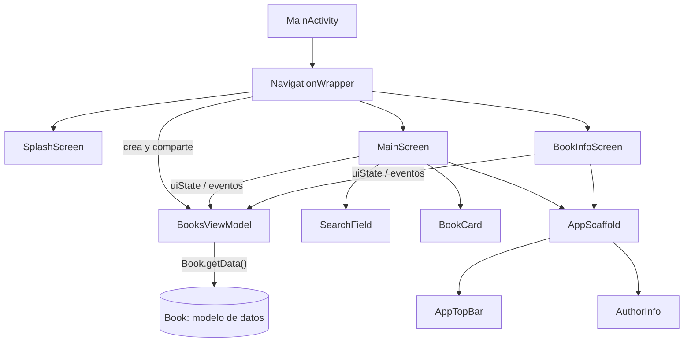

<ExportPDF />

# 3. Caso práctico: lista de libros con ViewModel compartido

## 3.1. Descripción de la aplicación

Esta aplicación tiene **dos pantallas que comparten el mismo ViewModel**:

- **Pantalla principal**: lista de libros con un campo de búsqueda, un icono de papelera para eliminar cada libro, una estrella para los favoritos y un botón para recargar la lista. En la parte inferior aparece la información del autor de la app.
- **Pantalla de información**: muestra título, autor, año, portada (cargada desde Internet) y argumento del libro seleccionado, con un botón para **marcar o quitar como favorito**.


## 3.2. Creación del proyecto

Las dependencias son **las mismas que en el caso práctico de Registro** (ViewModel, Navigation 3, serialización, iconos y Coil). Consulta el apartado [Creación del proyecto: dependencias](./02-mvvm-stateflow#creacion-del-proyecto-dependencias) de la página anterior y añádelas a `libs.versions.toml` y a `build.gradle.kts` (Module: app). Recuerda pulsar **Sync Now** y actualizar las versiones de las librerías por defecto.

## 3.3. Estructura de archivos

Para una buena organización:

- Se crea un paquete **`data`** donde se incluirá todo lo necesario para el acceso a los datos (de momento, el paquete `model`).
- Dentro del paquete **`ui`** se crean paquetes para:
  - **Navegación** (`navigation`): depende de la UI.
  - **Layout** (`layout`): componentes comunes a varias pantallas.
  - **Funcionalidades**: un paquete por funcionalidad (`books` y `splash`).
- Si una funcionalidad tiene varias pantallas, se crea además un paquete por pantalla (`bookinfo` y `main` dentro de `books`).

```text
booksviewmodel
├── data
│   └── model
│       └── Book.kt
├── ui
│   ├── books
│   │   ├── bookinfo
│   │   │   └── BookInfoScreen.kt
│   │   ├── main
│   │   │   ├── BookCard.kt
│   │   │   ├── MainScreen.kt
│   │   │   └── SearchField.kt
│   │   └── BooksViewModel.kt
│   ├── layout
│   │   ├── AppScaffold.kt
│   │   ├── AppTopBar.kt
│   │   └── AuthorInfo.kt
│   ├── navigation
│   │   ├── NavigationWrapper.kt
│   │   └── Routes.kt
│   ├── splash
│   │   └── SplashScreen.kt
│   └── theme
└── MainActivity.kt
```

El esquema de dependencias entre las piezas queda así:



## 3.4. Modelo de datos: Book.kt

En el paquete `model` se crea el archivo **`Book.kt`**, que contiene una `data class` que define el objeto `Book` y un método estático (en el `companion object`) para obtener todos los libros. En el futuro estos datos se obtendrían de una base de datos, directamente o mediante una API.

```kotlin
data class Book(
    val title: String = "",
    val author: String = "",
    val year: Int = 0,
    var plot: String = "",
    var coverURL: String = "",
    var favorite: Boolean = false,
    var visible: Boolean = true,
) {
    companion object {
        fun getData(): List<Book> = listOf(
            Book(
                title = "Ready Player One",
                author = "Ernest Cline",
                year = 2011,
                plot = "En un futuro cercano marcado por la crisis energética y social, la mayor parte de la humanidad pasa su tiempo en OASIS, un vasto universo de realidad virtual. Wade Watts, un joven sin recursos, participa en una competición global para encontrar un huevo de Pascua oculto por el creador de OASIS. El ganador heredará una inmensa fortuna y el control del sistema, lo que desata una carrera llena de referencias culturales, peligros reales y decisiones morales.",
                coverURL = "https://alextz78.github.io/ReadyPlayerOne.jpg"
            ),
            Book(
                title = "El juego de Ender",
                author = "Orson Scott Card",
                year = 1985,
                plot = "Ender Wiggin es reclutado desde niño para entrenarse en una escuela militar es...", // texto recortado en el original
                coverURL = "https://alextz78.github.io/ElJuegoDeEnder.jpg"
            ),
            Book(
                title = "El señor de los anillos",
                author = "J. R. R. Tolkien",
                year = 1954,
                plot = "En la Tierra Media, el hobbit Frodo Bolsón recibe la misión de destruir el Ani...", // texto recortado en el original
                // ...
            ),
            // ... resto de libros: La historia interminable, Juego de tronos, Dune,
            //     Harry Potter y la piedra filosofal, El Hobbit, Los juegos del hambre...
        )
    }
}
```

## 3.5. El ViewModel: BooksViewModel.kt

En el paquete `books` se crea el archivo **`BooksViewModel.kt`**, con la clase del ViewModel, sus `StateFlow` y los métodos que los modifican. Al final del archivo se definen las `data class` de estado; en este caso todos los estados se agrupan en una:

```kotlin
// Estado de la vista: UiState
data class BooksUiState(
    val isLoading: Boolean = false,
    val bookList: List<Book> = emptyList(),
    val selectedBook: Book? = null,
    val searchString: String = "",
)
```

El `StateFlow` se declara igual que en el caso de Registro: una variable **privada y mutable** que solo se modifica desde el ViewModel y otra **pública e inmutable** que se expone a las pantallas.

```kotlin
// Estado de la pantalla
private val _uiState = MutableStateFlow(BooksUiState())
val uiState: StateFlow<BooksUiState> = _uiState
```

### Código completo del ViewModel

```kotlin
class BooksViewModel : ViewModel() {
    // Estado de la pantalla
    private val _uiState = MutableStateFlow(BooksUiState())
    val uiState: StateFlow<BooksUiState> = _uiState

    // Cuando se instancia un objeto BooksViewModel, tras llamar al constructor se ejecuta el bloque init
    init {
        loadBookList()
    }

    // Función para reutilizar este código en una futura mejora en la que se podrá recargar la lista
    fun loadBookList() {
        // Corrutina: coroutineScope
        //  Se simula la petición a la BBDD
        viewModelScope.launch(Dispatchers.IO) {
            _uiState.update { state ->
                state.copy(isLoading = true)
            }
            // Simulación del tiempo de espera de carga de datos desde una API
            delay(1200)

            _uiState.update { state ->
                state.copy(
                    bookList = Book.getData(),
                    isLoading = false,
                    selectedBook = null,
                    searchString = "",
                )
            }
        }
    }

    // Cuando se pulsa un libro se actualiza el estado para guardar ese libro como seleccionado
    fun onBookClicked(book: Book) {
        _uiState.update { state ->
            state.copy(
                selectedBook = book,
            )
        }
    }

    // Cuando se marca/desmarca un libro como favorito se actualiza el estado con dicha información
    fun onToggleFavorite(book: Book) {
        _uiState.update { state ->
            val updatedBookList = state.bookList.map {
                if (it.title == book.title) it.copy(favorite = !it.favorite) else it
            }
            val updatedBook = updatedBookList.first { it.title == book.title }
            state.copy(
                bookList = updatedBookList,
                selectedBook = updatedBook
            )
        }
    }

    // Cuando se elimina un libro se actualiza el estado
    fun deleteBook(book: Book) {
        // Con API o BBDD se mandaría el id y se borraría de la BBDD
        // A continuación se actualiza la lista de libros eliminando el libro
        _uiState.update { state ->
            state.copy(
                bookList = state.bookList.filter {
                    it != book
                },
                selectedBook = null,
            )
        }
    }

    // Cuando cambia el contenido del TextField de búsqueda se actualiza el estado
    fun onSearchStringChanged(searchString: String) {
        _uiState.update { state ->
            // Al no tener acceso a la base de datos para filtrar los resultados de la búsqueda
            //  los libros que no coincidan se marcan como no visibles
            val filteredBookList = state.bookList.map {
                it.copy(visible = it.title.contains(searchString, ignoreCase = true))
            }
            state.copy(
                bookList = filteredBookList,
                searchString = searchString,
            )
        }
    }

    // Al borrar el contenido del TextField se actualiza el estado
    fun onDeleteSearch() {
        _uiState.update { state ->
            // Al no tener acceso a la base de datos para restaurar la lista de libros
            //  se marcan todos los libros como visibles
            val filteredBookList = state.bookList.map {
                it.copy(visible = true)
            }
            state.copy(
                bookList = filteredBookList,
                searchString = ""
            )
        }
    }
}
```

Puntos clave:

- **`init`** lanza la carga de datos en cuanto se crea el ViewModel.
- **`viewModelScope`** es el ámbito de corrutinas propio del ViewModel: las corrutinas lanzadas en él se cancelan automáticamente cuando el ViewModel se destruye. Aquí se lanza con `Dispatchers.IO` porque simula un acceso a datos externos.
- `MutableStateFlow.update { }` es **seguro entre hilos**, por eso se puede llamar desde la corrutina de `Dispatchers.IO`.
- Mientras `isLoading` es `true`, la pantalla principal muestra un indicador de carga.
- `onToggleFavorite` recorre la lista con `map` y **crea una copia** del libro modificado (`it.copy(favorite = ...)`) en lugar de cambiar el objeto existente.

::: warning-box IMPORTANTE: copiar los objetos
Igual que en el caso de Registro: con tipos simples Compose detecta el cambio directamente, pero con objetos **solo recompone cuando cambia la instancia**. Por eso siempre se usa `state.copy(...)` (y `it.copy(...)` para los libros de la lista) en lugar de modificar los objetos.
:::

## 3.6. Navegación y rutas

En el paquete `navigation` se crean los archivos **`Routes.kt`** y **`NavigationWrapper.kt`**, donde se define la navegación de la aplicación (con Navigation 3).

::: tabs
== Routes.kt

```kotlin
sealed class Routes : NavKey {
    // Splash Screen
    @Serializable
    data object Splash: Routes()

    // Pantalla inicial
    @Serializable
    data object Main: Routes()

    // Pantalla con la información de un libro
    // No es necesario enviar nada porque las dos
    // pantallas compartirán ViewModel
    @Serializable
    data object BookInfo: Routes()
}
```

== NavigationWrapper.kt

```kotlin
@Composable
fun NavigationWrapper() {
    val backStack = rememberNavBackStack(Routes.Splash)

    val booksViewModel: BooksViewModel = viewModel()

    NavDisplay(
        backStack = backStack,
        entryProvider = entryProvider {
            entry<Routes.Splash> {
                SplashScreen(
                    navigateToMain = {
                        backStack.add(Routes.Main)
                    }
                )
            }

            entry<Routes.Main> {
                MainScreen(
                    booksViewModel = booksViewModel,
                    navigateToBookInfo = {
                        backStack.add(Routes.BookInfo)
                    }
                )
            }

            entry<Routes.BookInfo> {
                BookInfoScreen(
                    booksViewModel = booksViewModel,
                    onNavigateToBack = {
                        backStack.removeLastOrNull()
                    }
                )
            }
        },
    )
}
```

:::

En este ejemplo **las dos pantallas comparten ViewModel**, porque en su `StateFlow` se almacena toda la lista de libros con sus modificaciones (favoritos y eliminados) y también el libro seleccionado en la primera pantalla, que es el que se muestra en la segunda.

Al compartir ViewModel, este se crea **una sola vez en el componente de navegación** y se pasa a cada pantalla como parámetro:

```kotlin
val booksViewModel: BooksViewModel = viewModel()
```

```kotlin
entry<Routes.Main> {
    MainScreen(
        booksViewModel = booksViewModel,
        navigateToBookInfo = {
            backStack.add(Routes.BookInfo)
        }
    )
}
```

## 3.7. MainActivity

En `MainActivity.kt` se aplica el tema de la app y se le pasa el componente `NavigationWrapper`, que será el encargado de gestionar el contenido de la `Activity`:

```kotlin
class MainActivity : ComponentActivity() {
    override fun onCreate(savedInstanceState: Bundle?) {
        super.onCreate(savedInstanceState)
        enableEdgeToEdge()
        setContent {
            BooksViewModelTheme {
                NavigationWrapper()
            }
        }
    }
}
```

## 3.8. Layout: componentes comunes

El paquete `layout` contiene los componentes que comparten todas las pantallas: la barra superior, la información del autor y un `Scaffold` personalizado que los une.

### AppTopBar.kt

```kotlin
@OptIn(ExperimentalMaterial3Api::class)
@Composable
fun AppTopBar(
    showNavigateToBack: Boolean = false,
    onNavigateToBack: () -> Unit,
) {
    CenterAlignedTopAppBar(
        title = {
            Row(
                verticalAlignment = Alignment.CenterVertically
            ) {
                Icon(imageVector = Icons.Default.LocalLibrary, contentDescription = null)
                Spacer(modifier = Modifier.width(16.dp))
                Text(
                    text = "Lista de libros",
                    fontSize = 30.sp
                )
                Spacer(modifier = Modifier.width(16.dp))
                Icon(imageVector = Icons.Default.LocalLibrary, contentDescription = null)

            }
        },
        navigationIcon = {
            if (showNavigateToBack) {
                IconButton(
                    onClick = onNavigateToBack
                ) {
                    Icon(
                        imageVector = Icons.AutoMirrored.Filled.ArrowBack,
                        contentDescription = "Go back",
                        tint = MaterialTheme.colorScheme.onPrimary
                    )
                }
            }
        },
        colors = TopAppBarDefaults.topAppBarColors(
            containerColor = MaterialTheme.colorScheme.primary,
            titleContentColor = MaterialTheme.colorScheme.onPrimary
        )
    )
}
```

### AuthorInfo.kt

```kotlin
@Composable
fun AuthorInfo(modifier: Modifier = Modifier) {
    Row(
        modifier = Modifier
            .fillMaxWidth()
            .then(modifier),
        horizontalArrangement = Arrangement.spacedBy(
            20.dp,
            Alignment.CenterHorizontally
        ),
        verticalAlignment = Alignment.CenterVertically,
    ) {
        Image(
            painter = painterResource(id = R.drawable.rick),
            contentDescription = "Foto de Rick",
            modifier = Modifier
                .clip(CircleShape)
                .border(
                    width = 3.dp,
                    color = MaterialTheme.colorScheme.onPrimary,
                    shape = CircleShape
                )
                .width(60.dp)
        )
        Text(
            text = "Rick Sanchez",
            fontSize = 35.sp,
            fontWeight = FontWeight.Bold,
            color = MaterialTheme.colorScheme.onPrimary
        )
    }
}
```

### AppScaffold.kt: Scaffold personalizado

`AppScaffold` recibe el contenido de cada pantalla como lambda `@Composable` y lo coloca entre la barra superior y la información del autor:

```kotlin
@Composable
fun AppScaffold(
    showNavigateToBack: Boolean = false,
    onNavigateToBack: () -> Unit = {},
    content: @Composable () -> Unit
) {
    Scaffold(
        topBar = {
            AppTopBar(
                showNavigateToBack = showNavigateToBack,
                onNavigateToBack = onNavigateToBack,
            )
        },
    ) { paddingValues ->
        Column(
            modifier = Modifier
                .background(MaterialTheme.colorScheme.primary)
                .padding(paddingValues)
                .padding(horizontal = 12.dp)
                .fillMaxWidth()
        ) {
            Box(
                modifier = Modifier
                    .weight(9f)
                    .fillMaxWidth()
            ) {
                content()
            }
            HorizontalDivider(
                modifier = Modifier
                    .background(MaterialTheme.colorScheme.onPrimary)
                    .height(2.dp)
            )
            AuthorInfo(modifier = Modifier.padding(vertical = 6.dp))
        }
    }
}
```

## 3.9. Pantalla principal

### SearchField.kt

```kotlin
@Composable
fun SearchField(
    searchString: String,
    onSearchStringChange: (String) -> Unit,
    onDeleteSearch: () -> Unit
) {

    TextField(
        value = searchString,
        onValueChange = { onSearchStringChange(it) },
        label = { Text(text = "Buscar libro") },
        trailingIcon = {
            if (searchString.isNotBlank()) {
                IconButton(onClick = onDeleteSearch) {
                    Icon(
                        imageVector = Icons.Default.Cancel,
                        contentDescription = "Cancelar búsqueda"
                    )
                }
            }
        },
        modifier = Modifier.fillMaxWidth()
    )
}
```

### BookCard.kt: tarjeta de un libro

```kotlin
@Composable
fun BookCard(
    book: Book,
    onBookClick: (Book) -> Unit,
    onBookDelete: (Book) -> Unit,
) {
    OutlinedCard(
        modifier = Modifier
            .padding(vertical = 4.dp, horizontal = 8.dp)
            .clickable { onBookClick(book) }
    ) {
        ListItem(
            headlineContent = { Text(text = book.title) },
            supportingContent = { Text(text = book.author) },
            leadingContent = {
                if (book.favorite) {
                    Icon(
                        imageVector = Icons.Default.Star,
                        contentDescription = "book",
                        tint = Color(0xFFFB8C00)
                    )
                }
            },
            trailingContent = {
                Icon(
                    imageVector = Icons.Default.Delete,
                    contentDescription = "book",
                    modifier = Modifier.clickable { onBookDelete(book) }
                )
            }
        )
    }
}
```

`SearchField` y `BookCard` son componentes **stateless**: no guardan ningún estado, reciben los datos y avisan de los eventos mediante lambdas. Es la pantalla la que los conecta con el ViewModel.

### Pantallas y ViewModel

Todas las pantallas reciben el ViewModel, así que cada una debe **suscribirse** a su `StateFlow`:

```kotlin
val uiState by booksViewModel.uiState.collectAsStateWithLifecycle()
```

Una vez hecha la suscripción, se usa `uiState` para acceder a los estados y los métodos del ViewModel para actualizarlos:

```kotlin
SearchField(
    searchString = uiState.searchString,
    onSearchStringChange = { booksViewModel.onSearchStringChanged(it) },
    onDeleteSearch = { booksViewModel.onDeleteSearch() }
)
```

```kotlin
BookCard(
    book = book,
    onBookClick = {
        // Al clicar sobre el libro se actualiza en el ViewModel el libro seleccionado
        booksViewModel.onBookClicked(it)
        // Se ejecuta el código recibido en la lambda: navegar a la ventana de información
        navigateToBookInfo()
    },
    onBookDelete = {
        // Al clicar sobre el icono de papelera se elimina el libro de la lista del ViewModel
        booksViewModel.deleteBook(book)
    }
)
```

### MainScreen.kt

```kotlin
@Composable
fun MainScreen(
    booksViewModel: BooksViewModel,
    navigateToBookInfo: () -> Unit = {},
) {
    val uiState by booksViewModel.uiState.collectAsStateWithLifecycle()

    AppScaffold {
        Column(modifier = Modifier.fillMaxWidth()) {
            SearchField(
                searchString = uiState.searchString,
                onSearchStringChange = { booksViewModel.onSearchStringChanged(it) },
                onDeleteSearch = { booksViewModel.onDeleteSearch() }
            )

            HorizontalDivider(
                modifier = Modifier.padding(vertical = 4.dp),
                thickness = 2.dp,
                color = MaterialTheme.colorScheme.onPrimary,
            )

            LazyColumn(
                modifier = Modifier
                    .fillMaxWidth()
                    .background(MaterialTheme.colorScheme.primary)
                    .padding(vertical = 8.dp)
                    .weight(1f)
            ) {
                items(uiState.bookList) { book ->
                    if (book.visible) {
                        BookCard(
                            book = book,
                            onBookClick = {
                                // Al clicar sobre el libro se actualiza en el ViewModel el libro seleccionado
                                booksViewModel.onBookClicked(it)
                                // Se ejecuta el código recibido en la lambda: navegar a la ventana de información
                                navigateToBookInfo()
                            },
                            onBookDelete = {
                                // Al clicar sobre el icono de papelera se elimina el libro de la lista del ViewModel
                                booksViewModel.deleteBook(book)
                            }
                        )
                    }
                }
            }

            // Cuando la variable del ViewModel es true es que se está cargando la lista de libros
            //  en ese caso se mostrará un texto y una línea de progreso indicando la carga
            if (uiState.isLoading) {
                Column(
                    verticalArrangement = Arrangement.Center,
                    horizontalAlignment = Alignment.CenterHorizontally,
                    modifier = Modifier
                        .fillMaxSize()
                        .background(MaterialTheme.colorScheme.primary)
                ) {
                    Text(
                        text = "Loading...",
                        fontSize = 40.sp,
                        fontWeight = FontWeight.Bold,
                        color = MaterialTheme.colorScheme.onPrimary
                    )
                    Spacer(modifier = Modifier.height(20.dp))
                    CircularProgressIndicator(
                        color = MaterialTheme.colorScheme.onPrimary
                    )
                }
            } else {
                Row(
                    horizontalArrangement = Arrangement.End,
                    verticalAlignment = Alignment.CenterVertically,
                    modifier = Modifier.fillMaxWidth()
                ) {
                    Text(
                        text = "Recarga la lista de libros",
                        color = MaterialTheme.colorScheme.onPrimary
                    )
                    IconButton(onClick = {
                        booksViewModel.loadBookList()
                    }) {
                        Icon(
                            imageVector = Icons.Default.Refresh,
                            contentDescription = "Recargar",
                            tint = MaterialTheme.colorScheme.onPrimary
                        )
                    }
                }
            }
        }
    }
}
```

## 3.10. Pantalla de información: BookInfoScreen.kt

La pantalla de información lee el libro seleccionado del `uiState`. Si no hay ninguno (`null`), sale de la función con el operador Elvis (`?: return`). El botón de favorito llama a `onToggleFavorite`, y la portada se carga desde su URL con `AsyncImage` de **Coil**.

```kotlin
@Composable
fun BookInfoScreen(
    booksViewModel: BooksViewModel,
    onNavigateToBack: () -> Unit = {},
) {
    val uiState by booksViewModel.uiState.collectAsStateWithLifecycle()

    val book = uiState.selectedBook ?: return

    AppScaffold(
        showNavigateToBack = true,
        onNavigateToBack = onNavigateToBack) {
        Column(
            modifier = Modifier
                .fillMaxWidth()
                .background(MaterialTheme.colorScheme.primaryContainer)
                .padding(8.dp)
        ) {
            Row(
                horizontalArrangement = Arrangement.Start,
                verticalAlignment = Alignment.CenterVertically,
                modifier = Modifier.fillMaxWidth()
            ) {
                Icon(
                    imageVector = Icons.AutoMirrored.Filled.MenuBook,
                    contentDescription = "book"
                )

                Spacer(modifier = Modifier.width(20.dp))

                Text(
                    text = book.title,
                    fontSize = 30.sp,
                    lineHeight = 38.sp,
                    modifier = Modifier.weight(1f)
                )
            }

            Spacer(modifier = Modifier.height(10.dp))

            Row(
                verticalAlignment = Alignment.Top
            ) {
                Column(
                    modifier = Modifier.weight(1f)
                ) {
                    Text(
                        text = book.author,
                        fontSize = 16.sp
                    )
                    Spacer(modifier = Modifier.height(10.dp))
                    Text(text = "Año: ${book.year}")

                    TextButton(
                        onClick = { booksViewModel.onToggleFavorite(book) }
                    ) {
                        Text(text = if (book.favorite) "Quitar favorito" else "Marcar favorito")
                    }
                }
                if (book.favorite) {
                    Spacer(modifier = Modifier.height(4.dp))
                    Icon(
                        imageVector = Icons.Default.Star,
                        contentDescription = "favorite",
                        tint = Color(0xFFFB8C00),
                        modifier = Modifier.size(48.dp)
                    )
                }
            }

            Row(
                modifier = Modifier
                    .background(MaterialTheme.colorScheme.tertiary)
                    .fillMaxWidth()
                    .padding(8.dp)
                    .verticalScroll(rememberScrollState())
            ) {
                AsyncImage(
                    model = book.coverURL,
                    contentDescription = book.title,
                    modifier = Modifier.weight(2f),
                )
                Text(
                    text = book.plot,
                    color = MaterialTheme.colorScheme.onTertiary,
                    modifier = Modifier
                        .weight(4f)
                        .padding(start = 10.dp)
                )
            }
        }
    }
}
```

::: info-box Permiso de Internet
`AsyncImage` descarga la portada de Internet, así que la app necesita el permiso `android.permission.INTERNET` declarado en el `AndroidManifest.xml`.
:::

## 3.11. ViewModel y StateFlow: notas finales

Cuando la aplicación tiene varias pantallas, para decidir cuántos ViewModel crear:

- Si **cada pantalla tiene su propio conjunto de datos o lógica de negocio**, se define **un ViewModel por pantalla**.
- Si **todas las pantallas comparten** un conjunto de datos o lógica de negocio, se define **un único ViewModel** para todas.
- Si algunos datos o lógica son **propios de una pantalla y otros son comunes**, se definen **dos ViewModel**: uno propio de la pantalla y otro compartido entre todas.
- Según las características de la aplicación, se pueden dar diferentes combinaciones de los puntos anteriores.

Si un ViewModel se comparte entre varias pantallas, se debe crear **en un lugar común**, como el componente donde se define la navegación (como se ha hecho en `NavigationWrapper`).

## 3.12. Cancelar corrutinas

Con `rememberCoroutineScope` y con `viewModelScope` se pueden ejecutar corrutinas mediante `launch`. Cuando la corrutina se lanza desde un elemento `@Composable`, se cancela automáticamente si la pantalla deja de verse.

La función `launch` **devuelve un `Job`**, el identificador de la corrutina, que se puede guardar para cancelarla después si es necesario. Esto es muy útil con las corrutinas que se ejecutan dentro de un ViewModel (por ejemplo, un bucle que debe detenerse cuando el usuario pulsa un botón):

```kotlin
var workoutCoroutine: Job = Job()
```

```kotlin
workoutCoroutine = viewModelScope.launch {
    // Acciones a realizar en la corrutina ...
}
```

```kotlin
workoutCoroutine.cancel()
```

::: tip-box Job nulable
También es habitual declararlo como `private var workoutCoroutine: Job? = null` y cancelarlo con `workoutCoroutine?.cancel()`, evitando crear un `Job` vacío solo para inicializar la variable.
:::
