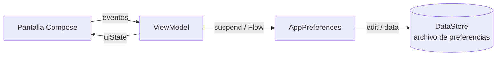

<ExportPDF />

# 1. Persistencia con DataStore

## 1.1. Introducción a la persistencia

La **persistencia de datos** es un asunto muy importante en las aplicaciones móviles.

El primer motivo aparece cuando cambia la orientación o la configuración del dispositivo: la actividad se recrea y, si no se hace nada, los datos en memoria se pierden. Este problema ya se ha resuelto con el uso de **estados** y de **ViewModel**.

Pero hay muchas otras situaciones en las que interesa guardar los datos para usarlos más adelante, incluso después de cerrar la aplicación o de reiniciar el dispositivo. En esta unidad se estudian tres herramientas para implementar la persistencia de datos en local:

- **DataStore**: conjuntos de datos pequeños o simples (preferencias).
- **Room**: bases de datos relacionales SQLite.
- **File System**: archivos en el almacenamiento interno o externo.

## 1.2. DataStore

**DataStore** permite almacenar en el dispositivo conjuntos de datos pequeños o simples. Los datos se guardan en el **almacenamiento interno específico de la aplicación**, por lo que ninguna otra aplicación podrá acceder a ellos.

DataStore tiene dos implementaciones:

| Implementación | Qué almacena |
| --- | --- |
| **Preferences DataStore** | Pares clave-valor. |
| **Proto DataStore** | Objetos (instancias de clases) tipados. |

Debido a la complejidad de desarrollo de Proto DataStore, en el módulo solo se estudiará **Preferences DataStore**.

Con DataStore se pueden crear archivos para guardar información, generalmente **preferencias** del usuario o de la aplicación. Su gran ventaja es que es el propio sistema el que se encarga de toda la gestión de los archivos de preferencias.

::: warning-box Reglas para usar DataStore
- Mantener **solo una instancia** de DataStore abierta sobre el mismo archivo.
- El tipo genérico de DataStore debe ser **inmutable** (al declarar el objeto).
- No mezclar nunca `SingleProcessDataStore` y `MultiProcessDataStore` para el mismo archivo de preferencias.
:::

## 1.3. Preferences DataStore

### Organización del código

Lo más habitual es que las preferencias se guarden y recuperen desde el **ViewModel**, para poder mantener correctamente las variables de estado.

Para mantener una buena estructura de archivos en el proyecto se recomienda crear un paquete llamado `preferences` donde se ubicará la clase que implementa toda la lógica de guardado y recuperación de los valores de las preferencias. Esta clase se usará desde el ViewModel que necesite esos datos.



### Corrutinas y Flows

Preferences DataStore usa **corrutinas** y **Flows** (flujos de datos) para guardar y recuperar los datos de manera asíncrona y coherente.

Como los datos se guardan en el almacenamiento interno del dispositivo, lo más recomendable al lanzar la corrutina es usar el conjunto de hilos destinado a entrada/salida: `Dispatchers.IO`.

Un **Flow** permite emitir varios valores de manera secuencial, que se recogen desde una corrutina; por ejemplo, se puede usar para recibir actualizaciones en vivo desde una base de datos. Un Flow es similar a un `Iterator`, pero usa funciones de suspensión para producir y consumir los valores. En Preferences DataStore se usa un Flow para **recuperar** los datos.

Además, Preferences DataStore necesita el **contexto de la aplicación** para acceder al almacenamiento del dispositivo y gestionar los archivos de preferencias.

### Tipos de datos admitidos

Preferences DataStore almacena pares clave-valor cuyos valores son de tipos básicos:

| Tipo | Función para crear la clave |
| --- | --- |
| `Int` | `intPreferencesKey()` |
| `Double` | `doublePreferencesKey()` |
| `String` | `stringPreferencesKey()` |
| `Boolean` | `booleanPreferencesKey()` |
| `Float` | `floatPreferencesKey()` |
| `Long` | `longPreferencesKey()` |
| `Set<String>` | `stringSetPreferencesKey()` |

Además de los tipos básicos, se ofrece la posibilidad de almacenar un conjunto de cadenas (`Set<String>`).

## 1.4. Ejemplo: guardar nombre de usuario y modo oscuro

Para mostrar el funcionamiento se estudiará una aplicación como la de la imagen, en la que se puede almacenar el **nombre de usuario** y el **modo** (claro/oscuro) de la aplicación.


### Dependencias

Para usar Preferences DataStore hay que añadir la siguiente dependencia.

En el archivo **`libs.versions.toml`**, apartado `[versions]`:

```toml
datastorePreferences = "1.2.1"
```

En el apartado `[libraries]`:

```toml
androidx-datastore = { group = "androidx.datastore", name = "datastore-preferences", version.ref="datastorePreferences" }
```

En el archivo **`build.gradle.kts (Module: app)`**, dentro de `dependencies`:

```kotlin
implementation(libs.androidx.datastore)
```

Como se va a usar ViewModel, también habrá que añadir su dependencia y, si fueran necesarias, otras (Navigation, LiveData, Serialization…).

::: tip-box Consejo
Recuerda pulsar **Sync Now** tras estos cambios.
:::

### Clase `AppPreferences`

Esta clase concentra toda la lógica para guardar y recuperar preferencias. Fíjate en los puntos clave:

- La propiedad de extensión `Context.dataStore` se declara **a nivel de archivo** con el delegado `by preferencesDataStore(...)`, lo que la convierte en un *singleton*: solo habrá una instancia.
- Las **claves** se definen en un `companion object` con las funciones `xxxPreferencesKey()`.
- Para **guardar** se usa `dataStore.edit { }` dentro de una función `suspend`.
- Para **recuperar** se usa `dataStore.data.map { }`, que devuelve un `Flow`.

```kotlin
// Variable DataStore a la que se le pasa el nombre del archivo de preferencias: "preferences"
// Al declararla con el delegado "by" la variable será un singleton: solo habrá una instancia
private val Context.dataStore: DataStore<Preferences> by preferencesDataStore(name = "preferences")

class AppPreferences(private val context: Context) {
    // Variables estáticas para representar las claves de los valores a guardar
    companion object {
        val USERNAME = stringPreferencesKey("USERNAME")
        val DARK_MODE = booleanPreferencesKey("DARK_MODE")
    }

    // Función que recibe un String y lo almacena en el archivo de preferencias declarado en el DataStore
    //  El guardado debe realizarse en segundo plano (corrutina) por ello se añade la palabra "suspend"
    //  que obliga a que la llamada a esta función se realice desde una corrutina
    suspend fun saveUsername(name: String) {
        context.dataStore.edit { preferences ->
            //          clave  -  valor
            preferences[USERNAME] = name
        }
    }

    suspend fun saveDarkMode(darkMode: Boolean) {
        context.dataStore.edit { preferences ->
            preferences[DARK_MODE] = darkMode
        }
    }

    // Función que recupera un String del archivo de preferencias declarado en el DataStore
    //  Esta función devuelve un Flow<String>
    fun loadUsername() = context.dataStore.data.map { preferences ->
        preferences[USERNAME] ?: ""
    }

    fun loadDarkMode() = context.dataStore.data.map { preferences ->
        preferences[DARK_MODE] ?: false
    }

    // Función para eliminar una preferencia del DataStore
    suspend fun deleteUsername() {
        context.dataStore.edit { preferences ->
            preferences.remove(USERNAME)
        }
    }

    // Función para eliminar todas las preferencias del DataStore
    suspend fun clearPreferences() {
        context.dataStore.edit { preferences ->
            preferences.clear()
        }
    }
}
```

::: info-box Valores por defecto
Si una clave no existe todavía en el archivo, `preferences[CLAVE]` devuelve `null`. Por eso se usa el operador Elvis (`?:`) para devolver un valor por defecto (`""` o `false`).
:::

### ViewModel que usa `AppPreferences`

El ViewModel crea la instancia de `AppPreferences` con el **contexto de la aplicación** (`applicationContext`) y expone el estado de la vista con un `StateFlow`. Todas las llamadas a `AppPreferences` se hacen dentro de `viewModelScope.launch` y, para el acceso al almacenamiento, con `withContext(Dispatchers.IO)`.

Para leer un valor una sola vez (por ejemplo, al arrancar), se usa `.first()` sobre el `Flow`, que devuelve el primer valor emitido.

```kotlin
class PreferencesViewModel(context: Context) : ViewModel() {
    // Declaración del objeto para guardar/almacenar preferencias
    private val preferences = AppPreferences(context.applicationContext)

    private val _uiState = MutableStateFlow(UiState())
    val uiState: StateFlow<UiState> = _uiState

    // Al instanciar el ViewModel se cargan todas las preferencias almacenadas
    init {
        loadUsername()
        loadDarkMode()
    }

    fun onUsernameChanged(name: String) {
        _uiState.update { state ->
            state.copy(username = name)
        }
    }

    fun onDarkModeChanged(darkMode: Boolean) {
        viewModelScope.launch {
            _uiState.update { state ->
                state.copy(darkMode = darkMode)
            }
            withContext(Dispatchers.IO) {
                preferences.saveDarkMode(darkMode)
            }
        }
    }

    // Función que guarda el nombre en las preferencias
    fun saveUsername(username: String) {
        viewModelScope.launch {
            withContext(Dispatchers.IO) {
                preferences.saveUsername(username)
            }
            _uiState.update { state ->
                state.copy(
                    savedUsername = username,
                    username = ""
                )
            }
        }
    }

    // Función que recupera el username de las preferencias y actualiza el estado
    fun loadUsername() {
        viewModelScope.launch {
            val username = withContext(Dispatchers.IO) {
                preferences.loadUsername().first()
            }
            _uiState.update { state ->
                state.copy(savedUsername = username)
            }
        }
    }

    // Función que recupera darkMode de las preferencias y actualiza el estado
    fun loadDarkMode() {
        viewModelScope.launch {
            val darkMode = withContext(Dispatchers.IO) {
                preferences.loadDarkMode().first()
            }
            _uiState.update { state ->
                state.copy(darkMode = darkMode)
            }
        }
    }

    // Función para eliminar el username de las preferencias y actualizar el estado
    fun deleteSavedUsername() {
        viewModelScope.launch {
            withContext(Dispatchers.IO) {
                preferences.deleteUsername()
            }
            _uiState.update { state ->
                state.copy(savedUsername = "")
            }
        }
    }

    // Función que elimina todas las preferencias y actualiza el estado
    fun deletePreferences() {
        viewModelScope.launch {
            withContext(Dispatchers.IO) {
                preferences.clearPreferences()
            }
            _uiState.update { state ->
                state.copy(
                    savedUsername = "",
                    darkMode = false
                )
            }
        }
    }
}

// Estado de la vista: UiState
data class UiState(
    val savedUsername: String = "",
    val username: String = "",
    val darkMode: Boolean = false,
)
```

::: tip-box ¿Por qué dos variables de nombre?
`username` es lo que el usuario está escribiendo en el `TextField` (estado de la UI), mientras que `savedUsername` es el valor realmente guardado en DataStore. Al guardar, se copia `username` en `savedUsername` y se vacía el campo de texto.
:::

### Uso desde la pantalla

En las pantallas que necesiten acceder a las preferencias se usa el ViewModel creado para ello y se llaman sus métodos. El estado se observa con `collectAsStateWithLifecycle()`:

```kotlin
val preferencesViewModel = remember { PreferencesViewModel(applicationContext) }
val uiState by preferencesViewModel.uiState.collectAsStateWithLifecycle()

Scaffold(modifier = Modifier.fillMaxSize()) { innerPadding ->
    Column(
        modifier = Modifier.padding(innerPadding).padding(16.dp)
    ) {

        Text(text = "Nombre de usuario guardado: ${uiState.savedUsername.ifEmpty { "ninguno" }}")

        TextField(
            value = uiState.username,
            onValueChange = { preferencesViewModel.onUsernameChanged(it) },
            label = { Text(text = "Nombre de usuario") },
        )

        Row(
            modifier = Modifier.fillMaxWidth(),
            horizontalArrangement = Arrangement.SpaceAround
        ) {
            Button(
                onClick = { preferencesViewModel.saveUsername(uiState.username) }
            ) {
                Text(text = "Guardar username")
            }

            Button(
                onClick = { preferencesViewModel.deleteSavedUsername() }
            ) {
                Text(text = "Borrar username")
            }
        }

        Spacer(modifier = Modifier.height(20.dp))

        Row(verticalAlignment = Alignment.CenterVertically) {
            Switch(
                checked = uiState.darkMode,
                onCheckedChange = { preferencesViewModel.onDarkModeChanged(it) }
            )
            Spacer(modifier = Modifier.width(16.dp))
            Text(text = "Modo oscuro")
        }

        Spacer(modifier = Modifier.height(20.dp))

        Row(
            modifier = Modifier.fillMaxWidth(),
            horizontalArrangement = Arrangement.Center
        ) {
            Button(
                onClick = { preferencesViewModel.deletePreferences() }
            ) {
                Text(text = "Borrar todas las preferencias")
            }
        }
    }
}
```

::: warning-box ViewModel con parámetros
En este ejemplo el ViewModel recibe un `Context` en su constructor, por eso se crea con `remember { PreferencesViewModel(applicationContext) }` (por ejemplo, desde `MainActivity`). Si se quiere obtener con `viewModel()` y que sobreviva a los cambios de configuración, una alternativa es extender `AndroidViewModel(application)`, como se hace en el caso de estudio de Room.
:::

## 1.5. Guardar datos complejos

Si se quieren guardar datos más complejos, como **objetos**, lo correcto sería usar Proto DataStore. Como su implementación es compleja, se puede sustituir por la siguiente técnica: **en la clase que almacena las preferencias se deconstruye el objeto al guardarlo y se vuelve a construir al recuperarlo**.

Clase que modela el objeto a guardar:

```kotlin
class UserPreferences(
    val username: String,
    val darkMode: Boolean
)
```

Métodos en la clase de preferencias (`AppPreferences`):

```kotlin
suspend fun saveUserPreferences(userPreferences: UserPreferences) {
    context.dataStore.edit { preferences ->
        preferences[USERNAME] = userPreferences.username
        preferences[DARK_MODE] = userPreferences.darkMode
    }
}

fun loadUserPreferences() = context.dataStore.data.map { preferences ->
    UserPreferences(
        username = preferences[USERNAME] ?: "",
        darkMode = preferences[DARK_MODE] ?: false,
    )
}
```

Métodos en el ViewModel:

```kotlin
fun saveUserPreferences(username: String, darkMode: Boolean) {
    viewModelScope.launch(Dispatchers.IO) {
        preferences.saveUserPreferences(UserPreferences(username = username, darkMode = darkMode))
    }
    _uiState.update { state ->
        state.copy(
            savedUsername = username,
            username = ""
        )
    }
}

fun loadUserPreferences(){
    viewModelScope.launch {
        val userPreferences = withContext(Dispatchers.IO) {
            preferences.loadUserPreferences().first()
        }
        _uiState.update { state ->
            state.copy(
                savedUsername = userPreferences.username,
                username = "",
                darkMode = userPreferences.darkMode
            )
        }
    }
}
```

Observa que `viewModelScope.launch(Dispatchers.IO) { ... }` es una forma abreviada de lanzar directamente la corrutina en el *dispatcher* de entrada/salida, equivalente a usar `withContext(Dispatchers.IO)` dentro de un `launch`.

::: tip-box Practica
Ya puedes hacer la [Actividad 1 — Onboarding con usuario](../ejercicios/#actividad-1).
:::
