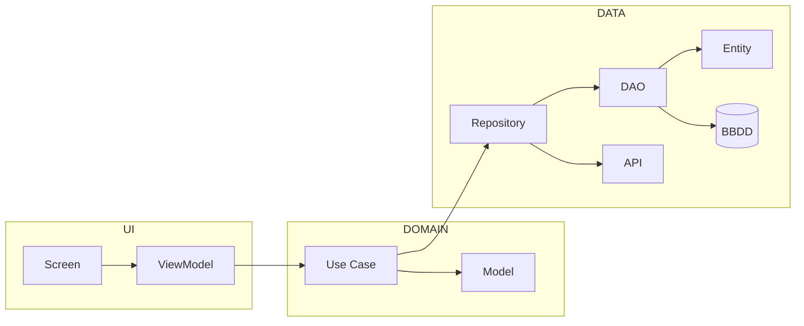

<ExportPDF />

# 2. Room: entidades, DAO y base de datos

## 2.1. Bases de datos en el dispositivo

Cuando se necesita almacenar datos más complejos que unas pocas preferencias, lo habitual es usar una **base de datos**. Algunos ejemplos de aplicaciones que usan una base de datos local en el dispositivo:

- **Contactos**: datos personales y de contacto de personas.
- **Reloj**: alarmas.
- **Google Maps**: lista de búsquedas recientes.
- …

Android ofrece **SQLite**, que permite crear una base de datos relacional local para la aplicación. SQLite es un Sistema Gestor de Bases de Datos (SGBD) muy específico y de tamaño mucho menor que otros SGBD como MySQL.

Otra opción es usar una **base de datos externa**. En ese caso, desde Android se desaconsejan las conexiones directas a la base de datos: se debe desarrollar una **API** que permita realizar operaciones sobre la base de datos mediante diferentes peticiones.

En este apartado se estudia el uso de SQLite en Android a través de Room.

## 2.2. Room

**Room** es una librería de Android que aporta una capa de abstracción para conectarse y acceder a una base de datos local SQLite.

::: accent-box primary 📖 Componentes de Room
- **La base de datos**: punto de acceso principal a los datos persistidos.
- **Las entidades**: representan las tablas de la base de datos.
- **Los DAO** (*Data Access Object*): proporcionan los métodos para las acciones CRUD (*Create, Read, Update, Delete*) sobre la base de datos.
- **Modelo de datos**: como es recomendable separar la representación de las tablas (entidades) de la información que usa la interfaz de usuario, se define una clase para almacenar la información obtenida de cada tabla.
:::

En la [documentación oficial de Room](https://developer.android.com/training/data-storage/room?hl=es-419) se puede encontrar más información.

## 2.3. Caso de estudio: gestor de tareas

Para aprender a usar Room se va a desarrollar, como caso de estudio, una aplicación para **gestionar tareas**:

- Se podrán **agregar** tareas.
- Por cada tarea habrá un **CheckBox** para indicar si se ha realizado o no.
- Si se hace una **pulsación larga** sobre una tarea aparecerá el icono de la papelera y, al pulsarlo, se **eliminará** la tarea de la lista.

La aplicación pone en juego los siguientes conocimientos:

| Elemento | Uso en la aplicación |
| --- | --- |
| Componentes de Jetpack Compose | Construcción de la interfaz. |
| `LazyColumn` | Las tareas se muestran como elementos de una lista. |
| ViewModel | Separa la lógica de negocio de las vistas. |
| Flow | Notifica a las vistas los cambios en el ViewModel. |
| Corrutinas | Los accesos a la base de datos se realizan en segundo plano. |
| Room | Creación y acceso a la base de datos. |

## 2.4. Preparación del proyecto

### Dependencias

Se añaden las dependencias necesarias para Room y las vistas estudiadas anteriormente: ViewModel, Navigation, Serialization, Icons-Core e Icons-Extended. A continuación se muestran las específicas de Room.

Archivo **`libs.versions.toml`**, apartado `[versions]`:

```toml
# Room
room = "2.8.4"
# KSP - API para gestionar las anotaciones usadas con Room
ksp = "2.3.4"
```

::: warning-box Versión de KSP
La [versión de KSP](https://github.com/google/ksp/releases) debe ser compatible con la versión de Kotlin del proyecto.
:::

Apartado `[libraries]`:

```toml
# Room
androidx-room-runtime = { group = "androidx.room", name = "room-runtime", version.ref = "room" }
androidx-room-compiler = { group = "androidx.room", name = "room-compiler", version.ref = "room" }
androidx-room-ktx = { group = "androidx.room", name = "room-ktx", version.ref = "room" }
```

Apartado `[plugins]`:

```toml
# KSP - API para gestionar las anotaciones usadas con Room
ksp = { id = "com.google.devtools.ksp", version.ref = "ksp" }
```

Archivo **`build.gradle.kts (Module: app)`**, dentro de `plugins`:

```kotlin
// KSP
alias(libs.plugins.ksp)
```

Dentro de `dependencies`:

```kotlin
// Room
implementation(libs.androidx.room.runtime)
implementation(libs.androidx.room.ktx)
ksp(libs.androidx.room.compiler)
```

Observa que el compilador de Room no se añade con `implementation` sino con `ksp(...)`: es el procesador de anotaciones que genera el código de acceso a la base de datos a partir de `@Entity`, `@Dao`, `@Database`…

::: tip-box Consejo
Recuerda pulsar **Sync Now** tras estos cambios.
:::

### Arquitectura

En un proyecto real se deberían aplicar los principios de **Clean Architecture**, un patrón de desarrollo de software que separa las responsabilidades para que el código sea más fácil de mantener, escalar y testear. Con Clean Architecture, además del DAO, las entidades y la base de datos, hay que definir **casos de uso**, **repositorios** y **dominios**:



Como estos elementos se ponen en práctica en el módulo de Acceso a Datos (ADA), en esta unidad se implementa una aplicación que solo usa los **elementos mínimos** (DAO, entidades, base de datos y modelo de datos) para simplificar el uso de Room. En el aula virtual se dispone de un proyecto completo que usa casos de uso, repositorios y dominios.

::: info-box En proyectos reales
El acceso a datos suele hacerse a través de **APIs**, dejando las bases de datos locales SQLite solo como respaldo para cuando no hay conexión a Internet.
:::

### Estructura de paquetes

Para organizar el proyecto se crea un paquete **`data`** que contiene, a su vez, paquetes para el **DAO**, la **definición de la base de datos** y la **definición de la tabla** (entidad).

En el paquete **`ui`** se crean paquetes para separar las diferentes pantallas de la aplicación (`splash` y `tasks`); dentro de `tasks` se añade el paquete `model`, donde se encuentra el **modelo de datos**.

```text
taskmanager
├── data
│   ├── dao
│   │   └── TaskDAO
│   ├── database
│   │   └── TasksDatabase
│   └── entities
│       └── TaskEntity
├── ui
│   ├── layout
│   │   ├── AppScaffold.kt
│   │   ├── AppTopBar.kt
│   │   └── AuthorInfo.kt
│   ├── navigation
│   │   ├── NavigationWrapper.kt
│   │   └── Routes
│   ├── splash
│   │   └── SplashScreen.kt
│   ├── tasks
│   │   ├── main
│   │   │   ├── MainScreen.kt
│   │   │   ├── MainViewModel.kt
│   │   │   ├── NewTaskForm.kt
│   │   │   └── TaskItem.kt
│   │   └── model
│   │       └── Task
│   └── theme
│       ├── Color.kt
│       ├── Theme.kt
│       └── Type.kt
└── MainActivity
```

## 2.5. Entidades

El primer componente de Room que se implementa es la **entidad**, que representa los datos de una tabla. La entidad debe ser una **data class**; en el caso de estudio se llama `TaskEntity`:

```kotlin
@Entity(tableName = "tasks")
data class TaskEntity(
    @PrimaryKey(autoGenerate = true)
    val id: Int = 0,
    val name: String,
    val isDone: Boolean = false
)
```

Con las anotaciones de Room (procesadas por el plugin KSP) se indica:

- **`@Entity`**: nombre de la tabla a la que hace referencia la clase.
- **`@PrimaryKey`**: la propiedad siguiente es la clave primaria. Con `autoGenerate = true`, SQLite asigna el valor automáticamente al insertar (por eso el valor por defecto `0`).

Otra opción disponible es **`@ColumnInfo`**, que permite indicar un nombre de columna en la base de datos diferente del de la propiedad:

```kotlin
@Entity(tableName = "users")
data class User (
    @PrimaryKey val id: Int,
    @ColumnInfo(name = "first_name") val firstName: String?,
    @ColumnInfo(name = "last_name") val lastName: String?
)
```

En este ejemplo la propiedad `firstName` de la clase corresponde a la columna `first_name` de la tabla. En la [documentación sobre la definición de entidades](https://developer.android.com/training/data-storage/room/defining-data?hl=es-419) se pueden consultar todas las opciones posibles.

## 2.6. DAO (Data Access Object)

El **DAO** define las acciones sobre la base de datos; esas acciones reciben o devuelven objetos de la clase entidad, cada uno con un registro de la tabla.

- El DAO debe ser una **interfaz**.
- Normalmente se define **un DAO por cada tabla** de la base de datos.
- Dentro del DAO se definen todas las acciones necesarias para el CRUD sobre la tabla asociada, manteniendo así separados los distintos accesos a la base de datos.
- Si se necesita una consulta que afecte a varias tablas, se define en el DAO de la tabla **más importante** de la consulta.

En el caso de estudio la interfaz se llama `TaskDAO`:

```kotlin
@Dao
interface TaskDAO {
    // Devuelve la lista de todas las tareas dentro de un Flow
    @Query("SELECT * FROM tasks ORDER BY name")
    fun getAllTasks(): Flow<List<TaskEntity>>

    // Devuelve true|false dependiendo de si el nombre de la tarea ya existe o no
    @Query("SELECT EXISTS (SELECT 1 FROM tasks WHERE name = :name)")
    suspend fun taskExists(name: String): Boolean

    @Query("SELECT * FROM tasks WHERE id = :id")
    suspend fun getTaskById(id: Long): TaskEntity

    @Insert(onConflict = OnConflictStrategy.REPLACE)
    suspend fun addTask(item: TaskEntity): Long

    @Update
    suspend fun updateTask(item: TaskEntity): Int

    @Delete
    suspend fun deleteTask(item: TaskEntity): Int

    @Query("DELETE FROM tasks")
    suspend fun deleteAllTasks(): Int
}
```

### Valores devueltos y funciones de suspensión

Los métodos pueden devolver valores directamente o bien un **`Flow`**. Al usar un Flow, cada vez que haya un cambio en la tabla el Flow lo detectará y **volverá a emitir el resultado**, de modo que no es necesario repetir la consulta.

Como los métodos acceden a la base de datos (almacenamiento), deben ser **funciones de suspensión** (`suspend`), lo que obliga a llamarlas desde **corrutinas**. En el caso de `getAllTasks` no es necesario marcarla como `suspend`, porque al devolver un `Flow` ya se obliga a recogerla desde una corrutina.

::: info-box Qué devuelven los métodos de escritura
- `@Insert` puede devolver un `Long` con el *rowId* del registro insertado.
- `@Update` y `@Delete` pueden devolver un `Int` con el número de filas afectadas.
:::

### Anotaciones del DAO

| Anotación | Significado |
| --- | --- |
| `@Dao` | La interfaz es un DAO de Room. |
| `@Query` | Consulta personalizada; puede ser de cualquier tipo: `SELECT`, `INSERT`, `UPDATE` o `DELETE`. |
| `@Insert` | Guarda en la tabla un registro con los datos del objeto recibido. |
| `@Update` | Actualiza el registro cuya clave primaria coincide con la del objeto recibido. |
| `@Delete` | Elimina de la tabla el registro que coincide con el objeto recibido. |

En las consultas personalizadas se puede hacer referencia a los parámetros de la función con **`:`**: si en la consulta aparece `:name`, se refiere al parámetro `name: String` de la función.

En `@Insert` se puede indicar la **estrategia en caso de conflicto**. En el caso de estudio se ha decidido que, si ya existe un registro con la misma clave, se **reemplace** (`OnConflictStrategy.REPLACE`).

## 2.7. Base de datos

La base de datos se define con una **clase abstracta que extiende de `RoomDatabase`**. En ella se configura la base de datos y se obtiene el acceso a ella; si la base de datos aún no existe, la crea. En el caso de estudio se declara en la clase abstracta `TasksDatabase`:

```kotlin
//@Database(entities = arrayOf(TaskEntity::class), version = 1)
@Database(entities = [TaskEntity::class], version = 1)
abstract class TasksDatabase : RoomDatabase() {
    abstract fun taskDAO(): TaskDAO

    companion object {  // Patrón Singleton para solo tener una instancia de la BBDD
        @Volatile
        private var INSTANCE: TasksDatabase? = null

        fun getInstance(context: Context): TasksDatabase {
            // el método databaseBuilder devuelve una referencia a la base de datos
            return INSTANCE ?: synchronized(this) {
                val instance = Room.databaseBuilder(
                    context.applicationContext,
                    TasksDatabase::class.java,
                    "task_database"
                ).build()
                INSTANCE = instance
                instance
            }
        }
    }
}
```

Con las anotaciones de Room se indica:

- **`@Database`**: mediante un array se indican todas las entidades asociadas a la base de datos. Se puede usar la notación `[ ]` o la función `arrayOf()` (línea comentada). También se indica el número de **versión** del esquema.
- **`@Volatile`**: evita errores de sincronización entre hilos al usar el patrón *Singleton*; junto con `synchronized` garantiza que solo se cree una instancia aunque varios hilos llamen a la vez a `getInstance`.

Además:

- Por cada DAO se declara un **método abstracto** (`taskDAO()`) que Room implementará.
- La función `getInstance` necesita el **contexto de la aplicación**.
- En la llamada a `Room.databaseBuilder` se indica el **nombre de la base de datos**; en el caso de estudio, `"task_database"`.
