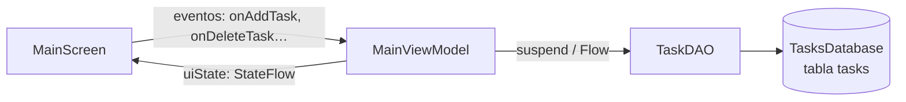

<ExportPDF />

# 3. Room: ViewModel, interfaz y evolución de la base de datos

Con la entidad, el DAO y la base de datos definidos, falta conectar Room con la interfaz. Igual que con DataStore, la pantalla **no accede nunca directamente** a la base de datos: lo hace a través del ViewModel.



## 3.1. Estado de la pantalla y conversiones

En el archivo **`MainViewModel.kt`** se define el ViewModel que mantiene los estados de `MainScreen`. En ese mismo archivo se definen también:

- Una **data class** con todos los estados de la pantalla.
- Una **función de extensión** para convertir un objeto de la entidad en un objeto del modelo de datos.
- Una **función de extensión** para convertir un objeto del modelo de datos en un objeto de la entidad.

```kotlin
// Estado de la vista: UiState
data class UiState(
    val isLoading: Boolean = false,
    val showTaskForm: Boolean = false,
    val showInsertTaskError: Boolean = false,
    val NewTaskClearIcon: Boolean = false,
    val newTaskTextField: String = "",
    val showLoadTasksError: Boolean = false,
    val taskList: List<Task> = emptyList(),
    val showDeleteAlertDialog: Boolean = false,
)

fun TaskEntity.toTask() = Task(
    id = id,
    name = name,
    isDone = isDone
)

fun Task.toEntity() = TaskEntity(
    id = id,
    name = name,
    isDone = isDone
)
```

El **modelo de datos** `Task` (paquete `ui/tasks/model`) tiene las mismas propiedades que la entidad, pero sin anotaciones de Room, de modo que la interfaz no depende de cómo se guardan los datos. Por el uso que se hace de él (`Task(name = taskName)`), su definición es similar a esta:

```kotlin
data class Task(
    val id: Int = 0,
    val name: String,
    val isDone: Boolean = false
)
```

::: tip-box Convención de nombres
Las propiedades de Kotlin se escriben en *lowerCamelCase*. En el original la propiedad `NewTaskClearIcon` empieza por mayúscula; funciona, pero lo recomendable sería llamarla `newTaskClearIcon`. Aquí se mantiene el nombre original para que coincida con el proyecto del aula virtual.
:::

## 3.2. El ViewModel

El ViewModel debe extender de **`AndroidViewModel`**, porque necesita el contexto (`Application`) para acceder a la base de datos.

- Se definen las variables `_uiState` y `uiState` para los estados. Deben ser **Flow** (`MutableStateFlow` / `StateFlow`), como se ha estudiado anteriormente. El estado inicial es `isLoading = true`.
- Mediante la clase `TasksDatabase` se obtiene la instancia de la base de datos y, con ella, una instancia de `TaskDAO`.
- Mediante el DAO se ejecutan las acciones sobre la tabla `tasks`.

```kotlin
class MainViewModel(application: Application) : AndroidViewModel(application) {
    // Estado de la pantalla
    private val _uiState = MutableStateFlow(UiState(isLoading = true))
    val uiState: StateFlow<UiState> = _uiState

    private val taskDAO: TaskDAO = TasksDatabase.getInstance(application).taskDAO()

    init {
        observeTasks()
    }

    private fun observeTasks() {
        viewModelScope.launch {
            delay(3000) // Simula el tiempo de carga
            taskDAO.getAllTasks()
                .catch {
                    _uiState.update { current ->
                        current.copy(
                            isLoading = false,
                            showLoadTasksError = true
                        )
                    }
                }
                .collect { tasks ->
                    _uiState.update { current ->
                        current.copy(
                            isLoading = false,
                            taskList = tasks.map { e -> e.toTask() }
                        )
                    }
                }
        }
    }

    // ... funciones que modifican el estado (ver más abajo)
}
```

### Observar las tareas

Al instanciar el ViewModel, en el bloque `init` se obtiene la lista de tareas de la base de datos llamando a `observeTasks()`. Este método usa el DAO para cargar en `_uiState` la lista completa de tareas, que **se mantendrá actualizada** automáticamente porque `getAllTasks()` devuelve un `Flow`:

- **`catch`**: se ejecuta si se produce algún error en la consulta; se desactiva la carga y se marca el error.
- **`collect`**: si no hay error, se recolecta el Flow y se actualiza la lista en `_uiState` (convirtiendo cada `TaskEntity` en `Task`). Cada vez que la tabla cambie, este bloque se volverá a ejecutar con la lista nueva.

::: info-box Sin recargas manuales
Gracias al Flow, las funciones que insertan, actualizan o borran tareas **no necesitan tocar `taskList`**: basta con modificar la tabla y Room volverá a emitir la lista actualizada.
:::

### Funciones que modifican la base de datos

Además, en el ViewModel hay que definir todas las funciones que modifican el estado de la pantalla. Las que acceden a la base de datos se ejecutan dentro de `viewModelScope.launch`, ya que los métodos del DAO son `suspend`:

```kotlin
fun onAddTask() {
    viewModelScope.launch {
        val taskName = uiState.value.newTaskTextField.trim()

        if (taskName.isBlank()) {
            _uiState.update { it.copy(showInsertTaskError = true) }
            return@launch
        }

        val exists = taskDAO.taskExists(taskName)
        if (exists) {
            _uiState.update { it.copy(showInsertTaskError = true) }
            return@launch
        }

        taskDAO.addTask(Task(name = taskName).toEntity())

        _uiState.update {
            it.copy(
                newTaskTextField = "",
                showInsertTaskError = false,
                showTaskForm = false
            )
        }
    }
}

fun onToggleTaskDone(task: Task) {
    viewModelScope.launch {
        taskDAO.updateTask(
            task.copy(isDone = !task.isDone).toEntity()
        )
    }
}

fun onDeleteTask(task: Task) {
    viewModelScope.launch {
        taskDAO.deleteTask(task.toEntity())
    }
}

fun onDeleteAllTasks() {
    viewModelScope.launch {
        taskDAO.deleteAllTasks()
    }
}
```

`onAddTask` valida antes de insertar: si el nombre está vacío o la tarea ya existe (`taskExists`), muestra el error y sale de la corrutina con `return@launch`.

::: tip-box ¿Y `Dispatchers.IO`?
Room ejecuta internamente las funciones `suspend` del DAO y las consultas que devuelven `Flow` en sus propios hilos de E/S, por lo que se pueden llamar con seguridad desde `viewModelScope.launch` sin bloquear el hilo principal.
:::

### Funciones que solo modifican la interfaz

```kotlin
fun onNewTaskTextFieldChanged(newTask: String) {
    _uiState.update { state ->
        state.copy(
            newTaskTextField = newTask,
            NewTaskClearIcon = newTask.isNotBlank(),
            showInsertTaskError = false
        )
    }
}

fun onToggleTaskForm() {
    _uiState.update { state ->
        state.copy(
            showTaskForm = !state.showTaskForm,
            showInsertTaskError = false
        )
    }
}

fun onToggleAlertDialog() {
    _uiState.update { state ->
        state.copy(
            showDeleteAlertDialog = !state.showDeleteAlertDialog,
        )
    }
}
```

## 3.3. La pantalla `MainScreen`

Por último, en `MainScreen` se observa la variable `uiState` y, conforme varían sus estados y el usuario interactúa con la aplicación, la pantalla se muestra de una manera u otra.

```kotlin
@Composable
fun MainScreen(
    mainViewModel: MainViewModel = viewModel(),
) {
    val uiState by mainViewModel.uiState.collectAsStateWithLifecycle()
    // ...
}
```

El formulario para añadir una tarea solo se muestra cuando `showTaskForm` es `true`; sus valores y eventos se enlazan con el estado y con las funciones del ViewModel:

```kotlin
if (uiState.showTaskForm) {
    NewTaskForm(
        fieldValue = uiState.newTaskTextField,
        onFieldValueChange = { mainViewModel.onNewTaskTextFieldChanged(it) },
        showDeleteIcon = uiState.NewTaskClearIcon,
        onToggleTaskForm = { mainViewModel.onToggleTaskForm() },
        onSaveTask = { mainViewModel.onAddTask() },
        showTaskError = uiState.showInsertTaskError
    )
}
```

La lista de tareas se pinta con una `LazyColumn` a partir de `uiState.taskList`, usando el `id` de cada tarea como clave:

```kotlin
LazyColumn(
    Modifier
        .fillMaxWidth()
        .padding(horizontal = 8.dp)
        .weight(1f)
) {
    items(
        items = uiState.taskList,
        key = {
            it.id
        }
    ) { task ->
        TaskItem(
            task = task,
            onUpdate = { mainViewModel.onToggleTaskDone(task) },
            onDelete = { mainViewModel.onDeleteTask(task) }
        )
    }
}
```

Como la definición de interfaces con Jetpack Compose ya se ha estudiado durante el curso, se omite el resto del código de la interfaz (`NewTaskForm`, `TaskItem`, `AppScaffold`, diálogo de confirmación…) para no hacer más densa la unidad. Toda la definición de la interfaz se encuentra en el proyecto de Android Studio **TaskManager** disponible en el aula virtual.

### Resultado


En las capturas se aprecia el flujo completo: añadir tareas, el error cuando la tarea ya existe («La tarea "Ir al gimnasio" ya existe»), marcar una tarea como realizada, el icono de papelera tras la pulsación larga y el diálogo de confirmación para borrar todas las tareas.

## 3.4. Splash Screen y ViewModel compartido

La **Splash Screen** es el primer destino de la navegación, por lo que lo más habitual es que durante ella se obtengan los datos de la fuente de datos elegida (BBDD, API, Preferences).

Para ello, el ViewModel se define en el componente `NavigationWrapper` y se pasa en la llamada de cada pantalla, como se estudió en el ejemplo «Listado de libros» de la UP06. Así, los datos obtenidos de la base de datos están disponibles en todas las pantallas que comparten ese ViewModel.

```kotlin
@Composable
fun NavigationWrapper() {
    val backStack = rememberNavBackStack(Routes.Splash)

    val booksViewModel: BooksViewModel = viewModel()

    NavDisplay(
        backStack = backStack,
        entryProvider = entryProvider {
            entry<Routes.Splash> {
                SplashScreen(
                    navigateToMain = {
                        backStack.add(Routes.Main)
                    }
                )
            }

            entry<Routes.Main> {
                MainScreen(
                    booksViewModel = booksViewModel,
                    navigateToBookInfo = {
                        backStack.add(Routes.BookInfo)
                    }
                )
            }

            entry<Routes.BookInfo> {
                BookInfoScreen(
                    booksViewModel = booksViewModel,
                    onNavigateToBack = {
                        backStack.removeLastOrNull()
                    }
                )
            }
        },
    )
}
```

## 3.5. Base de datos con más de una tabla

Si la base de datos tiene más entidades/tablas, se deben indicar todas en el array de `@Database`. Al tener más tablas habrá más DAO, y se deben añadir tantos **métodos abstractos** como DAO haya:

```kotlin
@Database(entities = arrayOf(TaskEntity::class, UserEntity::class), version = 1)
abstract class TasksDatabase : RoomDatabase() {
    abstract fun taskDAO(): TaskDAO
    abstract fun userDAO(): UserDAO

    companion object {  // Patrón Singleton
        private var instance: TasksDatabase? = null

        fun getInstance(context: Context): TasksDatabase {
            // el método databaseBuilder devuelve una referencia a la base de datos
            return instance ?: Room.databaseBuilder(context, TasksDatabase::class.java, "tasks-db")
                .build()
                .also {instance = it}
        }
    }
}
```

Este fragmento muestra además una forma más compacta del *Singleton*, usando `also` para guardar la instancia recién construida (aunque sin `@Volatile` ni `synchronized`, por lo que no está protegida frente a accesos simultáneos desde varios hilos).

Para **relacionar entidades** entre sí (uno a uno, uno a muchos, muchos a muchos) se puede consultar la [documentación sobre relaciones en Room](https://developer.android.com/training/data-storage/room/relationships?hl=es-419).

## 3.6. Cambios en la estructura de la base de datos

Si se realizan **cambios en la estructura** de la base de datos (añadir tablas, columnas…), hay que indicarlo **subiendo el número de versión** (entero) en `@Database`.

Por defecto, Room necesita que se indique cómo migrar a la versión nueva. Si al subir de versión no se quiere hacer una migración, se puede rehacer la base de datos desde cero con el método **`fallbackToDestructiveMigration()`**:

```kotlin
@Database(entities = arrayOf(TaskEntity::class), version = 2)
abstract class TasksDatabase : RoomDatabase() {
    abstract fun taskDAO(): TaskDAO

    companion object {  // Patrón Singleton
        private var instance: TasksDatabase? = null

        fun getInstance(context: Context): TasksDatabase {
            // el método databaseBuilder devuelve una referencia a la base de datos
            return instance ?: Room.databaseBuilder(context, TasksDatabase::class.java, "tasks-db")
                .fallbackToDestructiveMigration()
                .build()
                .also {instance = it}
        }
    }
}
```

::: danger-box Migración destructiva
`fallbackToDestructiveMigration()` **borra todos los datos** de la base de datos al cambiar de versión. Úsalo solo cuando perder los datos no sea un problema.
:::

::: tip-box Durante el desarrollo
Si la estructura de la base de datos cambia mientras desarrollas, una alternativa sencilla es **desinstalar la aplicación del emulador** y volver a lanzarla: la base de datos se creará de nuevo con la estructura actual.
:::

::: tip-box Práctica
Pon en práctica estos conceptos con las [actividades propuestas](../ejercicios/#actividades-propuestas-no-evaluables) de la unidad.
:::
