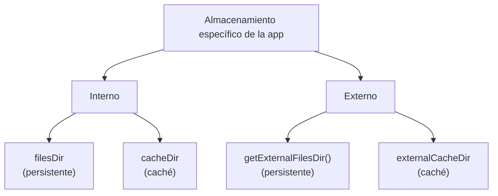

<ExportPDF />

# 4. Sistema de archivos

## 4.1. El sistema de archivos de Android

Como cualquier sistema operativo, Android usa un **sistema de archivos** (*File System*), que ofrece varias opciones para guardar los datos de una aplicación:

- **Almacenamiento específico de la aplicación** (*App-specific storage*): archivos destinados solo al uso de la propia aplicación. Se pueden crear carpetas dedicadas tanto en el almacenamiento **interno** como en el **externo**. Para información confidencial se debe usar el almacenamiento interno, ya que otras aplicaciones no tienen acceso a él.
- **Almacenamiento compartido** (*Shared storage*): archivos que la aplicación puede compartir con otras aplicaciones, como documentos, contenido multimedia (audio, vídeo…) u otros archivos.
- **Preferencias**: almacenamiento privado de datos primitivos en pares clave-valor (DataStore).
- **Bases de datos**: datos estructurados almacenados de forma privada mediante la librería Room.

### Tabla resumen

La [documentación oficial sobre almacenamiento de datos](https://developer.android.com/training/data-storage?hl=es-419) ofrece la siguiente tabla resumen:

| | Tipo de contenido | Método de acceso | Permisos requeridos | ¿Pueden acceder otras apps? | ¿Se quitan los archivos al desinstalar la app? |
| --- | --- | --- | --- | --- | --- |
| **Archivos específicos de la app** | Archivos para uso exclusivo de tu app | Almacenamiento interno: `getFilesDir()` o `getCacheDir()`. Almacenamiento externo: `getExternalFilesDir()` o `getExternalCacheDir()` | No se necesitan permisos para el almacenamiento interno. Tampoco para el externo en Android 4.4 (API 19) o posterior | No | Sí |
| **Contenido multimedia** | Archivos multimedia que se pueden compartir (imágenes, audio, vídeos) | API de `MediaStore` | `READ_EXTERNAL_STORAGE` para acceder a archivos de otras apps en Android 11 (API 30) o posterior; `READ_EXTERNAL_STORAGE` o `WRITE_EXTERNAL_STORAGE` en Android 10 (API 29); permisos para **todos** los archivos en Android 9 (API 28) o anterior | Sí, aunque la otra app necesita el permiso `READ_EXTERNAL_STORAGE` | No |
| **Documentos y otros archivos** | Otros tipos de contenido que se pueden compartir, incluidos los archivos descargados | *Storage Access Framework* | Ninguno | Sí, a través del selector de archivos del sistema | No |
| **Preferencias de la app** | Pares clave-valor | Biblioteca Preferencias de Jetpack (DataStore) | Ninguno | No | Sí |
| **Base de datos** | Datos estructurados | Biblioteca de persistencia Room | Ninguno | No | Sí |

### ¿Qué opción elegir?

A la hora de elegir un tipo de almacenamiento entran en juego varias variables:

| Criterio | Recomendación |
| --- | --- |
| **Tamaño de los datos** | El almacenamiento interno tiene espacio limitado. |
| **Asegurar el acceso a los datos** | Usar el almacenamiento interno o una base de datos: no siempre se tiene acceso al almacenamiento externo (por ejemplo, si es una microSD y se extrae). |
| **Tipo de datos** | Si los archivos no se deben compartir, almacenamiento específico de la aplicación. Para elementos multimedia que se pueden compartir, almacenamiento compartido. |
| **Privacidad de los datos** | Los datos sensibles se guardan en las preferencias, en una base de datos o en el almacenamiento interno; este último, además, oculta los datos a los usuarios. |

## 4.2. Almacenamiento específico de la aplicación

Android ofrece las siguientes ubicaciones destinadas al uso exclusivo de la aplicación:

**Directorios en el almacenamiento interno**

- Android impide que otras aplicaciones accedan a estas ubicaciones.
- A partir de Android 10 (API 29) estas ubicaciones están **cifradas**.
- Son un buen lugar para almacenar **datos sensibles**.
- Suelen tener **poca capacidad**.

**Directorios en el almacenamiento externo**

- Son ubicaciones destinadas al uso exclusivo de la aplicación, aunque otras aplicaciones con los permisos adecuados podrían acceder a ellas.
- Si se van a crear archivos destinados a ser compartidos con otras aplicaciones, deberían crearse en el espacio **compartido** del almacenamiento externo.

Ambas opciones incluyen un directorio para archivos **persistentes** y otro para **caché**.



## 4.3. Acceso a archivos del almacenamiento interno

Los archivos comunes y persistentes se encuentran en un directorio al que se accede con la propiedad **`filesDir`** de un objeto **contexto** (como ya se ha visto, el contexto se puede obtener de diferentes maneras).

Mediante la API **`File`** (similar a la de Java) se puede acceder a los archivos y almacenarlos. Para que el rendimiento de la aplicación no se vea afectado, **no se debe abrir y cerrar el mismo archivo muchas veces**.

Así se abre un archivo con la API `File`:

```kotlin
val file = File(applicationContext.filesDir, "nombre_de_archivo")
```

### Almacenar un archivo usando un *stream*

Como alternativa a la API `File` se puede usar el método **`openFileOutput()`**, que devuelve un objeto `FileOutputStream` para escribir en un archivo dentro del directorio `filesDir`:

```kotlin
val myFile = "miArchivo"
val content = "Mi primer archivo en Android!"
applicationContext.openFileOutput(myFile, Context.MODE_PRIVATE).use {
    it.write(content.toByteArray())
}
```

La función `use { }` cierra automáticamente el *stream* al terminar, aunque se produzca una excepción.

Desde Android Studio, con el **Device Explorer** (menú lateral *View → Tool Windows → Device Explorer*, o el icono de la barra lateral derecha), se pueden ver los archivos creados en la ruta:

`data → data → nombredelpaquete → files`


::: warning-box `Context.MODE_PRIVATE`
En Android 7 (API 24) o superior, si no se indica `Context.MODE_PRIVATE` (por ejemplo, usando los modos obsoletos `MODE_WORLD_READABLE` o `MODE_WORLD_WRITEABLE`) se obtiene una **excepción de seguridad** (`SecurityException`).
:::

Si se quiere [permitir que otras aplicaciones accedan a los archivos del almacenamiento interno](https://developer.android.com/training/secure-file-sharing?hl=es-419), se debe usar un [`FileProvider`](https://developer.android.com/reference/androidx/core/content/FileProvider) al que se le indica el atributo `FLAG_GRANT_READ_URI_PERMISSION`.

### Leer un archivo usando un *stream*

Para leer el contenido de un archivo se usa el método **`openFileInput()`**, que devuelve un `FileInputStream`; a partir de él, con `bufferedReader()` se obtiene un `BufferedReader` y con `useLines` una secuencia de cadenas (una por cada línea del archivo):

```kotlin
// Acceder a archivo usando Stream
val text = applicationContext.openFileInput(myFile).bufferedReader().useLines { fileContent ->
    var text = ""
    fileContent.forEach {
        text += it
    }
    text
}
Text(text = text)
```

::: details Nota sobre el código original
En la diapositiva original el bucle recorría `content` (la cadena escrita en el ejemplo anterior) en lugar de `fileContent` (las líneas leídas del archivo), y el `Text` se llamaba dentro de `useLines`. Aquí se ha corregido para que se recorran realmente las líneas leídas, se devuelva el texto resultante y se muestre fuera del bloque de lectura. En una aplicación real la lectura debería hacerse en el ViewModel, dentro de una corrutina con `Dispatchers.IO`.
:::

### Ver la lista de archivos

Con el método **`fileList()`** se obtiene un array con los nombres de los archivos del directorio `filesDir`:

```kotlin
val files = applicationContext.fileList()
Column() {
    files.forEach {
        Text(text = it)
    }
}
```

### Subdirectorios

Si es necesario, se pueden crear subdirectorios con el método **`getDir()`**, que también permite acceder a los subdirectorios ya creados:

```kotlin
applicationContext.getDir("subdirectorio", Context.MODE_PRIVATE)
```

Este método tiene un pequeño inconveniente: crea el directorio con el prefijo **`app_`** y **fuera** del directorio `files`:

```text
com.example.ud7salvarest
├── app_subdirectorio      ← creado con getDir()
├── cache
├── code_cache
└── files
    └── miArchivo
```

Para crear subdirectorios **dentro** de `files` se pueden usar las funciones de la clase `File`, como en Java:

```kotlin
val appDir: File = applicationContext.filesDir
val subDir = File(appDir, "subDirectorio")
if (!subDir.exists()) subDir.mkdir()
```

```text
com.example.ud7salvarest
├── cache
├── code_cache
└── files
    ├── subDirectorio      ← creado con File.mkdir()
    └── miArchivo
```

### Caché

Si hay que almacenar **temporalmente** archivos con datos sensibles, se deben guardar en el directorio **`cache`**.

Para crear un archivo en la caché se usa **`File.createTempFile()`**, indicando el prefijo (nombre), el sufijo (extensión; si es `null`, por defecto `.tmp`) y el directorio donde crearlo, que se obtiene del contexto con `cacheDir`:

```kotlin
File.createTempFile("archivoTemporal", null, applicationContext.cacheDir)
```

El sistema añade al nombre un número aleatorio para que sea único:

```text
com.example.ud7salvarestado
├── cache
│   └── archivoTemporal3064016544267148776.tmp
├── code_cache
└── files
    ├── subDirectorio
    └── miArchivo
```

Para acceder a los archivos del directorio de caché se usa la propiedad **`cacheDir`** del contexto junto con la clase `File`:

```kotlin
val archivoCache = File(applicationContext.cacheDir, "nombreArchivo")
```

::: warning-box La caché la gestiona Android
Android gestiona automáticamente el directorio `cache`: si el dispositivo se queda sin espacio, **eliminará archivos** de ese directorio. No guardes ahí nada que la aplicación necesite conservar.
:::

### Eliminar archivos

Si el archivo se encuentra en la carpeta `files`:

```kotlin
applicationContext.deleteFile("nombreArchivo")
```

También se puede eliminar mediante un objeto `File`, dependiendo de la ubicación del archivo:

::: tabs
== En files

```kotlin
val fileToDelete = File(applicationContext.filesDir, "nombreArchivo")
fileToDelete.delete()
```

== En cache

```kotlin
val archivoCache = File(applicationContext.cacheDir, "nombreArchivo")
archivoCache.delete()
```

:::

## 4.4. Acceso al almacenamiento externo

Si necesitas **espacio extra** para archivos específicos de la aplicación, puedes usar el **almacenamiento externo**, siempre que esté disponible. Puede ser una partición de la memoria interna, pero también un dispositivo conectado: una tarjeta **SD** o incluso un **pendrive** USB.

Cuando el almacenamiento externo está en un dispositivo conectado, **puede dejar de estar disponible** (por ejemplo, si se extrae la tarjeta SD). Por eso **no conviene** guardar en él archivos de los que dependa el funcionamiento correcto de la aplicación.

### Verificar la disponibilidad

Antes de leer o guardar información, comprueba que el almacenamiento externo esté disponible con la clase **`Environment`** y su método **`getExternalStorageState`**:

| Estado | Permisos |
|:---|:---|
| `MEDIA_MOUNTED` | Lectura y escritura. |
| `MEDIA_MOUNTED_READ_ONLY` | Solo lectura. |

```kotlin
fun isExternalStorageWritable(): Boolean {
    return Environment.getExternalStorageState() == Environment.MEDIA_MOUNTED
}

fun isExternalStorageReadable(): Boolean {
    return Environment.getExternalStorageState() in
        setOf(Environment.MEDIA_MOUNTED, Environment.MEDIA_MOUNTED_READ_ONLY)
}
```

### Seleccionar una ubicación

Como el almacenamiento externo puede estar en la memoria interna o en un dispositivo conectado, hay que **elegir la ubicación**. El método **`getExternalFilesDirs`** (también disponible en `ContextCompat`) devuelve un **array con todos los volúmenes** disponibles:

```kotlin
val externalStorage = applicationContext.getExternalFilesDirs(null)
```

| Índice | Volumen |
|:---|:---|
| `0` | Volumen principal (partición de la memoria interna). Es el que se debe usar salvo que esté lleno o no disponible. |
| `1` | Normalmente, la tarjeta microSD. |
| `2`, `3`… | Otros dispositivos conectados, como pendrives. |

```kotlin
// Segundo volumen (normalmente, la tarjeta microSD)
val externalStorage = applicationContext.getExternalFilesDirs(null)[1]

// Un directorio concreto dentro del almacenamiento externo
val externalDownloads = applicationContext.getExternalFilesDirs(Environment.DIRECTORY_DOWNLOADS)
```

### Acceder a los archivos

Para acceder a los archivos del almacenamiento externo específico de la aplicación se usa **`getExternalFilesDir`** del contexto. Para no afectar al rendimiento, **no abras y cierres el mismo archivo muchas veces**.

```kotlin
val nombreArchivo = "miArchivo"
val appSpecificExternalDir = File(applicationContext.getExternalFilesDir(null), nombreArchivo)
```

::: info-box Android 11 y superiores
Desde Android 11 (API 30), con el almacenamiento con ámbito (*scoped storage*), la aplicación **no puede crear directorios** en el almacenamiento externo **fuera de su propio directorio específico** (por ejemplo, en `Android/data` de otras aplicaciones). Dentro de su directorio sí puede crear subdirectorios, como se ve en el ejemplo de contenido multimedia.
:::

### Caché del almacenamiento externo

Para crear un archivo en la caché del almacenamiento externo se usa la propiedad **`externalCacheDir`** del contexto:

```kotlin
val nombreArchivoCache = "miArchivoTemporal"
val externalCacheFile = File(applicationContext.externalCacheDir, nombreArchivoCache)
```

### Contenido multimedia

Si la aplicación trabaja con archivos multimedia que **no son indispensables** pero aportan valor a la experiencia de usuario, lo mejor es guardarlos en el almacenamiento externo:

```kotlin
fun getAppSpecificAlbumStorageDir(context: Context, albumName: String): File {
    // Obtener el directorio para imágenes dentro del directorio específico del almacenamiento externo de la aplicación
    val file = File(context.getExternalFilesDir(Environment.DIRECTORY_PICTURES), albumName)

    // La siguiente instrucción intenta crear el directorio anterior en el caso de que
    // no exista previamente
    if (!file.mkdirs()) {
        // Error creando el directorio
    }

    return file
}

val documentsExternalDir = getAppSpecificAlbumStorageDir(
    applicationContext,
    Environment.DIRECTORY_DOCUMENTS
).absolutePath
```

Para que la aplicación funcione bien, usa los **nombres de directorio de la API**, que son constantes de la clase [`Environment`](https://developer.android.com/reference/android/os/Environment#fields): `DIRECTORY_ALARMS`, `DIRECTORY_AUDIOBOOKS`, `DIRECTORY_DCIM`, `DIRECTORY_DOCUMENTS`, `DIRECTORY_DOWNLOADS`, `DIRECTORY_MOVIES`, `DIRECTORY_MUSIC`, `DIRECTORY_NOTIFICATIONS`, `DIRECTORY_PICTURES`, `DIRECTORY_PODCASTS`, `DIRECTORY_RECORDINGS`, `DIRECTORY_RINGTONES`, `DIRECTORY_SCREENSHOTS`…

Si ningún nombre predefinido se adapta a la aplicación, pasa **`null`** a `getExternalFilesDir`: los archivos se guardarán en la raíz del almacenamiento externo específico de la aplicación.

## 4.5. Consultar el espacio libre

Algunos dispositivos tienen muy poco espacio, así que hay que tener especial cuidado con lo que ocupa la aplicación. Una buena práctica es **comprobar si el archivo cabe** antes de guardarlo.

No siempre es necesario: a veces no sabes cuánto va a ocupar el archivo. En ese caso, intenta guardarlo y **captura la excepción `IOException`**, que se lanza si no se consigue.

Para comprobar el espacio libre se usa **`getAllocatableBytes`** de `StorageManager`. Puede indicar más espacio del real, porque el sistema cuenta archivos de caché de otras aplicaciones que borraría si hiciera falta. Si hay espacio, se usa **`allocateBytes`** para reservarlo; si no, la aplicación puede pedir al usuario que elimine archivos o vacíe la caché:

```kotlin
// Se necesitan 10 MB de almacenamiento
val NUM_BYTES_NEEDED_FOR_MY_APP = 1024 * 1024 * 10L

val storageManager = applicationContext.getSystemService<StorageManager>()!!
val appSpecificInternalDirUuid: UUID = storageManager.getUuidForPath(filesDir)
val availableBytes: Long = storageManager.getAllocatableBytes(appSpecificInternalDirUuid)
if (availableBytes >= NUM_BYTES_NEEDED_FOR_MY_APP) {
    storageManager.allocateBytes(appSpecificInternalDirUuid, NUM_BYTES_NEEDED_FOR_MY_APP)
} else {
    val storageIntent = Intent().apply {
        // Para pedir al usuario que elimine toda la caché de la aplicación se debe
        //     indicar el valor ACTION_CLEAR_APP_CACHE
        action = ACTION_MANAGE_STORAGE
    }
}
```

::: info-box Lanzar el Intent
El ejemplo solo crea el `Intent`; para mostrar al usuario la pantalla del sistema hay que lanzarlo, por ejemplo con `startActivity(storageIntent)` desde la `Activity`.
:::
