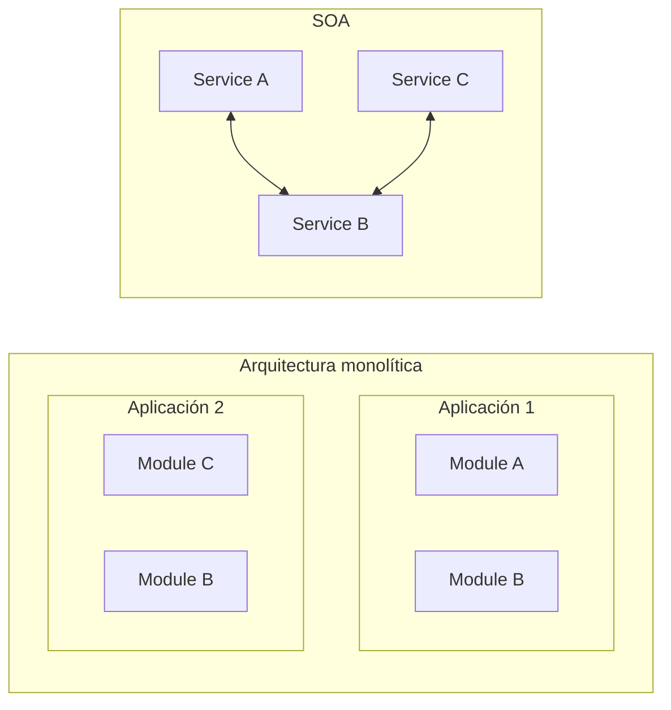

<ExportPDF />

# 1. Servicios web, API REST y conexiones HTTP

## 1.1. Introducción

En la unidad anterior se estudió cómo almacenar y acceder a información en el propio dispositivo. En esta unidad se estudian las diferentes técnicas para **acceder a información disponible en internet** a través de **API REST**: veremos cómo **obtener** y también cómo **enviar** información utilizando API ya existentes.

## 1.2. Arquitectura orientada a servicios (SOA)

La **arquitectura orientada a servicios** (*SOA, Service Oriented Architecture*) se apoya en los **servicios web** (*web services*): un conjunto de protocolos y estándares que permiten que diferentes aplicaciones intercambien datos.

Una de sus características principales es que esas aplicaciones pueden estar **desarrolladas con lenguajes de programación distintos**, **ejecutarse en plataformas diferentes** e incluso estar **desarrolladas por entidades diferentes**.

### Arquitectura monolítica frente a SOA

Cuando se utiliza una arquitectura orientada a servicios, el desarrollo **no se basa en generar aplicaciones completas**. Con SOA se desarrollan **servicios** (aplicaciones) que **generan resultados**, y esos servicios se pueden **utilizar** tanto en la **propia aplicación** como en **aplicaciones de terceros**.



En la arquitectura monolítica cada aplicación incluye sus propios módulos (el *Module B* aparece duplicado en ambas); en SOA, el *Service B* es único y lo consumen tanto el *Service A* como el *Service C*.

### Estándares usados en SOA

Para implementar servicios se pueden utilizar distintas tecnologías según las características del servicio. Entre las más usadas están:

| Siglas | Nombre completo |
|---|---|
| HTML | *HyperText Markup Language* |
| XML | *eXtensible Markup Language* |
| JSON | *JavaScript Object Notation* |
| SOAP | *Simple Object Access Protocol* |
| WSDL | *Web Services Description Language* |
| REST | *Representational State Transfer* |

## 1.3. API REST

::: accent-box primary 📖 ¿Qué es una API?
Una **API** (*Application Programming Interface*) es un conjunto de funcionalidades ya desarrolladas y preparadas para ser usadas desde otras tecnologías siguiendo los principios SOA. Su finalidad es ofrecer una **capa de abstracción** para realizar distintas tareas (cálculos, obtener o guardar datos…), facilitando el trabajo de los desarrolladores.
:::

### REST y los métodos HTTP

**REST** (*REpresentational State Transfer*) es una arquitectura que se basa en **peticiones HTTP** para trabajar con los datos de la aplicación web (almacenados en su base de datos) mediante operaciones bien definidas:

| Método | Operación |
|---|---|
| `GET` | Obtener uno o varios registros de una tabla. |
| `POST` | Almacenar un registro nuevo en una tabla. |
| `PUT` | Cambiar **todos** los campos de un registro de una tabla. |
| `PATCH` | Cambiar **algún** campo de un registro de una tabla. |
| `DELETE` | Eliminar un registro de una tabla. |

### Endpoints

Una **API REST** es una implementación de servicios web que utiliza principalmente **REST** y **JSON** para el acceso a los datos. Para desarrollar un servicio web API REST hay que:

- Definir las **URL** (amigables) que acepta la API.
- Definir el **tipo de petición** aceptado para cada URL.
- Crear los **scripts** que traten las peticiones a esas URL y generen los datos resultado.

::: tip-box Endpoint
A cada par **URL + tipo de petición** se le conoce como **endpoint**. Para usar una API es imprescindible conocer sus endpoints.
:::

Por ejemplo, el endpoint `GET` [https://swapi.dev/api/starships/10/?format=json](https://swapi.dev/api/starships/10/?format=json) de la API de Star Wars devuelve este JSON:

```json
{
    "name": "Millennium Falcon",
    "model": "YT-1300 light freighter",
    "manufacturer": "Corellian Engineering Corporation",
    "cost_in_credits": "100000",
    "length": "34.37",
    "max_atmosphering_speed": "1050",
    "crew": "4",
    "passengers": "6",
    "cargo_capacity": "100000",
    "consumables": "2 months",
    "hyperdrive_rating": "0.5",
    "MGLT": "75",
    "starship_class": "Light freighter",
    "pilots": [
        "https://swapi.dev/api/people/13/",
        "https://swapi.dev/api/people/14/",
        "https://swapi.dev/api/people/25/",
        "https://swapi.dev/api/people/31/"
    ],
    "films": [
        "https://swapi.dev/api/films/1/",
        "https://swapi.dev/api/films/2/",
        "https://swapi.dev/api/films/3/"
    ],
    "created": "2014-12-10T16:59:45.094000Z",
    "edited": "2014-12-20T21:23:49.880000Z",
    "url": "https://swapi.dev/api/starships/10/"
}
```

### API públicas

Actualmente muchas empresas ofrecen su API para integrar sus datos y funcionalidades en cualquier aplicación. Eso sí, las condiciones pueden cambiar: en febrero de 2023 Twitter anunció que a partir del 9 de febrero dejaba de ofrecer acceso gratuito a su API (v2 y v1.1) y que lo sustituiría por un nivel básico de pago.

Existen infinidad de API públicas; algunas requieren registro:

- Datos abiertos del Ayuntamiento de Valencia: [https://opendata.vlci.valencia.es/](https://opendata.vlci.valencia.es/)
- Rick y Morty: [https://rickandmortyapi.com/](https://rickandmortyapi.com/)
- Star Wars: [https://swapi.dev/](https://swapi.dev/)
- Disney: [https://disneyapi.dev/](https://disneyapi.dev/)
- …

Listados de API públicas:

- [https://github.com/public-apis/public-apis](https://github.com/public-apis/public-apis)
- [https://rapidapi.com/collection/list-of-free-apis](https://rapidapi.com/collection/list-of-free-apis)

API con datos ficticios para pruebas:

- [https://httpbin.org](https://httpbin.org): dispone de una gran variedad de peticiones.
- [https://app.mocklab.io](https://app.mocklab.io): al crear una cuenta se pueden configurar las peticiones a medida.

## 1.4. Coil y los endpoints de imágenes

En la UP06 se estudió la librería **Coil** para acceder a imágenes ubicadas en internet. Coil necesita una URL de donde obtener la imagen; esa URL puede ser la **ruta directa a una imagen** o bien un **endpoint de una API**, como en los ejemplos ya vistos:

```kotlin
AsyncImage(
    model = "https://alextz78.github.io/portal.png",
    contentDescription = "Rick y Morty",
    modifier = Modifier.fillMaxWidth(),
    contentScale = ContentScale.Fit
)
```

## 1.5. Permiso de conexión a internet

::: warning-box Permiso INTERNET obligatorio
Si la aplicación va a acceder a internet hay que declararlo en el manifiesto (`manifests` → `AndroidManifest.xml`) con la línea `uses-permission`, antes de la etiqueta `application`. Sin este permiso, cualquier conexión de red fallará.
:::

```xml
<manifest xmlns:android="http://schemas.android.com/apk/res/android"
    xmlns:tools="http://schemas.android.com/tools">

    <uses-permission android:name="android.permission.INTERNET" />

    <application
        ...>
        <!-- ... -->
    </application>
</manifest>
```

## 1.6. HttpURLConnection

Android ofrece la clase **`HttpURLConnection`** para realizar conexiones HTTP de **manera manual**:

- Las conexiones con `HttpURLConnection` se deben realizar **en una corrutina fuera del hilo principal** (por ejemplo, con `Dispatchers.IO`).
- Se pueden realizar peticiones de **cualquier tipo** de los permitidos por el protocolo HTTP.

### Petición GET desde Jetpack Compose

El siguiente código realiza una petición `GET` a la API de Rick y Morty con el texto introducido en un `OutlinedTextField` y muestra la respuesta tal cual en un `Text`:

```kotlin
Column(
    horizontalAlignment = Alignment.CenterHorizontally,
    verticalArrangement = Arrangement.Top,
    modifier = Modifier.fillMaxWidth().padding(4.dp)
) {
    // variables para mantener el estado
    var searchedCharacter by rememberSaveable { mutableStateOf("") }
    var responseJSON by rememberSaveable { mutableStateOf("") }
    val coroutineScope = rememberCoroutineScope()

    // Fila para el buscador
    Row(
        verticalAlignment = Alignment.CenterVertically
    ) {
        OutlinedTextField(
            value = searchedCharacter,
            onValueChange = { searchedCharacter = it },
            modifier = Modifier.weight(1.5f)
        )
        Button(
            onClick = {
                coroutineScope.launch(Dispatchers.IO) {
                    val apiURL = "https://rickandmortyapi.com/api/character/"
                    val regParam = "name=${URLEncoder.encode(searchedCharacter, "UTF-8")}"
                    val endpoint = URL("$apiURL?$regParam")

                    with(endpoint.openConnection() as HttpURLConnection) {
                        requestMethod = "GET"
                        Log.i("INFO", "URL: $url")
                        Log.i("INFO", "Response code: $responseCode")
                        BufferedReader(InputStreamReader(inputStream)).use {
                            val response = StringBuffer()
                            var inputLine = it.readLine()
                            while (inputLine != null) {
                                response.append(inputLine)
                                inputLine = it.readLine()
                            }
                            it.close()
                            responseJSON = response.toString()
                            Log.i("INFO", "Response: $response")
                        }
                    }
                }
            },
            modifier = Modifier.weight(.5f)
        ) {
            Text(text = "Buscar")
        }
    }

    Text(
        text = responseJSON,
        modifier = Modifier.weight(8f).verticalScroll(rememberScrollState())
    )
}
```

Puntos clave del ejemplo:

- `URLEncoder.encode(..., "UTF-8")` codifica el texto del usuario para que sea válido dentro de la URL (los espacios pasan a `+`, etc.).
- `openConnection()` devuelve la conexión, que se convierte a `HttpURLConnection` para fijar `requestMethod`.
- La respuesta se lee **línea a línea** desde `inputStream` con un `BufferedReader`.

### Resultado de la ejecución

Al buscar "Rick sanchez", el Logcat muestra:

```text
I  URL: https://rickandmortyapi.com/api/character/?name=Rick+sanchez
I  Response code: 200
I  Response: {"info":{"count":4,"pages":1,"next":null,"prev":null},"results":[{"id":1,"name":"Rick Sanchez","status":"Alive",...
```


::: info-box Parsear los datos
En una aplicación real hay que **"parsear"** los datos recibidos para mostrarlos de forma entendible para los usuarios, no como un texto JSON en bruto.
:::

## 1.7. Librerías para conexiones HTTP

Con `HttpURLConnection` hay que tratar **manualmente** los datos recibidos, lo cual es costoso. Es recomendable usar alguna de las librerías existentes, que facilitan y agilizan estas tareas:

| Ámbito | Librerías |
|---|---|
| Android | **Retrofit**, **Volley** |
| Kotlin (disponibles en proyectos Android y Kotlin) | **Ktor**, **http4k** |

En la siguiente página se estudia **Retrofit** mediante un caso de estudio completo.
