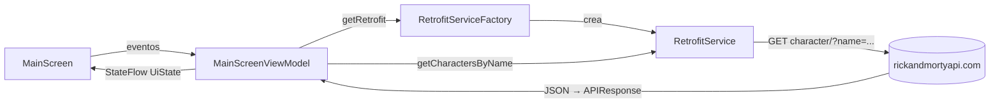

<ExportPDF />

# 2. Retrofit: caso de estudio

## 2.1. Qué es Retrofit

::: accent-box primary 📖 Retrofit
**Retrofit** es una librería de código abierto para Java y Android que simplifica la realización de **peticiones HTTP** y el **procesamiento de los datos** obtenidos.
:::

Características principales:

- **Seguridad de tipos**: convierte automáticamente las respuestas JSON en objetos Java/Kotlin y, en las peticiones, los objetos Java/Kotlin en JSON.
- **Código legible y mantenible**: las peticiones HTTP se definen mediante **anotaciones en interfaces**, lo que simplifica su uso.
- Permite **añadir parámetros, cabeceras y variables** a los endpoints.
- Permite manejar **diferentes formatos de respuesta** además de JSON.

Toda la información está en su [web oficial](https://square.github.io/retrofit/).

## 2.2. El caso de estudio

Para estudiar Retrofit se desarrolla una aplicación que realiza peticiones a una API pública: [https://rickandmortyapi.com](https://rickandmortyapi.com), para recuperar personajes de la serie.

El endpoint que se usará es el siguiente, sustituyendo el valor del parámetro `name` por el que introduzca el usuario:

```text
https://rickandmortyapi.com/api/character/?name=rick
```

La API devuelve la información de los personajes encontrados en formato JSON; Retrofit realizará la petición y almacenará esa información en **objetos fácilmente usables desde Kotlin**.

La aplicación tendrá un **campo de búsqueda** para introducir un nombre y un **botón de buscar**; con los datos obtenidos se mostrará por pantalla la información de los personajes encontrados.


::: tip-box Más allá de consultar
Evidentemente, Retrofit sirve para mucho más que obtener datos: también para **insertar**, **eliminar** o **modificar** información a través de la API (`POST`, `PUT`, `PATCH`, `DELETE`).
:::

### Ejemplos de respuesta de la API

Petición [https://rickandmortyapi.com/api/character/?name=frank](https://rickandmortyapi.com/api/character/?name=frank) (fragmento; `origin`, `location` y `episode` aparecen plegados):

```jsonc
{
    "info": {
        "count": 3,
        "pages": 1,
        "next": null,
        "prev": null
    },
    "results": [
        {
            "id": 127,
            "name": "Frank Palicky",
            "status": "Dead",
            "species": "Human",
            "type": "",
            "gender": "Male",
            "origin": {},
            "location": {},
            "image": "https://rickandmortyapi.com/api/character/avatar/127.jpeg",
            "episode": [],
            "url": "https://rickandmortyapi.com/api/character/127",
            "created": "2017-12-26T19:22:48.474Z"
        },
        {
            "id": 128,
            "name": "Frankenstein's Monster",
            "status": "Dead",
            "species": "Alien",
            "type": "Parasite",
            "gender": "Male",
            "origin": {},
            "location": {},
            "image": "https://rickandmortyapi.com/api/character/avatar/128.jpeg",
            "episode": [],
            "url": "https://rickandmortyapi.com/api/character/128",
            "created": "2017-12-26T19:24:56.679Z"
        },
        {
            "id": 756,
            "name": "Franklin D. Roosevelt",
            // ...
        }
    ]
}
```

Observa que el campo `image` es, a su vez, un endpoint que devuelve la imagen del personaje (que podremos cargar con Coil).

Si no se encuentra ningún personaje, por ejemplo con [https://rickandmortyapi.com/api/character/?name=felipe](https://rickandmortyapi.com/api/character/?name=felipe), la respuesta es:

```json
{
    "error": "There is nothing here"
}
```

## 2.3. Configuración del proyecto

Tras crear el proyecto hay que:

### 1. Añadir el permiso de internet

En `AndroidManifest.xml`:

```xml
<uses-permission android:name="android.permission.INTERNET" />
```

### 2. Añadir las dependencias de Retrofit

En `gradle/libs.versions.toml`, apartado `[versions]`:

```toml
retrofit2 = "2.9.0"
```

Apartado `[libraries]`:

```toml
retrofit2 = { group = "com.squareup.retrofit2", name = "retrofit", version.ref = "retrofit2" }
retrofit2-converter-gson = { group = "com.squareup.retrofit2", name = "converter-gson", version.ref = "retrofit2" }
```

En `build.gradle.kts (Module: app)`, dentro de `dependencies`:

```kotlin
implementation(libs.retrofit2)
implementation(libs.retrofit2.converter.gson)
```

`converter-gson` es el conversor que transforma el JSON en objetos Kotlin (y viceversa) usando la librería Gson.

### 3. Resto de dependencias

Además, se añaden las demás dependencias y plugins necesarios, ya vistos en unidades anteriores:

- **Navigation**: navegación entre pantallas.
- **Serialization**: para las rutas de la navegación.
- **ViewModel**: gestión del estado de las pantallas.
- **Coil**: carga de imágenes desde internet.
- Cualquier otra dependencia necesaria.

## 2.4. Modelos de datos (data classes)

La respuesta de la API es JSON, así que hay que **analizar la estructura de ese JSON** para crear los **modelos de datos** necesarios, que se almacenan en **data classes**. Conviene crearlas en un paquete `model` dentro de un paquete `data`.

Para el ejemplo podrían crearse estas data classes:

- `Response`: representa toda la respuesta.
- `Info`: representa el elemento `info` de la respuesta.
- `Results`: representa la información de cada personaje.

```kotlin
data class Response(var info: Info, var results: List<Results>)

data class Info(var count: Int, var pages: Int)

data class Results(var name: String, var image: String)
```

::: info-box No hace falta mapearlo todo
No es necesario declarar **todos** los campos de la respuesta: Retrofit (con el conversor Gson) se encarga de rellenar solo los que existan en la data class e ignora el resto.
:::

### Generación automática con JSON To Kotlin Class

Crear a mano las data classes puede ser laborioso. El plugin **JSON To Kotlin Class** genera automáticamente la estructura a partir de la respuesta de una petición a una API. Se instala desde **File → Settings… → Plugins → Marketplace**:


Tras instalarlo aparece una nueva opción al crear un recurso: clic derecho sobre la carpeta `model` → **New → Kotlin data class File from JSON**.


En la ventana que se abre se pega **toda la respuesta** del endpoint deseado. Para el caso de estudio se usa el endpoint de ejemplo [https://rickandmortyapi.com/api/character/?name=Morty](https://rickandmortyapi.com/api/character/?name=Morty). En la parte inferior (**Class Name**) se indica el nombre de la data class que representará toda la respuesta: `APIResponse`.


Al pulsar **Generate** se crea en `data/model` la estructura de data classes correspondiente (`APIResponse`, `Info`, `Location`, `Origin` y `Result`):

```kotlin
data class APIResponse(
    val info: Info,
    val results: List<Result>
)

data class Info(
    val count: Int,
    val next: String,
    val pages: Int,
    val prev: Any
)

data class Result(
    val created: String,
    val episode: List<String>,
    val gender: String,
    val id: Int,
    val image: String,
    val location: Location,
    val name: String,
    val origin: Origin,
    val species: String,
    val status: String,
    val type: String,
    val url: String
)
```

Si algún dato de la respuesta no se va a utilizar, se puede **eliminar** de las data classes generadas.

::: warning-box Tipos generados
El plugin deduce los tipos a partir del JSON de ejemplo. Como en ese ejemplo `prev` era `null`, lo ha tipado como `Any`, y `next` como `String` no nulo. Revisa los tipos generados: en esta API lo correcto sería `val next: String?` y `val prev: String?`, porque ambos pueden valer `null`.
:::

### Renombrar propiedades con @SerializedName

Con *Kotlin data class File from JSON* **los nombres de las propiedades** se obtienen **directamente de la respuesta JSON**. Si no son los más adecuados, se pueden cambiar con la anotación **`@SerializedName`**:

```kotlin
data class Result(
    @SerializedName(value = "char_name")    // nombre original en el JSON
    var name: String,                       // nombre de la propiedad
    @SerializedName(value = "avatar_img", alternate = ["img", "img_url"])
    var image: String
)
```

`alternate` indica nombres alternativos que también se aceptarán al leer el JSON.

Para facilitar el uso de los datos, en el caso de estudio se renombra la propiedad `results` a **`characters`** y la data class `Result` a **`CharacterInfo`** (refactorizando con *Refactor → Rename*):

```kotlin
data class APIResponse(
    val info: Info,
    @SerializedName(value = "results")
    val characters: List<CharacterInfo>
)

data class CharacterInfo(
    val created: String,
    val episode: List<String>,
    val gender: String,
    val id: Int,
    val image: String,
    val location: Location,
    val name: String,
    val origin: Origin,
    val species: String,
    val status: String,
    val type: String,
    val url: String
)
```

## 2.5. La interfaz del servicio: RetrofitService

El siguiente paso es crear una **interface** con las peticiones. Dentro del paquete `data` se crea `RetrofitService.kt`:

```kotlin
interface RetrofitService {
    // Si el valor a pasar es un parámetro: ?parámetro=valor
    @GET("character/")
    suspend fun getCharactersByName(
        @Query("name") name: String
    ): APIResponse

    // Si el valor a pasar es parte de la ruta
    @GET("character/{name}")
    suspend fun getCharactersByNamePath(
        @Path("name") name: String
    ): APIResponse
}
```

- `@GET` indica el método HTTP y la ruta relativa del endpoint (existen también `@POST`, `@PUT`, `@PATCH` y `@DELETE`).
- `@Query("name")` añade el parámetro a la URL como `?name=valor`.
- `@Path("name")` sustituye `{name}` dentro de la propia ruta.
- Las funciones son `suspend`, por lo que se llaman desde una corrutina.

En esta interface se crean **tantas funciones como peticiones a endpoints distintos** vaya a realizar la aplicación.

## 2.6. El objeto que crea el servicio: RetrofitServiceFactory

Para usar la interface hace falta un objeto que devuelva el **servicio Retrofit**. Dentro del paquete `data` se crea `RetrofitServiceFactory.kt`:

```kotlin
object RetrofitServiceFactory {
    // Función para crear la instancia de Retrofit
    fun getRetrofit(): RetrofitService {
        return Retrofit.Builder()
            .baseUrl("https://rickandmortyapi.com/api/")
            .addConverterFactory(GsonConverterFactory.create())
            .build()
            .create(RetrofitService::class.java)
    }
}
```

- `baseUrl` es la parte común de todos los endpoints (debe terminar en `/`); se concatena con la ruta de cada `@GET`.
- `addConverterFactory(GsonConverterFactory.create())` indica que el JSON se convierta con Gson.
- `create(RetrofitService::class.java)` genera la implementación de la interface.



## 2.7. ViewModel y estado

La aplicación usa un **ViewModel** y **Flow** para mantener los datos durante la ejecución. El estado de la vista:

```kotlin
// Estado de la vista: UiState
data class UiState(
    val isLoading: Boolean = false,
    val searchedCharacter: String = "",
    val responseError: Boolean = false,
    val charactersList: List<CharacterInfo> = emptyList(),
)
```

Y el ViewModel:

```kotlin
class MainScreenViewModel : ViewModel() {
    // Estado de la pantalla
    private val _uiState = MutableStateFlow(UiState())
    val uiState: StateFlow<UiState> = _uiState

    fun onSearchedCharacterChanged(character: String) {
        _uiState.update { state ->
            state.copy(searchedCharacter = character)
        }
    }

    fun loadCharacterList(searchedCharacter: String) {
        viewModelScope.launch(Dispatchers.IO) {
            _uiState.update { current ->
                current.copy(
                    isLoading = true,
                    responseError = false
                )
            }
            val service = RetrofitServiceFactory.getRetrofit()
            try {
                val searchResults = service.getCharactersByName(searchedCharacter)
                _uiState.update { current ->
                    current.copy(
                        isLoading = false,
                        charactersList = searchResults.characters
                    )
                }
            } catch (e: Exception) {
                _uiState.update { current ->
                    current.copy(
                        isLoading = false,
                        responseError = true
                    )
                }
            }
        }
    }
}
```

En `loadCharacterList` se ve cómo **se carga el servicio Retrofit** (`RetrofitServiceFactory.getRetrofit()`) y se **llama al endpoint** definido en `getCharactersByName`. La llamada va dentro de `try/catch`: si la API responde con error (por ejemplo, el `404` con `"There is nothing here"` cuando no hay coincidencias) o no hay conexión, Retrofit lanza una excepción y se marca `responseError = true`.

## 2.8. Pantalla principal

Por último, el código de la pantalla principal en `MainActivity.kt`:

```kotlin
@OptIn(ExperimentalMaterial3Api::class)
@Composable
fun MainScreen(
    mainViewModel: MainScreenViewModel = viewModel(),
) {
    val uiState by mainViewModel.uiState.collectAsStateWithLifecycle()

    AppScaffold {
        Column(
            horizontalAlignment = Alignment.CenterHorizontally,
            verticalArrangement = Arrangement.Top,
            modifier = Modifier
                .fillMaxWidth()
                //.padding(4.dp)
        ) {
            SearchBox(
                searchedCharacter = uiState.searchedCharacter,
                onValueChange = { mainViewModel.onSearchedCharacterChanged(it) },
                onClickPress = { mainViewModel.loadCharacterList(uiState.searchedCharacter) },
                modifier = Modifier.weight(1f)
            )

            Box(modifier = Modifier.weight(8f)) {
                if (uiState.isLoading) {
                    LoadingInfo()
                } else if (uiState.responseError) {
                    Text(text = "\"${uiState.searchedCharacter}\" no coincide con ningún personaje")
                } else {
                    if (uiState.charactersList.isNotEmpty()) {
                        Column(horizontalAlignment = Alignment.CenterHorizontally) {
                            LazyVerticalGrid(
                                columns = GridCells.Fixed(3),
                                verticalArrangement = Arrangement.spacedBy(8.dp),
                                horizontalArrangement = Arrangement.spacedBy(4.dp),
                            ) {
                                items(uiState.charactersList) { character ->
                                    CharacterInfoCard(character = character)
                                }
                            }
                        }
                    } else {
                        Column(
                            verticalArrangement = Arrangement.Center,
                            horizontalAlignment = Alignment.CenterHorizontally,
                            modifier = Modifier
                                .padding(40.dp)
                                .fillMaxWidth()
                        ) {
                            Image(
                                painter = painterResource(R.drawable.pazentremundos),
                                contentDescription = "Rick & Morty logo",
                                modifier = Modifier
                                    .border(
                                        width = 4.dp,
                                        color = MaterialTheme.colorScheme.primary,
                                        shape = CircleShape
                                    )
                                    .clip(CircleShape)
                                    .size(250.dp),
                                contentScale = ContentScale.Crop

                            )
                            Spacer(modifier = Modifier.size(24.dp))
                            Text(
                                text = "Busca tus personajes favoritos",
                                fontSize = 20.sp,
                                fontWeight = FontWeight.Bold
                            )
                        }
                    }
                }
            }
        }
    }
}
```

En `MainScreen` se ve cómo usar las llamadas a las funciones del ViewModel. Los composables auxiliares (`AppScaffold`, `SearchBox`, `LoadingInfo`, `CharacterInfoCard`…) no se reproducen aquí porque la definición de interfaces con Jetpack Compose ya se ha estudiado durante el curso.

::: info-box Proyecto completo en el aula virtual
Toda la definición de la interfaz se encuentra en el proyecto de Android Studio **RetrofitRickMorty**, disponible en el aula virtual.
:::

## 2.9. Posibles mejoras

### Paginación de resultados

Si se analiza el JSON de la respuesta se observa que no se reciben todos los datos, sino **paginados de 20 en 20**. Con las propiedades `pages` y `next` de `info` se puede saber si hacen falta más peticiones para seguir obteniendo datos:

```jsonc
{
    "info": {
        "count": 68,
        "pages": 4,
        "next": "https://rickandmortyapi.com/api/character/?page=2&name=Morty",
        "prev": null
    },
    "results": [ /* 20 items */ ]
}
```

Así se puede añadir un botón al final de la lista que, al pulsarlo, cargue los siguientes resultados del personaje buscado.

### Pantalla de detalle del personaje

Otra mejora es crear una **pantalla con la información completa de cada personaje**: al pulsar sobre un personaje se navega a esa pantalla y se le pasan como parámetro todos sus datos.

Si se han simplificado las data classes eliminando campos, en la pantalla de detalle se puede hacer una **nueva petición** a la API para obtener solo la información de ese personaje, ya que cada personaje tiene **su propio endpoint** (campo `url`):

```jsonc
{
    "id": 2,
    "name": "Morty Smith",
    "status": "Alive",
    "species": "Human",
    "type": "",
    "gender": "Male",
    "origin": { /* 2 props */ },
    "location": { /* 2 props */ },
    "image": "https://rickandmortyapi.com/api/character/avatar/2.jpeg",
    "episode": [ /* 51 items */ ],
    "url": "https://rickandmortyapi.com/api/character/2",
    "created": "2017-11-04T18:50:21.651Z"
}
```

::: tip-box Versión ampliada
En el aula virtual hay disponible una versión del caso de estudio con estas dos mejoras implementadas: el proyecto **RetrofitRickMortyEnhanced**.
:::

::: tip-box Practica
Ya puedes hacer las [actividades de la unidad](../ejercicios/).
:::
