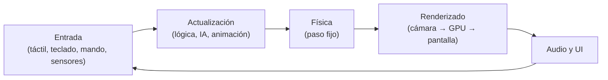
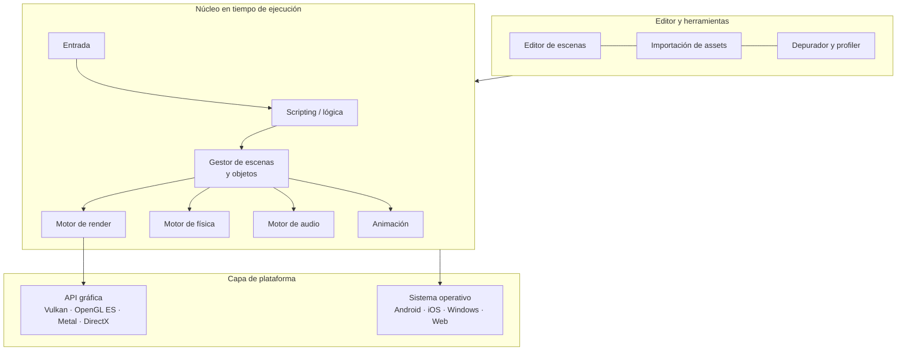

<ExportPDF />

# 1. Arquitectura de un videojuego y motores de juegos

## 1.1. ¿Qué es un videojuego desde el punto de vista técnico?

Un videojuego es una **aplicación interactiva en tiempo real**: varias decenas de veces por segundo lee lo que hace el jugador, actualiza el estado del mundo (posiciones, físicas, inteligencia artificial, puntuación…) y dibuja el resultado en pantalla. Esa repetición continua se llama **bucle de juego** (*game loop*) y es la pieza central de cualquier arquitectura de juego.

| Concepto | Significado |
|:---|:---|
| **Fotograma** (*frame*) | Cada una de las imágenes que se dibujan. A 60 FPS, el juego dispone de unos **16,6 ms** por fotograma para hacer todo su trabajo. |
| **FPS** | Fotogramas por segundo. En móvil lo habitual es 30 o 60 FPS; las pantallas de 90-120 Hz permiten más, a costa de batería. |
| **Delta time** | Tiempo transcurrido desde el fotograma anterior. Se usa para que el movimiento no dependa de la velocidad del dispositivo. |
| **Tiempo real** | El juego debe responder al jugador sin esperas perceptibles: no puede «bloquearse» mientras carga o calcula. |

## 1.2. El bucle de juego

Un bucle típico tiene estas fases:

1. **Procesar la entrada**: qué ha tocado, pulsado o inclinado el jugador.
2. **Actualizar el estado**: mover personajes, aplicar reglas del juego, ejecutar la IA, avanzar animaciones.
3. **Simular la física**: normalmente con un **paso de tiempo fijo** (por ejemplo, 50 veces por segundo) para que sea estable y determinista, aunque los FPS varíen.
4. **Renderizar**: la cámara «fotografía» la escena y la GPU la dibuja.
5. **Reproducir audio y actualizar la interfaz** (marcadores, menús).

::: info-box ¿Por qué un paso fijo para la física?
Si la física avanzara con el *delta time* variable, en un móvil lento un objeto rápido podría «atravesar» una pared entre dos fotogramas, y los resultados cambiarían de un dispositivo a otro. Por eso los motores separan el **bucle variable** de renderizado del **bucle fijo** de física. En Unity son `Update()` y `FixedUpdate()`, como verás en el [apartado 3](./03-scripting-csharp).
:::

## 1.3. Componentes de la arquitectura de un juego

Un juego, sea 2D o 3D, se puede descomponer en **bloques funcionales**:

| Bloque | Responsabilidad | Ejemplos |
|:---|:---|:---|
| **Entrada** | Traducir dispositivos en acciones del juego. | Táctil, acelerómetro, teclado, mando. |
| **Lógica de juego** (*gameplay*) | Reglas, estados, puntuación, condiciones de victoria y derrota. | Vidas, niveles, inventario. |
| **Mundo o escena** | Conjunto de objetos y su organización espacial. | Niveles, decorados, enemigos. |
| **Física y colisiones** | Movimiento realista, gravedad, choques, detección de contactos. | Saltos, rebotes, proyectiles. |
| **Gráficos y animación** | Dibujar sprites, mallas, materiales, luces, efectos, animaciones. | Personajes, partículas. |
| **Audio** | Música, efectos y sonido posicional. | Disparo, música de fondo. |
| **Interfaz de usuario** (UI/HUD) | Menús e información superpuesta. | Marcador, botón de pausa. |
| **Inteligencia artificial** | Comportamiento de los personajes no jugadores. | Patrullas, persecución, *pathfinding*. |
| **Persistencia** | Guardar partidas, récords y preferencias. | Puntuación máxima. |
| **Red** (opcional) | Multijugador y servicios en línea. | Clasificaciones, partidas en línea. |
| **Gestión de recursos** (*assets*) | Cargar y liberar texturas, modelos, sonidos y escenas. | Carga de niveles. |

### Juegos 2D y 3D

| | 2D | 3D |
|:---|:---|:---|
| **Espacio** | Plano (ejes X, Y). La profundidad se simula con capas de dibujo. | Tridimensional (X, Y, Z). |
| **Elementos visuales** | *Sprites* (imágenes), *tilemaps* (mapas de baldosas). | Mallas (*meshes*) con materiales y texturas. |
| **Cámara** | Normalmente **ortográfica** (sin perspectiva). | Normalmente **en perspectiva**. |
| **Física** | Motor 2D (en Unity, basado en **Box2D**). | Motor 3D (en Unity, **NVIDIA PhysX**). |
| **Iluminación** | Opcional (luces 2D). | Esencial: luces, sombras, iluminación global. |
| **Animación** | Por fotogramas (*sprite sheets*) o esqueletal 2D. | Esqueletal con huesos (*rigging*), *blend trees*. |
| **Coste** | Menor: ideal para móviles de gama baja. | Mayor consumo de GPU, memoria y batería. |

Hay también enfoques intermedios: el **2.5D** (mundo 3D con jugabilidad en un plano, como muchos juegos de plataformas modernos) o el **isométrico** (2D que simula 3D con una perspectiva fija).

## 1.4. Animación 2D y 3D

La animación da vida a los objetos. Las técnicas principales son:

| Técnica | Descripción | Uso típico |
|:---|:---|:---|
| **Por fotogramas** (*frame by frame*) | Se muestran imágenes distintas en secuencia, como en los dibujos animados. | Personajes 2D *pixel art*. |
| **Por interpolación** (*tweening*) | Se definen **fotogramas clave** (*keyframes*) y el motor calcula los intermedios. | Movimiento de objetos, UI, puertas. |
| **Esqueletal** | Un esqueleto de huesos deforma la malla o el sprite. | Personajes 3D y 2D con muchas animaciones. |
| **Procedural** | La animación se calcula con código o con física. | Ragdolls, ondas, cinemática inversa. |

Las animaciones se combinan mediante **máquinas de estados** (en Unity, el **Animator**): el personaje pasa de *reposo* a *correr* o *saltar* según unos **parámetros** que actualiza el código.

## 1.5. Motores de juegos

Un **motor de juegos** (*game engine*) es un conjunto de herramientas y librerías que resuelve los problemas comunes de todos los juegos (bucle, renderizado, física, audio, entrada, carga de recursos…) para que el equipo se centre en el **contenido y la jugabilidad**.

### Componentes de un motor

| Componente | Función | Librerías habituales |
|:---|:---|:---|
| **Motor de render** | Dibujar la escena: geometría, materiales, *shaders*, luces, sombras, posprocesado. | APIs gráficas: **OpenGL ES**, **Vulkan** (Android), **Metal** (Apple), **DirectX** (Windows, Xbox), **WebGL/WebGPU**. |
| **Motor de física** | Simular cuerpos rígidos, colisiones, articulaciones. | **Box2D** (2D), **NVIDIA PhysX**, **Havok**, **Jolt**, **Bullet**. |
| **Audio** | Reproducir, mezclar y espacializar sonido. | FMOD, Wwise, OpenAL. |
| **Animación** | Reproducir y mezclar animaciones, esqueletos, IK. | Integrada en el motor. |
| **Entrada** | Abstraer teclado, táctil, mandos y sensores. | Integrada en el motor. |
| **Scripting** | Permitir programar la lógica del juego. | C#, C++, GDScript, Lua, Blueprints (visual). |
| **Gestor de escenas** | Organizar los objetos en una **jerarquía** (grafo de escena). | Integrado en el motor. |
| **Gestor de recursos** | Importar, comprimir y cargar assets. | Integrado en el motor. |
| **Red** | Sincronizar partidas multijugador. | Netcode, Mirror, Photon. |
| **IA** | Navegación (*navmesh*), árboles de comportamiento. | Integrada o mediante paquetes. |
| **Editor** | Herramienta visual para construir el juego sin programarlo todo. | — |

### Tipos de motores

| Criterio | Tipos |
|:---|:---|
| **Dimensión** | Especializados en 2D (GameMaker, Defold), en 3D o mixtos (Unity, Godot, Unreal). |
| **Licencia** | Propietarios (Unity, Unreal) o de **código abierto** (Godot, Defold, O3DE). |
| **Público** | Generalistas o específicos de un género (RPG Maker, Ren'Py para novelas visuales). |
| **Forma de programar** | Con código (C#, C++, GDScript…), visual (Blueprints, Visual Scripting) o sin código. |
| **Propiedad** | Comerciales disponibles para todos o **internos** de un estudio (Frostbite de EA, RE Engine de Capcom…). |

## 1.6. Comparativa de motores actuales

| Motor | Lenguajes | Licencia | Puntos fuertes | Plataformas |
|:---|:---|:---|:---|:---|
| **[Unity](https://unity.com/)** | C# (y Visual Scripting) | Propietaria. Gratuita (*Personal*) por debajo de un umbral de ingresos. | Muy extendido en **móvil** e indie, enorme comunidad, Asset Store, 2D y 3D. | Android, iOS, PC, consolas, Web, XR. |
| **[Unreal Engine](https://www.unrealengine.com/)** | C++ y Blueprints | Propietaria; *royalties* a partir de cierto nivel de ingresos. | Gráficos 3D de máxima calidad (Nanite, Lumen). | PC, consolas, móvil, XR. |
| **[Godot](https://godotengine.org/)** | GDScript, C# | **Libre (MIT)**. | Ligero, abierto, muy bueno en 2D, sin costes. | Android, iOS, PC, Web. |
| **[GameMaker](https://gamemaker.io/)** | GML | Propietaria. | Prototipado rápido 2D. | PC, móvil, consolas. |
| **[Defold](https://defold.com/)** | Lua | Libre. | Juegos 2D ligeros para móvil y web. | Android, iOS, Web, PC. |

::: warning-box Las condiciones cambian
Precios, umbrales de ingresos y licencias de los motores cambian con frecuencia. Consulta siempre la página oficial antes de elegir uno para un proyecto real.
:::

### ¿Por qué Unity en este módulo?

- Es uno de los motores **más usados en el desarrollo de juegos para móviles**, y Android es la plataforma del módulo.
- Permite trabajar **2D y 3D** en el mismo entorno.
- Usa **C#**, un lenguaje orientado a objetos muy parecido a Kotlin y Java.
- La licencia **Personal** es gratuita para uso educativo y proyectos pequeños.
- Dispone de mucha documentación oficial y de cursos gratuitos en [Unity Learn](https://learn.unity.com/).

## 1.7. Áreas de especialización

El desarrollo de un juego implica perfiles muy distintos:

| Área | Tareas | Herramientas y lenguajes |
|:---|:---|:---|
| **Diseño de juego** (*game design*) | Mecánicas, reglas, niveles, equilibrio, documento de diseño (GDD). | Documentos, prototipos en papel, el propio motor. |
| **Programación de *gameplay*** | Lógica de juego, controles, IA, UI. | C#, C++, GDScript, Lua. |
| **Programación de motor y herramientas** | Render, física, optimización, extensiones del editor. | C++, C#, *shaders* (HLSL, GLSL). |
| **Arte 2D** | *Sprites*, fondos, interfaz, *concept art*. | Aseprite, Krita, Photoshop. |
| **Arte 3D** | Modelado, texturizado, *rigging*. | Blender, Maya, Substance. |
| **Animación** | Animar personajes y objetos. | Blender, el animador del motor. |
| **Audio** | Música, efectos, mezcla. | Audacity, Reaper, FMOD. |
| **QA** (*testing*) | Pruebas, informes de errores, rendimiento. | Profiler, gestores de incidencias. |
| **Producción** | Planificación y coordinación. | Trello, Jira, Git. |

## 1.8. Estudio de juegos existentes

Analizar juegos publicados es la mejor forma de entender su arquitectura. Para estudiar un juego, identifica:

1. **Género y plataforma**: plataformas, puzles, *runner*, *shooter*… ¿Está pensado para pantalla táctil?
2. **Bucle de juego principal** (*core loop*): qué hace el jugador una y otra vez (correr, saltar, recoger, evitar).
3. **Bloques funcionales**: qué entrada usa, qué física, qué tipo de cámara, cómo es la UI, cómo se guarda el progreso.
4. **Representación lógica de la escena**: qué objetos hay y cómo se relacionan (jugador, enemigos, plataformas, cámara, gestor de juego).
5. **Representación espacial**: 2D o 3D, sistema de coordenadas, tipo de cámara, capas de dibujo, colisionadores.
6. **Motor utilizado**: a menudo aparece en la pantalla de inicio o en los créditos.

En el siguiente apartado verás cómo se materializan todos estos conceptos en Unity, y en la [Práctica 1](../ejercicios/01-analisis-motores) los aplicarás a un juego real.
