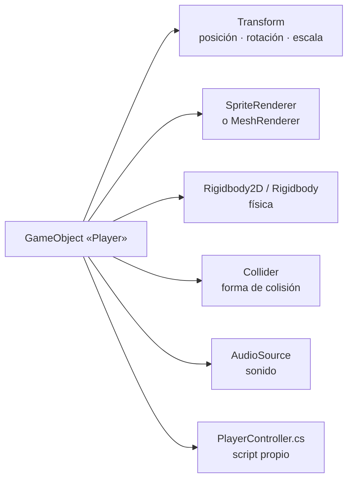

<ExportPDF />

# 2. Unity 6: entorno, escenas y GameObjects

## 2.1. Instalación

Unity se instala y gestiona desde **[Unity Hub](https://unity.com/download)**, que permite tener varias versiones del editor y crear proyectos.

1. Descarga e instala **Unity Hub** y crea o inicia sesión con una **Unity ID**.
2. Activa una licencia **Personal** (gratuita).
3. En **Installs → Install Editor**, instala la versión **LTS** más reciente de Unity 6 (en el curso, **Unity 6.3 LTS**, versión `6000.3`).
4. En los módulos, marca **Android Build Support** con **OpenJDK** y **Android SDK & NDK Tools**: así podrás generar el juego para Android sin configurar nada más.
5. Como editor de código, Unity integra **Visual Studio** o **JetBrains Rider** (gratuito para uso no comercial). También puedes usar **Visual Studio Code** con la extensión de Unity.

::: info-box ¿Qué es LTS?
Las versiones **LTS** (*Long Term Support*) reciben correcciones durante al menos dos años y son las recomendadas para proyectos y para el aula. Las versiones intermedias (*Supported* o *Update*) traen novedades antes, pero cambian más.
:::

::: tip-box Requisitos de hardware
Unity es exigente: se recomiendan **16 GB de RAM** y un SSD. Si tu equipo es modesto, trabaja con proyectos 2D o con la plantilla **Universal 3D** y calidad baja en el editor.
:::

### Crear un proyecto

En **Projects → New project** elige una plantilla:

| Plantilla | Uso |
|:---|:---|
| **Universal 2D** | Juegos 2D con el *Universal Render Pipeline* (URP) y luces 2D. |
| **Universal 3D** | Juegos 3D con URP. **Recomendada para móvil**. |
| **High Definition 3D** | Gráficos 3D de alta gama (PC y consola). No apta para móvil. |
| **Mobile 2D / Mobile 3D** | Ajustes pensados para móvil (según versión). |

::: info-box Render pipelines
Unity dibuja la escena mediante un ***render pipeline***. El **URP** (*Universal Render Pipeline*) es el recomendado para móvil por su equilibrio entre calidad y rendimiento. El **HDRP** apunta a equipos potentes y el *Built-in* es el sistema antiguo.
:::

## 2.2. El editor de Unity

| Ventana | Función |
|:---|:---|
| **Scene** | Vista de edición: colocas, mueves, rotas y escalas objetos. |
| **Game** | Lo que ve la cámara del juego. Se activa con el botón **Play**. |
| **Hierarchy** | Lista **jerárquica** de todos los objetos de la escena abierta. |
| **Inspector** | Propiedades y **componentes** del objeto seleccionado. |
| **Project** | Todos los *assets* del proyecto (carpeta `Assets`). |
| **Console** | Mensajes, avisos y errores (equivalente a Logcat). |

Atajos básicos en la vista **Scene**:

| Tecla | Herramienta |
|:---|:---|
| <kbd>Q</kbd> | Mano (desplazar la vista). |
| <kbd>W</kbd> | Mover. |
| <kbd>E</kbd> | Rotar. |
| <kbd>R</kbd> | Escalar. |
| <kbd>T</kbd> | Rect (2D y UI). |
| <kbd>F</kbd> | Enfocar el objeto seleccionado. |
| Botón derecho + <kbd>W</kbd><kbd>A</kbd><kbd>S</kbd><kbd>D</kbd> | Volar por la escena 3D. |

::: danger-box ¡Cuidado con el modo Play!
Los cambios que hagas en el **Inspector mientras el juego se ejecuta** (modo Play) **se pierden** al pararlo. Es útil para probar valores, pero apúntalos antes de salir.
:::

## 2.3. Estructura de un proyecto Unity

```
MiJuego/
├── Assets/              ← todo lo que forma el juego (escenas, scripts, sprites, modelos…)
│   ├── Scenes/
│   ├── Scripts/
│   ├── Prefabs/
│   ├── Sprites/  · Models/  · Materials/  · Audio/
│   └── Settings/        ← ajustes de URP y del Input System
├── Packages/            ← paquetes instalados (manifest.json)
├── ProjectSettings/     ← configuración del proyecto
├── Library/             ← caché generada (NO se versiona)
└── Temp/  · Logs/       ← temporales (NO se versionan)
```

::: tip-box Control de versiones
Usa Git con el [`.gitignore` oficial de Unity](https://github.com/github/gitignore/blob/main/Unity.gitignore), que excluye `Library/`, `Temp/`, `Logs/`… Para entregar un proyecto, **comprime solo** `Assets`, `Packages` y `ProjectSettings`.
:::

## 2.4. GameObjects y componentes

Unity sigue una arquitectura basada en **componentes**:

- Un **GameObject** es cualquier «cosa» de la escena: personaje, cámara, luz, suelo, marcador… Por sí solo es un contenedor vacío.
- Los **componentes** le dan comportamiento: aspecto, física, sonido, lógica…
- **Todo GameObject tiene un `Transform`**: posición, rotación y escala.



Componentes más habituales:

| Componente | Función |
|:---|:---|
| `Transform` | Posición, rotación y escala (obligatorio). |
| `SpriteRenderer` | Dibuja un sprite (2D). |
| `MeshFilter` + `MeshRenderer` | Malla 3D y su material. |
| `Rigidbody2D` / `Rigidbody` | El objeto participa en la simulación física. |
| `BoxCollider2D`, `CircleCollider2D`, `BoxCollider`, `SphereCollider`, `MeshCollider`… | Forma para detectar colisiones. |
| `Camera` | Punto de vista desde el que se renderiza. |
| `Light` | Fuente de luz (3D). |
| `AudioSource` / `AudioListener` | Emite / escucha sonido. |
| `Animator` | Reproduce animaciones con una máquina de estados. |
| Scripts (`MonoBehaviour`) | Lógica propia escrita en C#. |

::: info-box Composición frente a herencia
En lugar de crear una clase `EnemigoVoladorQueDispara` que herede de muchas otras, en Unity se **combinan componentes pequeños**: `Volar`, `Disparar`, `Vida`… Es la misma idea que los componentes propios pequeños y reutilizables de Jetpack Compose.
:::

## 2.5. Representación lógica de la escena: la jerarquía

Una **escena** (`.unity`) es un nivel o pantalla del juego: menú principal, nivel 1, pantalla de fin… La ventana **Hierarchy** muestra su **representación lógica**: un **árbol** de GameObjects en el que cada hijo hereda el `Transform` de su padre.

```
Nivel1                      (escena)
├── Main Camera
├── Global Light 2D
├── GameManager             ← objeto vacío con la lógica global
├── Player
│   ├── Sprite              ← el dibujo, separado de la lógica
│   └── GroundCheck         ← punto para detectar el suelo
├── Enemies
│   ├── Slime (1)
│   └── Slime (2)
├── Level
│   ├── Grid
│   │   └── Tilemap
│   └── Coins
└── Canvas                  ← interfaz (HUD)
    ├── ScoreText
    └── PauseButton
```

- Si mueves, rotas o escalas un **padre**, sus **hijos** se mueven con él.
- Los **objetos vacíos** (*Create Empty*) sirven para **agrupar** y ordenar la jerarquía, o como contenedores de lógica (`GameManager`).
- Las **etiquetas** (*Tags*, como `Player`) y las **capas** (*Layers*) clasifican los objetos para localizarlos desde código o para decidir qué colisiona con qué.

## 2.6. Representación espacial de la escena

### Sistema de coordenadas

Unity usa un sistema de coordenadas **cartesiano de mano izquierda** con el eje **Y hacia arriba**:

| Eje | Dirección | Color en el editor |
|:---|:---|:---|
| **X** | Derecha | Rojo |
| **Y** | Arriba | Verde |
| **Z** | Hacia delante (hacia dentro de la pantalla) | Azul |

- La unidad de medida es la **unidad de Unity** (por convención, **1 unidad = 1 metro**), importante para que la física se comporte con realismo.
- En **2D** se trabaja en el plano XY; la Z solo influye en el orden de dibujo junto con las **Sorting Layers** y el **Order in Layer** del `SpriteRenderer`.

### Espacio local y espacio global

| Espacio | Referencia | En código |
|:---|:---|:---|
| **Global** (*world*) | El origen de la escena. | `transform.position`, `transform.rotation` |
| **Local** | El objeto padre. | `transform.localPosition`, `transform.localRotation` |

La rotación se guarda internamente como **cuaterniones** (`Quaternion`) para evitar problemas como el bloqueo de cardán (*gimbal lock*); en el Inspector se muestra en **ángulos de Euler** (grados).

### Cámaras

| Proyección | Uso | Propiedad clave |
|:---|:---|:---|
| **Ortográfica** | 2D, isométrico: los objetos no se hacen pequeños con la distancia. | `Size` (mitad de la altura visible en unidades). |
| **Perspectiva** | 3D. | `Field of View` (ángulo de visión). |

Los **planos de recorte** (*near* y *far clipping planes*) limitan lo que la cámara dibuja: lo que queda fuera no se renderiza.

## 2.7. Prefabs

Un **prefab** es un GameObject guardado como *asset* reutilizable (moneda, enemigo, bala…). Se crea **arrastrando** un objeto de la jerarquía a la ventana Project.

- Todas las **instancias** de un prefab se actualizan cuando se modifica el prefab.
- Cada instancia puede **sobrescribir** valores concretos (*overrides*), que aparecen en negrita en el Inspector.
- Los **prefabs variantes** heredan de otro prefab (un `EnemigoRojo` basado en `Enemigo`).
- Desde código se crean copias con `Instantiate` (por ejemplo, disparos).

## 2.8. Assets e importación

| Tipo | Formatos habituales | Notas |
|:---|:---|:---|
| Imágenes y sprites | PNG, JPG, PSD | En 2D, *Texture Type* = **Sprite (2D and UI)**. |
| Modelos 3D | **FBX**, OBJ, `.blend` | FBX es el formato recomendado; incluye mallas, huesos y animaciones. |
| Audio | WAV, OGG, MP3 | Efectos cortos en WAV; música en OGG o MP3, comprimida. |
| Fuentes | TTF, OTF | Para la UI con **TextMeshPro**. |

::: warning-box Licencias de los assets
Usa assets **propios** o con licencia que permita su uso (por ejemplo, **CC0**). Fuentes recomendadas: [Kenney](https://kenney.nl/assets) (CC0), [OpenGameArt](https://opengameart.org/) (revisa cada licencia), [Freesound](https://freesound.org/) (revisa cada licencia) y la [Unity Asset Store](https://assetstore.unity.com/) (assets gratuitos y de pago). Indica siempre la autoría y la licencia en los créditos del juego.
:::

## 2.9. Analizar un juego existente en Unity

Unity ofrece proyectos completos para estudiar y modificar, disponibles en [Unity Learn](https://learn.unity.com/) y en el Hub. Para analizar uno:

1. **Abre la escena principal** y pulsa **Play** para jugar unos minutos.
2. Recorre la **Hierarchy**: localiza el jugador, la cámara, el gestor del juego, los enemigos y la interfaz.
3. Selecciona cada objeto y anota sus **componentes** en el Inspector.
4. Abre los **scripts** y relaciona sus campos públicos con lo que ves en el Inspector.
5. Identifica los **prefabs** (icono azul) y las **escenas** del proyecto (*File → Build Profiles → Scene List*).
6. Cambia valores (velocidad, gravedad, salto) y observa el efecto: es la base de las **modificaciones sobre juegos existentes** de la [Práctica 2](../ejercicios/02-modificar-juego).
