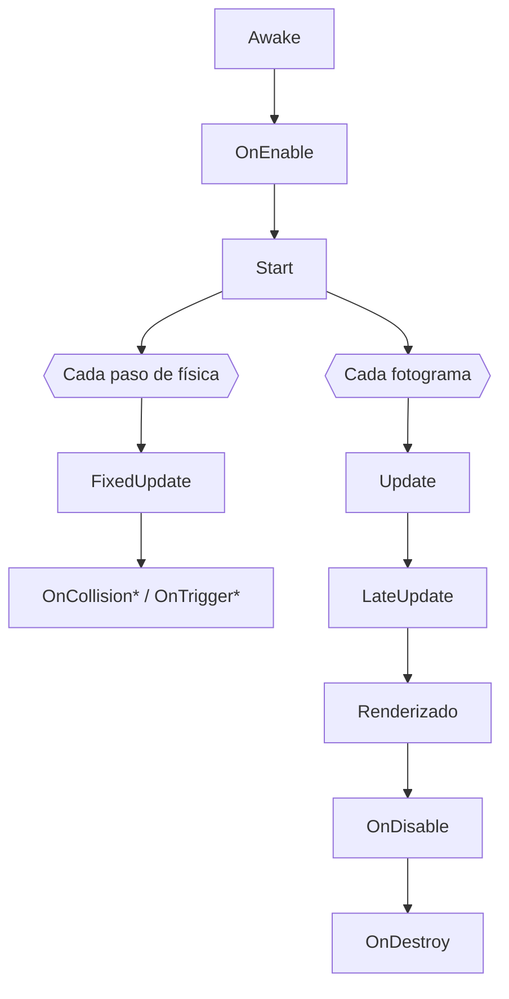

<ExportPDF />

# 3. Programación de la lógica del juego en C#

## 3.1. De Kotlin a C#

C# es un lenguaje orientado a objetos de tipado estático, muy parecido a Kotlin y Java. Las diferencias más visibles:

| Concepto | Kotlin | C# |
|:---|:---|:---|
| Variable | `var vidas = 3` / `val max = 5` | `int vidas = 3;` / `const int Max = 5;` (o `readonly`) |
| Tipo inferido | `var x = 2.5f` | `var x = 2.5f;` |
| Función | `fun sumar(a: Int, b: Int): Int` | `int Sumar(int a, int b)` |
| Nulos | `String?`, `?.`, `?:` | `string` (referencia), `?.`, `??` |
| Clase | `class Jugador : Personaje()` | `class Jugador : Personaje` |
| Propiedad | `var vida: Int = 3` | `public int Vida { get; private set; } = 3;` |
| Lista | `mutableListOf<Int>()` | `new List<int>()` |
| Plantilla de texto | `"Vidas: $vidas"` | `$"Vidas: {vidas}"` |
| Fin de instrucción | Opcional | Obligatorio `;` |
| Convención | `camelCase` para métodos | `PascalCase` para métodos y clases |

## 3.2. Scripts: la clase MonoBehaviour

Un script de Unity es una clase C# que **hereda de `MonoBehaviour`** y se añade como **componente** a un GameObject (*Add Component* o arrastrándolo al Inspector). El nombre de la clase debe coincidir con el del archivo.

```csharp [PlayerController.cs]
using UnityEngine;

public class PlayerController : MonoBehaviour
{
    // Visible y editable en el Inspector
    [SerializeField] private float speed = 5f;

    // Se llama una vez, antes del primer fotograma
    void Start()
    {
        Debug.Log("¡Hola desde " + gameObject.name + "!");
    }

    // Se llama una vez por fotograma
    void Update()
    {
        transform.Translate(Vector3.right * speed * Time.deltaTime);
    }
}
```

- `[SerializeField]` muestra un campo **privado** en el Inspector, para ajustar valores sin tocar el código (buena práctica frente a hacer los campos `public`).
- `gameObject` y `transform` dan acceso al objeto al que está unido el script.
- `Debug.Log` escribe en la **Console**.

### Ciclo de vida de un MonoBehaviour

Igual que una `Activity` tiene `onCreate`, `onResume`…, un `MonoBehaviour` tiene sus **métodos de evento**, que Unity llama automáticamente:



| Método | Cuándo se ejecuta | Uso típico |
|:---|:---|:---|
| `Awake()` | Al cargar el objeto, aunque el script esté desactivado. | Obtener referencias a componentes propios. |
| `OnEnable()` | Cada vez que el objeto o el script se activa. | Suscribirse a eventos. |
| `Start()` | Antes del primer `Update`, solo si está activo. | Inicializar usando otros objetos. |
| `Update()` | **Una vez por fotograma** (frecuencia variable). | Leer la entrada, lógica, temporizadores. |
| `FixedUpdate()` | **Con paso fijo** (50 veces/s por defecto). | **Física**: fuerzas y velocidades del `Rigidbody`. |
| `LateUpdate()` | Después de todos los `Update`. | Seguimiento de cámara. |
| `OnDisable()` / `OnDestroy()` | Al desactivar / destruir. | Liberar recursos, desuscribirse. |

Tienes el orden completo en la documentación: [Order of execution for event functions](https://docs.unity3d.com/Manual/execution-order.html).

### Independencia de la velocidad de fotogramas

`Time.deltaTime` es el tiempo, en segundos, del último fotograma. Multiplicar por él convierte «unidades por fotograma» en «**unidades por segundo**», de modo que el juego se mueve igual en un móvil a 30 FPS que en uno a 120 FPS.

```csharp
// ❌ Depende de los FPS: el doble de rápido a 120 FPS que a 60 FPS
transform.position += Vector3.right * 0.1f;

// ✅ 5 unidades por segundo en cualquier dispositivo
transform.position += Vector3.right * 5f * Time.deltaTime;
```

## 3.3. Acceso a componentes y a otros objetos

```csharp
public class Player : MonoBehaviour
{
    [SerializeField] private AudioSource jumpSound;   // asignado en el Inspector
    private Rigidbody2D rb;
    private Animator animator;

    void Awake()
    {
        // Componentes del mismo GameObject
        rb = GetComponent<Rigidbody2D>();
        animator = GetComponent<Animator>();
    }

    void Start()
    {
        // Otro objeto de la escena (úsalo con moderación: es lento)
        var manager = FindFirstObjectByType<GameManager>();
    }
}
```

::: tip-box Buenas prácticas
- Obtén las referencias **una sola vez** (en `Awake` o `Start`) y guárdalas; nunca llames a `GetComponent` o a `Find…` dentro de `Update`.
- Siempre que puedas, **asigna las referencias desde el Inspector** con `[SerializeField]`.
- `[RequireComponent(typeof(Rigidbody2D))]` encima de la clase obliga a que el objeto tenga ese componente.
:::

## 3.4. Entrada con el Input System

Unity 6 usa por defecto el paquete **[Input System](https://docs.unity3d.com/Packages/com.unity.inputsystem@latest)**, que separa los **dispositivos** de las **acciones** del juego. Los proyectos nuevos incluyen un archivo de acciones de proyecto, **`InputSystem_Actions`**, con un mapa `Player` que ya define acciones como `Move`, `Look`, `Jump` o `Attack`, vinculadas a teclado, ratón, mando **y pantalla táctil**.

```csharp [PlayerInputExample.cs]
using UnityEngine;
using UnityEngine.InputSystem;

public class PlayerInputExample : MonoBehaviour
{
    private InputAction moveAction;
    private InputAction jumpAction;

    void Start()
    {
        // Acciones definidas en Project Settings → Input System Package
        moveAction = InputSystem.actions.FindAction("Move");
        jumpAction = InputSystem.actions.FindAction("Jump");
    }

    void Update()
    {
        Vector2 move = moveAction.ReadValue<Vector2>();   // (-1..1, -1..1)
        if (jumpAction.WasPressedThisFrame())
        {
            Debug.Log("¡Salto!");
        }
    }
}
```

| Método | Devuelve `true`… |
|:---|:---|
| `WasPressedThisFrame()` | Solo en el fotograma en que se pulsa. |
| `IsPressed()` | Mientras se mantiene pulsado. |
| `WasReleasedThisFrame()` | En el fotograma en que se suelta. |
| `ReadValue<T>()` | Devuelve el valor (por ejemplo, un `Vector2` para un joystick). |

::: info-box Entrada táctil en móvil
Para móviles puedes añadir **controles en pantalla** con los componentes `On-Screen Stick` y `On-Screen Button` del Input System, que simulan un joystick y botones y se conectan a las mismas acciones. Así el mismo código funciona en el ordenador y en el móvil. Para gestos (deslizar, pellizcar) existe la API `EnhancedTouch`.
:::

## 3.5. Movimiento y física desde código

Hay dos formas de mover objetos:

| Forma | Cómo | Cuándo |
|:---|:---|:---|
| **Transform** | Cambiar `transform.position` o usar `Translate`. | Objetos **sin física** (decorados, UI, plataformas cinemáticas). |
| **Rigidbody** | Cambiar la velocidad o aplicar fuerzas en `FixedUpdate`. | Objetos **con física**: así colisionan correctamente. |

```csharp [PlayerMovement2D.cs]
using UnityEngine;
using UnityEngine.InputSystem;

[RequireComponent(typeof(Rigidbody2D))]
public class PlayerMovement2D : MonoBehaviour
{
    [SerializeField] private float speed = 6f;
    [SerializeField] private float jumpForce = 12f;

    private Rigidbody2D rb;
    private InputAction moveAction, jumpAction;
    private float horizontal;
    private bool jumpRequested;

    void Awake() => rb = GetComponent<Rigidbody2D>();

    void Start()
    {
        moveAction = InputSystem.actions.FindAction("Move");
        jumpAction = InputSystem.actions.FindAction("Jump");
    }

    // Entrada: en Update, para no perder pulsaciones
    void Update()
    {
        horizontal = moveAction.ReadValue<Vector2>().x;
        if (jumpAction.WasPressedThisFrame()) jumpRequested = true;
    }

    // Física: en FixedUpdate
    void FixedUpdate()
    {
        rb.linearVelocity = new Vector2(horizontal * speed, rb.linearVelocity.y);

        if (jumpRequested)
        {
            rb.AddForce(Vector2.up * jumpForce, ForceMode2D.Impulse);
            jumpRequested = false;
        }
    }
}
```

::: info-box Cambios de nombre en Unity 6
En Unity 6, `Rigidbody.velocity` pasó a llamarse **`linearVelocity`** y `drag` a **`linearDamping`** (igual en 2D). Si sigues un tutorial antiguo y ves `velocity`, usa el nombre nuevo.
:::

## 3.6. Colisiones y triggers

Para que dos objetos interactúen, **ambos** necesitan un **collider** y **al menos uno** un **Rigidbody**.

| Tipo | Configuración | Comportamiento | Métodos |
|:---|:---|:---|:---|
| **Colisión** | Collider normal. | Los objetos **chocan** y se empujan. | `OnCollisionEnter`, `OnCollisionStay`, `OnCollisionExit` |
| **Trigger** | Collider con **Is Trigger** marcado. | Los objetos se **atraviesan**, pero se detecta el contacto. | `OnTriggerEnter`, `OnTriggerStay`, `OnTriggerExit` |

En 2D los métodos terminan en `2D` (`OnCollisionEnter2D`, `OnTriggerEnter2D`) y reciben `Collision2D` / `Collider2D`.

```csharp [Coin.cs]
using UnityEngine;

public class Coin : MonoBehaviour
{
    [SerializeField] private int value = 1;
    [SerializeField] private AudioClip pickupClip;

    // El collider de la moneda tiene "Is Trigger" marcado
    void OnTriggerEnter2D(Collider2D other)
    {
        if (other.CompareTag("Player"))
        {
            GameManager.Instance.AddScore(value);
            AudioSource.PlayClipAtPoint(pickupClip, transform.position);
            Destroy(gameObject);
        }
    }
}
```

```csharp [Enemy.cs]
void OnCollisionEnter2D(Collision2D collision)
{
    if (collision.gameObject.CompareTag("Player"))
    {
        collision.gameObject.GetComponent<PlayerHealth>().TakeDamage(1);
    }
}
```

## 3.7. Crear y destruir objetos

```csharp
[SerializeField] private GameObject bulletPrefab;
[SerializeField] private Transform firePoint;

void Shoot()
{
    GameObject bullet = Instantiate(bulletPrefab, firePoint.position, firePoint.rotation);
    Destroy(bullet, 3f);   // se destruye a los 3 segundos
}
```

::: warning-box Crear y destruir tiene un coste
En móvil, crear y destruir muchos objetos por segundo provoca tirones por la **recolección de basura**. Para balas, partículas o enemigos repetidos se usa un ***object pool*** (ver el [apartado 6](./06-fases-optimizacion-android#_6-5-optimizacion)).
:::

## 3.8. Corrutinas: acciones en el tiempo

Una **corrutina** de Unity es un método que puede **pausarse** y continuar más tarde, sin bloquear el juego. Recuerda a las corrutinas de Kotlin, pero se basa en `IEnumerator` y `yield`:

```csharp
using System.Collections;
using UnityEngine;

public class Spawner : MonoBehaviour
{
    [SerializeField] private GameObject enemyPrefab;
    [SerializeField] private float interval = 2f;

    void Start() => StartCoroutine(SpawnLoop());

    IEnumerator SpawnLoop()
    {
        while (true)
        {
            Instantiate(enemyPrefab, transform.position, Quaternion.identity);
            yield return new WaitForSeconds(interval);   // espera sin bloquear
        }
    }
}
```

## 3.9. Gestor del juego, escenas y persistencia

Un patrón muy habitual es un **GameManager** único (*singleton*) que guarda el estado global: puntuación, vidas, fin de partida.

```csharp [GameManager.cs]
using UnityEngine;
using UnityEngine.SceneManagement;
using TMPro;

public class GameManager : MonoBehaviour
{
    public static GameManager Instance { get; private set; }

    [SerializeField] private TMP_Text scoreText;
    private int score;

    void Awake()
    {
        if (Instance != null && Instance != this) { Destroy(gameObject); return; }
        Instance = this;
    }

    public void AddScore(int amount)
    {
        score += amount;
        scoreText.text = $"Puntos: {score}";
    }

    public void GameOver()
    {
        int best = PlayerPrefs.GetInt("best", 0);
        if (score > best) PlayerPrefs.SetInt("best", score);   // persistencia sencilla
        SceneManager.LoadScene("GameOver");
    }
}
```

| API | Función |
|:---|:---|
| `SceneManager.LoadScene("Nombre")` | Cambia de escena. La escena debe estar en la lista de *Build Profiles*. |
| `DontDestroyOnLoad(gameObject)` | El objeto sobrevive al cambio de escena (música, gestor). |
| `PlayerPrefs` | Guarda datos sencillos clave-valor (como DataStore Preferences). |
| `Time.timeScale = 0` | Pausa la simulación (`1` la reanuda). |

::: tip-box ScriptableObjects
Para datos de configuración (estadísticas de enemigos, niveles, armas) Unity ofrece los **[ScriptableObject](https://docs.unity3d.com/Manual/class-ScriptableObject.html)**: *assets* con datos que se editan en el Inspector y se comparten entre objetos, separando datos y lógica.
:::

## 3.10. Depuración

- **Console**: `Debug.Log`, `Debug.LogWarning`, `Debug.LogError`. Al hacer doble clic en un error se abre la línea del script.
- **Gizmos**: `Debug.DrawRay` y `OnDrawGizmos()` dibujan líneas y formas en la vista Scene (rayos de detección, radios de ataque).
- **Puntos de ruptura**: con Visual Studio o Rider, pulsa *Attach to Unity* y pon *breakpoints* como en Android Studio.
- **Inspector en modo Debug**: el menú ⋮ del Inspector permite ver también los campos privados.
