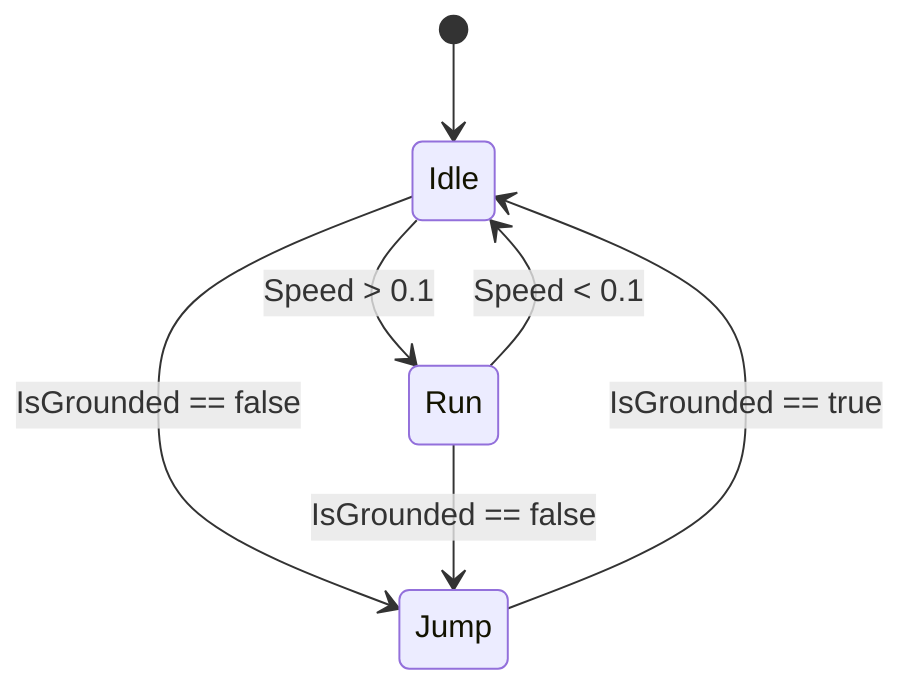

<ExportPDF />

# 4. Desarrollo de juegos 2D

En este apartado se construyen las piezas de un juego de **plataformas 2D**: sprites, niveles con *tilemaps*, física, animación, cámara, interfaz y sonido. Crea el proyecto con la plantilla **Universal 2D**.

## 4.1. Sprites

Un **sprite** es una imagen 2D que se dibuja en la escena. Al importar un PNG, en el Inspector:

| Propiedad | Valor recomendado | Por qué |
|:---|:---|:---|
| **Texture Type** | Sprite (2D and UI) | Para usarlo como sprite. |
| **Sprite Mode** | *Single* (una imagen) o *Multiple* (hoja de sprites). | Las hojas contienen varios fotogramas. |
| **Pixels Per Unit** (PPU) | El tamaño de tu *tile* (16, 32…) | Cuántos píxeles ocupan **1 unidad** (1 m) del mundo. Usa el mismo valor en todo el proyecto. |
| **Filter Mode** | *Point (no filter)* para *pixel art*; *Bilinear* para arte suave. | Evita que el *pixel art* se vea borroso. |
| **Compression** | *None* para *pixel art*; comprimida en el resto. | La compresión estropea los píxeles nítidos. |

### Hojas de sprites y Sprite Editor

Con *Sprite Mode = Multiple*, abre el **Sprite Editor** (paquete *2D Sprite*) y usa **Slice** para recortar la hoja automáticamente o por cuadrícula (*Grid By Cell Size*). Cada recorte se convierte en un sprite independiente.

### Orden de dibujo

En 2D, qué se dibuja delante lo deciden, en este orden:

1. **Sorting Layer** del `SpriteRenderer` (por ejemplo: `Background`, `Level`, `Player`, `Foreground`).
2. **Order in Layer** dentro de la misma capa (mayor = más delante).

::: tip-box Separa el dibujo de la lógica
Coloca el `SpriteRenderer` en un **hijo** del objeto con la física y la lógica. Así puedes voltear, escalar o animar el dibujo sin alterar el collider ni el movimiento.
:::

## 4.2. Niveles con Tilemap

Los niveles 2D se construyen como un mosaico de **baldosas** (*tiles*), igual que en muchos juegos clásicos.

1. *GameObject → 2D Object → Tilemap → Rectangular*. Se crea un `Grid` con un `Tilemap` hijo.
2. Abre *Window → 2D → Tile Palette*, crea una paleta y **arrastra** el *tileset* recortado: cada sprite se convierte en un *tile*.
3. Pinta el nivel con el pincel, el relleno o el rectángulo.
4. Crea varios *tilemaps* para separar **fondo**, **suelo sólido** y **decoración**, cada uno con su *Sorting Layer*.

### Colisiones del tilemap

En el *tilemap* del suelo añade:

| Componente | Función |
|:---|:---|
| `Tilemap Collider 2D` | Un collider por cada *tile*. |
| `Composite Collider 2D` | Une todos en una única forma: más eficiente y sin «enganches» entre baldosas. Marca *Composite Operation = Merge* en el `Tilemap Collider 2D`. |
| `Rigidbody2D` | Lo añade el composite; ponlo en *Body Type = Static*. |

::: info-box Rule Tiles
El paquete *2D Tilemap Extras* incluye los **Rule Tiles**, que eligen automáticamente la baldosa correcta (esquina, borde, centro) según las vecinas.
:::

## 4.3. Física 2D

### Rigidbody2D

| Body Type | Comportamiento | Ejemplo |
|:---|:---|:---|
| **Dynamic** | Afectado por gravedad, fuerzas y colisiones. | Jugador, cajas, pelotas. |
| **Kinematic** | Se mueve solo por código; no le afecta la gravedad ni las fuerzas, pero empuja a los dinámicos. | Plataformas móviles. |
| **Static** | No se mueve. | Suelo, paredes. |

Propiedades importantes: **Mass** (masa), **Gravity Scale** (multiplicador de la gravedad; `0` para juegos vistos desde arriba), **Linear Damping** (rozamiento con el aire), **Collision Detection** (*Continuous* para objetos rápidos) y **Constraints → Freeze Rotation Z** (para que el personaje no vuelque).

### Colliders 2D

`BoxCollider2D`, `CircleCollider2D`, `CapsuleCollider2D` (ideal para personajes), `PolygonCollider2D` y `EdgeCollider2D` (líneas). Usa **formas simples**: son mucho más baratas de calcular.

### Physics Material 2D: fricción y rebote

Crea un *asset* *Physics Material 2D* y asígnalo al collider:

| Propiedad | Efecto |
|:---|:---|
| **Friction** | Rozamiento. `0` evita que el personaje se quede pegado a las paredes al saltar contra ellas. |
| **Bounciness** | Rebote: `0` no rebota, `1` rebota sin perder energía (pelota). |

### Gravedad global y capas

En *Project Settings → Physics 2D* se ajusta la **gravedad** (por defecto `(0, -9.81)`) y la **matriz de colisión entre capas** (*Layer Collision Matrix*): por ejemplo, que los enemigos no choquen entre sí o que las balas del jugador no le golpeen.

### Detectar el suelo

```csharp
[SerializeField] private Transform groundCheck;      // objeto hijo a los pies
[SerializeField] private LayerMask groundLayer;      // capa "Ground"
private bool isGrounded;

void FixedUpdate()
{
    isGrounded = Physics2D.OverlapCircle(groundCheck.position, 0.1f, groundLayer);
}
```

Así solo se permite saltar cuando `isGrounded` es `true`.

## 4.4. Animación 2D

### Animación por fotogramas

1. Selecciona los sprites de una animación (por ejemplo, los 6 fotogramas de «correr») y **arrástralos a la escena** o al personaje: Unity crea un **Animation Clip** y un **Animator Controller**.
2. Ajusta la velocidad (*Samples*) en la ventana **Animation** (*Window → Animation → Animation*).
3. En esa ventana también puedes animar **cualquier propiedad** (posición, color, escala) con *keyframes*: ideal para plataformas móviles o efectos.

### Animator: máquina de estados

La ventana **Animator** muestra los **estados** (`Idle`, `Run`, `Jump`) y las **transiciones** entre ellos, que dependen de **parámetros**:



| Tipo de parámetro | Ejemplo |
|:---|:---|
| `Float` | `Speed` |
| `Bool` | `IsGrounded` |
| `Trigger` | `Hurt` (se dispara una vez) |
| `Int` | `WeaponType` |

```csharp
private Animator animator;
private SpriteRenderer sprite;

void Update()
{
    animator.SetFloat("Speed", Mathf.Abs(horizontal));
    animator.SetBool("IsGrounded", isGrounded);

    // Voltear el sprite según la dirección
    if (horizontal != 0) sprite.flipX = horizontal < 0;
}
```

::: tip-box Transiciones ágiles
En las transiciones de un personaje 2D desactiva **Has Exit Time** y pon **Transition Duration = 0**: si no, la animación tarda en responder a los controles.
:::

Para personajes con muchas animaciones existen el **2D Animation** (animación esqueletal 2D con huesos) y el **Sprite Library**, en el paquete *2D Animation*.

## 4.5. Cámara 2D con Cinemachine

**[Cinemachine](https://docs.unity3d.com/Packages/com.unity.cinemachine@latest)** crea cámaras inteligentes sin programarlas. Instálalo desde el *Package Manager*.

1. *GameObject → Cinemachine → 2D Camera*. Se crea una **`CinemachineCamera`** y se añade un `CinemachineBrain` a la cámara principal.
2. En **Tracking Target** arrastra el jugador.
3. En **Position Control** usa *Position Composer* y ajusta la **zona muerta** (*Dead Zone*) y el **amortiguado** (*Damping*) para un seguimiento suave.
4. Con la extensión **Cinemachine Confiner 2D** y un `PolygonCollider2D` como límite, la cámara no muestra nada fuera del nivel.

::: info-box Cinemachine 3
En Cinemachine 3 (Unity 6) el componente `CinemachineVirtualCamera` se llama **`CinemachineCamera`** y el espacio de nombres es `Unity.Cinemachine`. Ten en cuenta este cambio si sigues tutoriales antiguos.
:::

### Fondos con paralaje

El **paralaje** (*parallax*) mueve las capas del fondo más despacio que la cámara para dar sensación de profundidad:

```csharp [Parallax.cs]
public class Parallax : MonoBehaviour
{
    [SerializeField] private Transform cam;
    [SerializeField, Range(0f, 1f)] private float factor = 0.5f;   // 0 = fijo, 1 = como la cámara
    private Vector3 startPos, camStart;

    void Start() { startPos = transform.position; camStart = cam.position; }

    void LateUpdate()
    {
        Vector3 delta = cam.position - camStart;
        transform.position = startPos + new Vector3(delta.x * factor, delta.y * factor, 0);
    }
}
```

## 4.6. Interfaz de usuario (UI)

La UI se dibuja en un **Canvas** (*GameObject → UI*). Para móvil:

| Ajuste | Valor |
|:---|:---|
| **Canvas Scaler → UI Scale Mode** | *Scale With Screen Size*, con una resolución de referencia (por ejemplo, 1920×1080) y *Match* 0,5. Así la UI se adapta a cualquier pantalla. |
| **Anclas** (*anchors*) | Ancla cada elemento a su esquina o borde para que no se salga en pantallas alargadas. |
| **Texto** | Usa **TextMeshPro** (`TMP_Text`), nítido a cualquier tamaño. |
| **Safe Area** | Deja margen para la **muesca** (*notch*) y las esquinas redondeadas (`Screen.safeArea`). |

Los botones llaman a métodos públicos desde su evento **On Click ()** en el Inspector, sin escribir código de conexión.

::: info-box UI Toolkit
Unity también dispone de **UI Toolkit**, un sistema de interfaz basado en documentos (UXML + USS, parecido a HTML + CSS). En este módulo se usa el Canvas (uGUI), que es el más documentado para juegos.
:::

## 4.7. Sonido en 2D

| Componente | Función |
|:---|:---|
| `AudioListener` | El «oído» del juego (normalmente en la cámara). **Solo uno por escena**. |
| `AudioSource` | Reproduce un `AudioClip`. En 2D, pon *Spatial Blend* a **0 (2D)**. |

```csharp
[SerializeField] private AudioSource sfxSource;
[SerializeField] private AudioClip jumpClip;

void Jump()
{
    rb.AddForce(Vector2.up * jumpForce, ForceMode2D.Impulse);
    sfxSource.PlayOneShot(jumpClip);   // permite solapar varios efectos
}
```

Para la **música**, usa otro `AudioSource` con *Loop* y *Play On Awake* activados, en un objeto con `DontDestroyOnLoad` si debe sonar entre escenas. Con un **Audio Mixer** puedes crear grupos (*Music*, *SFX*) y controlar su volumen desde un menú de opciones. Los detalles del audio se amplían en el [apartado 5.6](./05-juegos-3d#_5-6-fuentes-de-audio).

## 4.8. Resumen: anatomía de un plataformas 2D

```
Nivel1
├── Main Camera  (Camera ortográfica + CinemachineBrain + AudioListener)
├── CM Camera    (CinemachineCamera → sigue a Player, Confiner 2D)
├── Global Light 2D
├── GameManager  (GameManager.cs, AudioSource música)
├── Player       (Rigidbody2D Dynamic, CapsuleCollider2D, PlayerMovement2D.cs, AudioSource)
│   ├── Sprite   (SpriteRenderer, Animator)
│   └── GroundCheck
├── Grid
│   ├── Background   (Tilemap, sin collider)
│   └── Ground       (Tilemap + Tilemap Collider 2D + Composite Collider 2D)
├── Coins        (prefabs Coin: SpriteRenderer, CircleCollider2D trigger, Coin.cs)
├── Enemies      (prefabs Slime: Rigidbody2D, collider, Patrol.cs, Animator)
├── Goal         (trigger que carga la siguiente escena)
└── Canvas       (Canvas Scaler, ScoreText, botones táctiles On-Screen)
```
