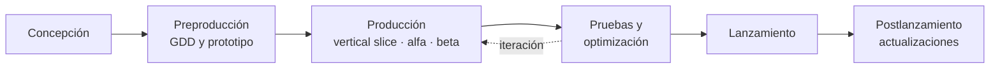
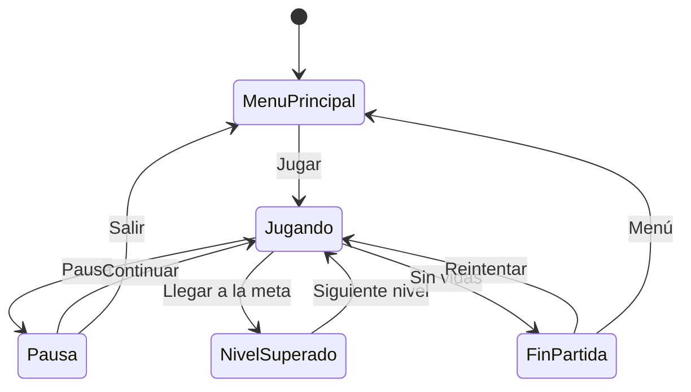

<ExportPDF />

# 6. Fases de desarrollo, pruebas, optimización y despliegue en Android

## 6.1. Fases del desarrollo de un videojuego



| Fase | Objetivo | Resultados |
|:---|:---|:---|
| **Concepción** | Definir la idea: género, público, plataforma, propuesta diferenciadora. | Concepto en una página (*one-pager*). |
| **Preproducción** | Diseñar el juego y comprobar que **es divertido** antes de invertir en él. | **GDD**, prototipo jugable con *greyboxing*, planificación. |
| **Producción** | Construir el juego completo. | ***Vertical slice*** (un trozo con calidad final), versión **alfa** (todas las funciones) y **beta** (todo el contenido, corrigiendo errores). |
| **Pruebas y optimización** | Corregir errores, equilibrar la dificultad y alcanzar el rendimiento objetivo. | Versión candidata (*release candidate*). |
| **Lanzamiento** | Publicar en la tienda. | Ficha de Google Play, capturas, vídeo. |
| **Postlanzamiento** | Mantener y mejorar el juego. | Parches, contenido nuevo. |

El desarrollo es **iterativo**: se prueba constantemente y se vuelve atrás cuando algo no funciona o no es divertido. Las metodologías **ágiles** (Scrum, Kanban) encajan bien con este ciclo.

## 6.2. Establecer la lógica de un juego: el GDD

El **documento de diseño del juego** (*Game Design Document*, GDD) recoge todas las decisiones de diseño. Es un documento **vivo** que se actualiza durante el desarrollo. Para un juego pequeño basta con unas pocas páginas:

| Sección | Contenido |
|:---|:---|
| **Ficha** | Título, género, plataforma, público objetivo, referencias (juegos parecidos). |
| **Concepto** | Resumen en dos o tres frases y propuesta diferenciadora. |
| **Bucle de juego** (*core loop*) | Qué hace el jugador una y otra vez, y por qué es divertido. |
| **Mecánicas** | Acciones del jugador (moverse, saltar, disparar…) y reglas. |
| **Controles** | Cómo se maneja en pantalla táctil (y opcionalmente teclado o mando). |
| **Objetivos y progresión** | Cómo se gana y se pierde; niveles y dificultad. |
| **Elementos del juego** | Personajes, enemigos, objetos y sus propiedades (vida, velocidad, daño…). |
| **Niveles y escenas** | Bocetos o mapas, lista de escenas y flujo entre ellas. |
| **Interfaz** | Menús, HUD, flujo de pantallas. |
| **Arte y sonido** | Estilo visual, paleta, referencias, música y efectos, **fuentes y licencias** de los assets. |
| **Tecnología** | Motor, versión, *render pipeline*, paquetes, plataformas, rendimiento objetivo. |
| **Planificación** | Tareas, hitos y reparto. |

### Diagrama de estados del juego

La lógica global se describe bien con una **máquina de estados**:



## 6.3. Pruebas

| Tipo | Qué se comprueba | Cómo |
|:---|:---|:---|
| **Funcionales** | Que cada mecánica funciona como dice el GDD. | Lista de comprobación por mecánica y escena. |
| **De jugabilidad** (*playtesting*) | Si se entiende, si es divertido, si la dificultad es adecuada. | Observar a otras personas jugar **sin ayudarles** y anotar dónde se atascan. |
| **De interacción en dispositivo** | Tamaño de los botones, posición de los pulgares, legibilidad, orientación. | En el **Device Simulator** y en un **móvil real**. |
| **De rendimiento** | FPS estables, memoria, temperatura, batería. | Profiler conectado al dispositivo. |
| **De regresión** | Que lo que funcionaba sigue funcionando tras un cambio. | Repetir la lista de comprobación; el paquete **Test Framework** permite pruebas automáticas. |

::: tip-box Device Simulator
La ventana **Simulator** (en la pestaña *Game*, cambia de *Game* a *Simulator*) muestra el juego con el tamaño, la resolución, la muesca y el área segura de muchos móviles reales. Permite detectar problemas de interfaz sin instalar nada.
:::

## 6.4. Análisis de ejecución

### Ventana Stats

En la vista *Game*, el botón **Stats** muestra los FPS, el tiempo de CPU, los ***batches*** (llamadas de dibujo agrupadas), los triángulos y los vértices.

### Profiler

*Window → Analysis → Profiler* registra fotograma a fotograma en qué se gasta el tiempo y la memoria:

| Módulo | Qué muestra |
|:---|:---|
| **CPU Usage** | Tiempo de scripts, física, animación, renderizado. Con la vista *Hierarchy* localizas el método más costoso. |
| **GPU Usage** | Tiempo de dibujo (no todos los dispositivos lo permiten). |
| **Rendering** | *Draw calls*, *batches*, triángulos. |
| **Memory** | Memoria usada por texturas, mallas, audio… |
| **GC Alloc** | Memoria reservada por los scripts en cada fotograma. Debe ser **cercana a cero** durante el juego. |

Para medir en el móvil: activa **Development Build** y **Autoconnect Profiler** en el *Build Profile* y conecta el dispositivo.

El **Frame Debugger** (*Window → Analysis*) muestra paso a paso cómo se dibuja un fotograma, para ver qué rompe el agrupamiento de *draw calls*.

## 6.5. Optimización

::: warning-box Mide antes de optimizar
Optimiza **solo lo que el Profiler demuestre que es un problema**, y comprueba después que la mejora es real. Optimizar a ciegas consume tiempo y complica el código.
:::

### Código

| Problema | Solución |
|:---|:---|
| `GetComponent`, `Find…` o `Camera.main` en `Update` | Guardar las referencias en `Awake`/`Start`. |
| Crear y destruir objetos constantemente | ***Object pooling***: reutilizar objetos desactivados. |
| Concatenar cadenas o crear listas en cada fotograma | Reutilizar estructuras; actualizar el texto del HUD solo cuando cambia el valor. |
| Lógica costosa en cada fotograma | Ejecutarla cada cierto tiempo con una corrutina o un temporizador. |
| Física en `Update` | Moverla a `FixedUpdate`. |

Unity incluye un *pool* genérico, `UnityEngine.Pool.ObjectPool<T>`:

```csharp [BulletPool.cs]
using UnityEngine;
using UnityEngine.Pool;

public class BulletPool : MonoBehaviour
{
    [SerializeField] private Bullet bulletPrefab;
    private ObjectPool<Bullet> pool;

    void Awake()
    {
        pool = new ObjectPool<Bullet>(
            createFunc: () => Instantiate(bulletPrefab),
            actionOnGet: b => b.gameObject.SetActive(true),
            actionOnRelease: b => b.gameObject.SetActive(false),
            actionOnDestroy: b => Destroy(b.gameObject),
            defaultCapacity: 20,
            maxSize: 100);
    }

    public Bullet Get(Vector3 position)
    {
        Bullet b = pool.Get();
        b.transform.position = position;
        b.Init(pool);            // la bala se devuelve sola con pool.Release(this)
        return b;
    }
}
```

### Gráficos

| Técnica | Efecto |
|:---|:---|
| **SRP Batcher** (activo en URP) y ***static batching*** | Agrupa objetos con el mismo shader o estáticos y reduce el coste de CPU de cada *draw call*. |
| **GPU Instancing** | Dibuja muchas copias de una misma malla (hierba, árboles) en una sola llamada. |
| **Sprite Atlas** | Une muchos sprites en una textura para dibujarlos juntos. |
| **LOD Group** | Usa mallas más simples cuando el objeto está lejos. |
| **Occlusion Culling** | No dibuja lo que queda oculto detrás de otros objetos. |
| **Iluminación horneada** | Sustituye luces y sombras en tiempo real por *lightmaps*. |
| **Texturas** | Compresión ASTC, tamaño máximo ajustado, *mipmaps*. |
| **Calidad** | *Project Settings → Quality* y los ajustes del URP Asset (escala de renderizado, MSAA, sombras). |

### Física

- Usa colliders **primitivos** en lugar de `MeshCollider`.
- Ajusta la **matriz de colisiones** para que no se comprueben pares innecesarios.
- No subas el *Fixed Timestep* más de lo necesario.

### Específico de móvil

- **Fotogramas**: Android suele limitar el juego a 30 FPS por defecto. Fija el objetivo con `Application.targetFrameRate = 60;` si el juego lo necesita, o déjalo en 30 para ahorrar batería en juegos tranquilos.
- **Calentamiento**: un móvil caliente reduce su rendimiento (*thermal throttling*). Prueba sesiones largas, no solo un minuto.
- **Tamaño del APK/AAB**: elimina assets no usados y comprime texturas y audio.

## 6.6. Empaquetado y despliegue en Android

### Preparar el proyecto

1. *File → **Build Profiles*** (en Unity 6 sustituye a la antigua *Build Settings*).
2. Selecciona **Android** y pulsa **Switch Platform** (la primera vez reimporta los assets y tarda).
3. En **Scene List**, añade las escenas en orden: la **0** es la que se carga al abrir el juego.

### Player Settings

En *Project Settings → Player → Android*:

| Ajuste | Valor |
|:---|:---|
| **Company Name** / **Product Name** | Tu nombre / nombre del juego (el que aparece bajo el icono). |
| **Version** / **Bundle Version Code** | Versión visible (`1.0`) y código entero que **debe aumentar** en cada publicación. |
| **Default Icon** / *Adaptive icons* | Icono del juego. |
| **Splash Image** | Pantalla de carga (en la licencia Personal se muestra el logo de Unity). |
| **Default Orientation** | *Portrait*, *Landscape Left* o *Auto Rotation* con las orientaciones permitidas. |
| **Package Name** | Identificador único, `com.tunombre.nombrejuego` (como el `applicationId` de Android Studio). |
| **Minimum API Level** / **Target API Level** | Versión mínima de Android y versión objetivo (Google Play exige una API objetivo reciente). |
| **Scripting Backend** | **IL2CPP** (compila C# a código nativo; obligatorio para 64 bits). |
| **Target Architectures** | **ARM64** (requisito de Google Play). |
| **Publishing Settings → Keystore** | Almacén de claves para **firmar** la versión de publicación. |

::: info-box Permisos
Unity añade al manifiesto los permisos que detecta en el código (por ejemplo, `INTERNET` si usas red, o la vibración con `Handheld.Vibrate()`). Si necesitas uno más, se puede añadir un `AndroidManifest.xml` personalizado en `Assets/Plugins/Android`. Revisa siempre los permisos del APK generado: un juego no debería pedir más de los que necesita.
:::

### Generar e instalar

| Opción | Resultado |
|:---|:---|
| **Build** | Genera un **APK** (instalación directa) o, marcando *Build App Bundle (Google Play)*, un **AAB** para subir a Google Play. |
| **Build And Run** | Genera el APK y lo **instala y ejecuta** en el móvil conectado por USB. |
| **Development Build** | Permite el Profiler y la consola remota. **No** se usa para publicar. |

Para instalar en un **dispositivo real**, activa las **opciones de desarrollador** y la **depuración USB** en el móvil, como hiciste en la [UP01](../../up01/ejercicios/04-dispositivo-real). Unity usa el Android SDK que instaló el Hub.

::: tip-box Pruebas rápidas sin compilar
Para pruebas táctiles rápidas, la app **Unity Remote 5** muestra la vista *Game* en el móvil y envía el toque y los sensores al editor. No sirve para medir rendimiento.
:::

## 6.7. Documentar el desarrollo

Además del GDD, un proyecto de juego bien documentado incluye:

- **README** del repositorio: versión de Unity, cómo abrir el proyecto, escenas, controles.
- **Comentarios XML** en los scripts (`/// <summary>`), el equivalente a KDoc en C#.
- **Registro de cambios** (*changelog*) por versión.
- **Informe de pruebas** y de **optimización**: qué se midió, qué se cambió y el resultado antes y después.
- **Créditos** con la autoría y la licencia de todos los assets de terceros.
